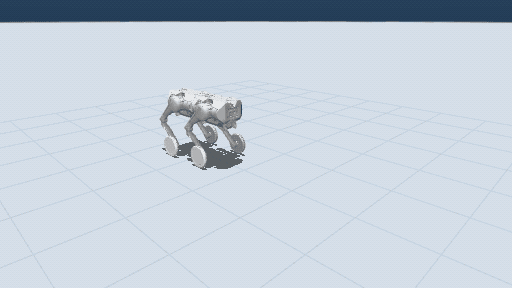
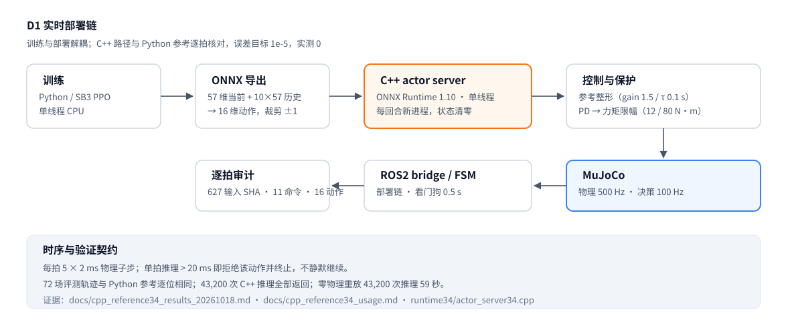

# 求职向概览：DDT D1 强化学习控制实验（机器人控制 / 部署方向）

> 给招聘方/面试官的 2 分钟入口。所有数字都能在 `docs/` 与 `reports/` 找到对应运行记录。

## 一句话

面向 16 执行器轮足机器人的**纯 PPO 训练 → ONNX 导出 → C++/ONNX Runtime 仿真闭环验证**，用固定 36 + 36 场矩阵、逐拍 SHA 校验和有界资源治理保证可复现；ROS2 控制器适配仍需单独验证。

## 60 秒版本

- 策略 50 Hz（每拍 10 个 2 ms 物理子步）、PD 250 Hz、C++ 单线程推理；**20 ms 是策略周期**。34 适配器的默认单次请求超时为 2 s，不能据此声称满足 20 ms 实时截止。
- 33 参考整形候选在 **formal 36/36 + 独立 holdout 36/36** 通过原阈值；代价是综合 J 相对 25 基线**变差 5.89%**，如实保留。
- 34 在真实 C++ 服务器上执行同一候选：**72 场轨迹与 Python 参考逐位相同**，43,200 次 C++ 推理全部返回；零物理重放 43,200 次推理 59 秒完成。
- 33/34 及本轮演示在单机 CPU、任务组 3 GiB 硬限额下完成；失败与部分运行原样保留，不续跑。

## 看控制过程：完整 12 秒仿真

| 前进与停车 | 正反转向与停车 |
|---|---|
|  |  |

固定零延迟、reset seed 1001，使用完整 25 random 权重和 C++34 参考整形；每段保留从静止到运动、再到停车的全过程。无 UI，单段 0.55 / 1.01 MB；本次录制共 1,200 次推理、12,000 个物理步，新增训练为 0。[来源与资源计数](reports/showcase35_results_20261022.json)可核验；这两段仅用于展示，资格与综合 J 的结论沿用原 33/34 报告。

**64 混合符号监督：** [三个配对 seed](docs/mixed_sign64_results_20261101.md)的首拍方向（旧回归9点＋新测试9点）均从13/18提高到18/18，旧失败轨迹回归均从6/9到9/9；多步代价仍有5/4/1个已解析方向错误，另1个物理参考不稳，完整修复门未通过。6000模型更新、4680验证策略步完整，无策略更新或新增控制性能结论。

**59 导数监督对照：** [三个配对 seed 的完整结果](docs/yaw_jvp59_results_20261101.md)显示，训练标签的导数RMSE降低97.4%–98.1%，独立轨迹首拍方向仍均为12/18；一个候选新增8个总代价方向错误，另一个物理参考不可判。6000模型更新、4680验证策略步完整；尚未修复模型响应，也没有新增控制性能提升结论。

**56 训练跨度对照：** [三个配对 seed 的结果](docs/paired_horizon56_results_20261101.md)显示，H32 状态误差均降低 34%–39%，但 H8/H32 方向匹配总数同为 24/27，各有一个 seed 未过门。6000 次模型更新与 4680 个验证策略步全部完成；没有策略更新或新增控制性能提升结论。

**54–55 模型梯度诊断：** [全链双精度计算](docs/model_gradient54_results_20261101.md)在原门槛下通过 54/54 个自检；[物理差分诊断](docs/observed_gradient55_results_20261101.md)在预先固定的四档小扰动下得到 9/9 个稳定参考。55 的原严格方向门未通过，完整控制对照未启动；自由模型的响应方向仍需改进，尚无新增控制性能提升结论。此前 [51 单步拟合](docs/supermimic51_offline_scope.md)、[52 采集失败](docs/model_gradient52_results_20261031.md)、[53 三模型梯度检验](docs/model_gradient53_results_20261101.md)均保留原结论与失败证据。

## 控制与部署栈

关键约束：每个策略周期 20 ms，含 10 个物理子步、5 次 PD 更新；每个回合新建 C++ 进程，状态不跨回合延续。请求超时属于适配器保护，20 ms 实时截止尚未由这条验证链证明。

## 可核验结果

| 结果 | 数字 | 证据 |
|---|---|---|
| 参考整形资格 | formal **36/36** + holdout **36/36**，全部满 600 拍，停车全过 | `docs/reference_shape33_results_20261018.md` |
| C++ 部署等价 | 72 场轨迹与 Python33 **逐位相同**；43,200 次 C++ 推理全返回；最大动作差 0.0 | `docs/cpp_reference34_results_20261018.md` |
| 可重复重放 | 全新 C++ 进程、零物理，43,200 次推理 **59 秒**，与保存动作逐位相同 | `docs/cpp_reference34_usage.md` |
| 纯自训基线 | 25 random 在原开发矩阵 **33/36**；默认模型仍是 16 control（27/36），未替换 | `README.md` 一页结论 |

## 控制/部署技能映射

| 技能 | 在本仓库的落点 |
|---|---|
| C++ 推理服务 | `runtime34/actor_server34.cpp`：JSONL 协议、单线程 ORT、每拍 SHA、进程级状态复位 |
| ONNX 导出与数值等价 | `tools33/`、`tools34/`：Python/PyTorch 与 C++ ORT 逐拍对比，门槛 1e-5，实测 0 |
| 控制时序与超时保护 | 50 Hz 策略 / 250 Hz PD / 500 Hz 物理；请求超时拒绝动作，周期与传输超时分开记录 |
| 执行器限幅与保护 | PD 目标、力矩上限、动作裁剪、看门狗、急停语义 |
| 离线轨迹审计 | 35 在每个 20 ms 边界记录完整 qpos/qvel，与 34 输入、动作及 trace 的 SHA 来源相互绑定 |
| 资源受限实验 | 4 GiB 准入、2 GiB 运行保留、cgroup 2/3 GiB、无 swap、Nice10 |
| 可复现工程 | SHA 来源闭包、CI、失败与 partial 原样保留、不续跑 |

## 三个可深挖的面试故事

### 1. 把"部署一致"做成可测试的契约

- **问题**：Python 跑通不等于 C++ 部署后行为一致；有状态参考整形与十帧历史最容易在移植时走样。
- **做法**：C++ 内部完成整形与历史；每拍对完整 627 维有效输入做 SHA，与 Python 独立实现比对；每回合新建进程；模型、源码、ORT 库、适配器逐一 SHA 固定。
- **结果**：72 场、43,200 拍动作差为 0，轨迹 SHA 与 Python 逐条相同；零物理重放 59 秒可复核。
- **可追问**：是"容差内"还是"逐位"？——逐位；门槛仍为 1e-5，实测为 0。

### 2. 资格提升不等于性能提升：5.89% 的取舍

- **背景**：延迟鲁棒性是主要失败来源（60 ms 转向）。
- **做法**：固定 25 权重，只改偏航参考的输入整形（增益 1.5、τ=0.1 s 因果平滑、真实有效历史），不改评分与物理命令。
- **结果**：formal 与 holdout 都 36/36，但综合 J 从 0.215939 变到 0.228668（**+5.89%**）。
- **处理**：保留取舍说明、不替换默认模型、不把"通过率提升"写成"性能提升"。
- **可追问**：为什么不用它？——它解决资格问题，不是综合指标；是否接受这个取舍应由使用者决定。

### 3. 让实验在小机器上可审计

- **约束**：单机、无 GPU、不能停用户其他程序。
- **做法**：4 GiB 有效内存持续 10 秒才准入、运行保留 2 GiB、任务组 MemoryHigh 2 GiB / MemoryMax 3 GiB / swap 0、Nice 10、单线程；每个实验独立 release/输出目录，绑定来源 SHA。
- **结果**：50+ 场级实验可在数分钟内完成并留下完整回执；C++ 资格 239 秒；所有中断留下可复核的失败记录。
- **可追问**：资源不够怎么办？——让监控按预设终止，保留 partial 并如实记录，不用 partial 冒充完整候选。

## 简历可直接用的条目（控制/部署方向）

- 实现轮足机器人纯 PPO 训练→ONNX→C++/ONNX Runtime 的仿真部署验证：策略 50 Hz、物理 500 Hz、单线程推理；72 场评测轨迹与 Python 参考逐位相同（每拍 627 维输入 SHA 校验），零物理重放 43,200 次推理 59 秒完成。
- 设计因果参考整形（增益 1.5、τ=0.1 s、10 帧有效历史），使 formal 与独立 holdout 均 36/36 通过；同时如实记录综合 J 相对基线变差 5.89% 的取舍，默认模型未替换。
- 在 3 GiB 内存硬限额、无 GPU 的单机环境建立有界训练/评测流水线（4 GiB 准入、2 GiB 保留、失败保留、不续跑 partial），支撑 50+ 场级实验的可复现执行。
- 实现完整策略边界状态捕获与离屏回放：每 20 ms 保存 qpos/qvel，绑定模型、输入、动作和 trace 的 SHA；输出完整直行、转向与停车短片，保留 PNG 与资源回执。

## 边界（建议主动说）

- 全部为 MuJoCo 仿真；未在本仓库版本上做实机部署。
- 33/34 已通过固定 formal/holdout 延迟矩阵；综合 J 相对 25 基线仍差 5.89%，默认模型未替换，不外推到全部场景。
- 34 的 ROS2 控制器适配与 20 ms 实时截止仍未验证；策略周期不等于实时性能证明。
- 机器人模型、mesh 与原始策略来自与合作者共同开发的资源包；`src/ddt_ros2_control` 为 D1 的 ROS2 控制工作区，本仓库工作集中在训练、导出、C++ 部署验证与评测纪律。
- 部分历史运行是 partial/失败，均原样保留并标注，不作为候选。

## 推荐阅读路径（给面试官）

1. 本页 + README 的控制/部署栈图；
2. `docs/cpp_reference34_results_20261018.md`（逐位等价与重放）；
3. `docs/cpp_reference34_usage.md`（协议、时序与复现命令）；
4. `runtime34/actor_server34.cpp` 与 `tools34/run_cpp_reference34.py`（实现）；
5. `docs/reference_shape33_results_20261018.md`（资格与取舍）。

## English summary

Pure-PPO training for a 16-actuator wheel-legged robot, exported to ONNX and executed by a single-threaded C++/ONNX Runtime actor at a 50 Hz simulation policy rate over 500 Hz physics. The 20 ms policy period is not a verified real-time deadline; ROS2 controller integration remains separate. The reference-shaping candidate passes formal 36/36 and an independent holdout 36/36, at the documented cost of a 5.89% worse aggregate J. The C++ path reproduces all 72 evaluation traces bit-for-bit (per-tick SHA over 627 inputs), and a zero-physics replay re-runs 43,200 inferences in 59 s. Two complete 12-second motion-and-stop demonstrations now preserve synchronized states and offscreen PNG/GIF artifacts. Qualification and showcase runs used CPU execution under a 3 GiB cgroup cap; failures and partial runs are retained, never resumed.
