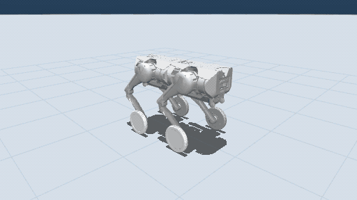

# 求职向概览：DDT D1 强化学习控制实验（机器人控制 / 部署方向）

> 给招聘方/面试官的 2 分钟入口。所有数字都能在 `docs/` 与 `reports/` 找到对应运行记录。

## 一句话

在 16 执行器 D1 上做**感知全身控制**。策略每 20 ms 给出 12 个腿关节角目标和 4 个轮速目标，由 250 Hz 的腿部位置 PD 和轮速伺服跟踪。训练端以感知 PPO 为基线，逐步引入 SuperMimic 式的模型强化学习。当前先在原生 MuJoCo 中核验轮地响应，待模型能算准提速和后溜、梯度也经小扰动验证，再用模型梯度训练策略。[动作接口](training/d1_rl/interface.py) · [上坡实测与迁移方案](docs/terrain_world91.md)

## 60 秒版本

- 策略 50 Hz（每拍 10 个 2 ms 物理子步）、PD 250 Hz、C++ 单线程推理；**20 ms 是策略周期**。34 适配器的默认单次请求超时为 2 s，不能据此声称满足 20 ms 实时截止。
- 33 参考整形候选在 **formal 36/36 + 独立 holdout 36/36** 通过原阈值；代价是综合 J 相对 25 基线**变差 5.89%**，如实保留。
- 34 在真实 C++ 服务器上执行同一候选：**72 场轨迹与 Python 参考逐位相同**，43,200 次 C++ 推理全部返回；零物理重放 43,200 次推理 59 秒完成。
- 33/34 及本轮演示在单机 CPU、任务组 3 GiB 硬限额下完成；失败与部分运行原样保留，不续跑。

## 平地加速与支撑

同一原厂全身策略加入 IMU 航向反馈后，1.5 m/s 平地综合通过 3/3。双前置雷达随后在真实闭环中提前调速、给四腿传递轮心目标。复合路三次全开均上台、驶出，均速 1.389～1.399 m/s，停车峰值 0.090～0.092 m/s，综合 0/3。三组同起点对照还测得，保持调速开启时，抬腿使中央均速增加 0.029～0.039 m/s。[复合路控制开关慢放](docs/assets/lidar111.mp4) · [可复算的轨迹与失败项](docs/lidar_compound111.md#复合路线实测)

为定位轮地接触的影响，在同一全身策略、同一速度请求和三个相同起点上，用物理等高的两种地面做配对闭环。仅从解析平面换成高度场，三条轨迹的中央均速各降低 0.176～0.185 m/s，停车峰值各增加 0.064～0.068 m/s。相同首个动作发出 20 ms 后，机器人状态已出现差异。[三个起点的因果对照](docs/surface112_results.md) · [慢放观察停车后退](docs/assets/surface112.mp4)

原厂全身策略在三个新起点均连续行驶 12 秒并停车。按米标线测得中央三米均速为 1.564～1.584 m/s，两个起点左轮越过 1 m 车道边界，另一个起点超速，综合通过 0/3。[完整平地回放](docs/assets/speed110.mp4) · [原始成绩与航向偏差](docs/speed110_results.md)

在同一全身策略上将轮速量程从 ±5 扩至 ±24 rad/s，三个起点的前向峰值从 1.11 左右升至 2.40～2.41 m/s。机身在规定巡航段前失去支撑，四轮改用速度参考也在加速期终止。九段均保留了实际轮速、机身位姿和终止标记，可复核峰值、速度持续时间及安全门槛。[调试录像](docs/assets/speed109.mp4) · [测量与失败分析](docs/speed109_results.md)

## 三厘米台阶上的真实接触

画面左侧是原全身策略，右侧在前轮碰到实体台阶后给两前膝额外 0.08 rad 屈曲。三个独立起点上，关节完成了动作，机身额外下沉超过 8 mm，前轮仍顶在台沿。通过轮载和接触法向可以区分“碰到台阶”和“压上台面”。三份局部世界模型共训练 300 次，独立盲测 0/9 通过，策略更新 0 次。[机器人并排慢放](docs/assets/contact108.mp4) · [世界模型怎样接受物理检验](docs/contact108_results.md)

## 全身策略怎样过坡

从零搭建的 SuperMimic 式训练链，用三份新策略采集了 1,198 个拟合转移。三份世界模型各更新 100 次后，36 段原生轮速校准均因非轮部位接地提前终止，策略更新数为 0。九组并排视频可以直接对照同一起点的小轮速微扰和实际后溜。[冷启动驻坡视频](docs/assets/cold_start94.mp4) · [模型响应与接触诊断](docs/supermimic_cold_start94_results.md)

用同样的三份策略，先封存世界模型给出的全身参数更新方向，再在三个新起点用原生 MuJoCo 测五档步幅。九组的正向半步和整步均减少前 0.64 秒的平均后溜，18 个幅值估计均超出原门槛。全程走满 45 段，44 段安全通过。视频左右分别走反向与正向整步，下方显示原参数在同一时刻的读数。[17.64 秒全身策略对照](docs/assets/policy_direction95.mp4) · [逐组实测](docs/supermimic_policy_direction95_results.md)

训练世界模型时增加了一项监督，要求它预测同一起点下两种动作造成的位移差。在三种子等预算对照中，沿已知方向预测策略效果的幅值达标数由 2/18 增至 7/18，两组完整通过数均为 1/9。九组实测和预测并排可看，第一组在原生仿真中平均少后溜 0.91 mm，原损失模型和配对损失模型分别预测 1.76 和 0.43 mm。[三栏对照视频](docs/assets/paired_response96.mp4) · [验收和未解决的问题](docs/supermimic_paired_response96_results.md)

从第 16 拍分叉，逐项替换配对世界模型的动作与起始状态。只换动作，后半段幅值达标数为 6/18。在同样的动作下校正起点，达标数升至 18/18。两项回放均执行 90 条分支，零新增仿真和训练。视频把第一组 1.57 mm 的原生收益与三条预测放在同一刻度。[误差从哪来](docs/supermimic_suffix_replay97_results.md) · [九组回放](docs/assets/suffix_replay97.mp4)

随后训练世界模型从复位独立预测 16 拍，仅改变第 16 拍状态误差的训练权重。150 次更新后，45 段新盲测里有两个种子的状态预测改善，第三个种子的误差增加 24.51%。第一组视频中，新模型把第 16 拍的机身位置误差从 10.24 mm 降到 4.94 mm，却把整步策略调整的收益估为 0.170 mm，MuJoCo 实测为 0.986 mm。新模型完整通过 0/9，策略更新 0 次。[九组盲测视频](docs/assets/endpoint98.mp4) · [模型导数与原生差分](docs/supermimic_endpoint98_results.md)

把两种动作在第 17～32 拍造成的位移差加进世界模型损失后，三个新起点上，预测斜率与原生同号的从 10/18 提高到 18/18，幅值达标的从 4/18 提高到 10/18。视频第一组，整步策略调整在后半段实际少偏离 1.697 mm，对照预测 −0.077 mm，候选预测 +1.700 mm。两个画面中的机器人都在末拍出现了非轮部位接地。九组完整通过数由 2 增至 3，保留了未过门的全部轨迹。[18 秒视频](docs/assets/late_response99.mp4) · [后段响应与安全结果](docs/supermimic_late_response99_results.md)

用仿真真值训练动力学、用后溜距离给动作打分时，D1 策略每拍接收的仍是 627 维本体与指令历史以及 16 维延迟测距。面试时可用驻坡例子解释哪些真值只在训练中使用，以及实机如何得到等价的传感器输入。[特权信息的用途与实机边界](docs/supermimic_policy_direction95_observations.md)

在相同机器人姿态和 40 ms 传感器延迟下，比较八束和稠密模拟点云对左右轮迹高差的估计。遮挡隆起场景中两组均有读数的 63 包，平均绝对误差由 13.33 mm 降至 0.95 mm。视频第一段可同时看到正确识别 30 mm 隆起和离开台顶时的误报。[48 秒成片](docs/assets/pointcloud100.mp4) · [感知对照及原始点云](docs/jeplo_d1_perception_results.md)

随后做了三种子、六份权重的等预算对照，检验 JEPLO 式下一包预测。五个留出回合上，三个网络都能预测下一包特征；前方轮迹高差验收为 0/3。固定几何解算在遮挡下合格 154/160，三个学习候选分别为 137、139、135 包。逐束配对确认，此次遮挡去掉 36 束，却没有改变任何一份几何读数。[36 秒处的误报样例](docs/assets/jeplo101.mp4) · [验收门槛与公开复核](docs/jeplo_next_packet101_results.md)

保持 36 束遮挡面积和时序，单独移动遮挡方向。2/5 个原生回合出现原本合格的几何读数转为误报，均在左侧。机器人慢动作以原始 50 Hz 关节姿态逐拍回放，可直接观看车轮、地面凸台和被移除的回波。[仿真里看轮迹遮挡](docs/assets/occlusion102.mp4) · [可复核的逐包记录](docs/occlusion_position102_results.md)

逐拍核对 1,768 组指令，D1 执行端收到的动作比策略下发晚 20 ms。将预测头的下发动作窗分别对齐测距采集与本体观测时钟后，三个种子在遮挡下的本体特征误差均下降至少 24.66%，点云特征误差降幅仅一份达到事前的 5% 门槛。[动作时序、三种子结果与边缘误差](docs/jeplo_action_window103_results.md)

在一个台阶后缘，真实预瞄点已经越过边缘 11.55 mm，轮速和 IMU 对齐后的历史查询却落在边缘前 8.75 mm，于是把齐平误报成左高 30 mm。将 512 个遮挡视图逐包对照后，历史补读共填对 3 次、填错 3 次。[原始点云、坐标审计和两来源验收](docs/terrain_history106.md)

用与厂方文件逐项匹配的 D1 网格建立双测距安装模型，在 918 个位置与姿态组合上核对支架和运动轮腿间隙。前移 70 mm 只给一个本已可见的离台样本增加了视线，六个完全遮挡的预瞄点没有一个打开，正式点云采集按预设门槛停止。[安装位置、几何下界与模型入口](docs/d1_sensor_mount107.md)

左侧是已训练的 PPO25，由 C++34 执行；右侧增加前视测距并更新 PPO。三个配对种子中六个模型均完成训练，所有腿和车轮输出行都已更新，独立工况 27/27 走满 6 秒。各组上坡都没有到达坡脚后 0.40 m，下坡全部到达。[下坡并排视频](docs/assets/full_body87/down.mp4) · [同种子上坡视频](docs/assets/full_body87/up.mp4) · [屏蔽测距对照和跟速误差](docs/full_body_perception87.md)

在另三个新种子上固定 PPO 与关节 PD，触坡后给四个轮速目标各加 0.50 rad/s，三对分别提速 0.0326、0.0329、0.0318 m/s。只有一个承重前轮接触点达到距离标线。图中可对照干预前后两条曲线，逐拍数据公开。[上坡因果对照图与诊断](docs/uphill_diagnosis88.md)

在感知 PPO 上只改上坡训练起点，三对模型合计训练 24,576 步。三个种子的四轮坡上承重样本占各自上坡行驶段的 18.46%、5.19%、18.12%。30 场独立评测均安全走满 6 秒，两种课程从原起点上坡各 0/9 过线。[同一起点并排视频](docs/assets/uphill89.mp4) · [控制变量、速度和接触记录](docs/uphill_curriculum89.md)

为 D1 全身 PPO 实现了把轮地接触约束转换为关节伺服目标的离线 WBC。180 帧中，求解器自身检查给出 134 个目标，按独立滚动和动力学复核有 3 个满足全部硬约束。进一步定位了轮缘滑动时遗漏的加速度项，在合成关节轮模型上把最大导数误差从 3.124 降到 2.05×10⁻¹⁰ m/s²。[驻坡对照、约束验算与修复](docs/stand_wbc90.md)

用三份地形可微动力学模型重建了上坡干预的闭环。原生仿真中加轮速带来 0.0318～0.0329 m/s 的提速，模型预测 0.0209～0.0254 m/s。预测从相同初态出发，每拍重新计算策略动作，随后与独立封存的原生轨迹核对。全部 72 条预测走满，地形模型 0/3 通过六对联合验收。[预测对实测与失败定位](docs/terrain_world91.md)

固定同一份模型和初态，改用原生仿真实际施加的动作后，行驶提速的平均绝对误差从 0.00982 降至 0.00246 m/s，九对全部改善。其中五对仍高估绝对车速。驻坡从 0/9 增至 2/9 通过，三份模型均未通过六对联合验收。36 条回放、3,060 个模型步，无新增训练或物理仿真。[固定动作对照与逐对结果](docs/fixed_actions92.md)

补齐三份策略 × 三个坡上姿态的驻坡对照后，后溜预测偏差的方向在三个父策略间一致，随初态翻转。首秒后段持续四轮承重在旧训练数据中为 0/108 个八拍窗口，在验证集中出现 99/324 个。公开的 18 条完整数值轨迹含复位状态、真实施加动作和同步轮速，可独立复算模型门槛。[九组仿真视频](docs/assets/stand_data93.mp4) · [验证数据与复算说明](docs/stand_data93.md)

## 看控制过程：完整 12 秒仿真

| 前进与停车 | 正反转向与停车 |
|---|---|
|  |  |

固定零延迟、reset seed 1001，使用完整 25 random 权重和 C++34 参考整形；每段保留从静止到运动、再到停车的全过程。无 UI，单段 0.55 / 1.01 MB；本次录制共 1,200 次推理、12,000 个物理步，新增训练为 0。[来源与资源计数](reports/showcase35_results_20261022.json)可核验；这两段仅用于展示，资格与综合 J 的结论沿用原 33/34 报告。

**84 感知运控诊断。** 原闭环测量 0/924 帧覆盖双轮迹查询点。隔离安装位置后，前移 16 cm 的事后复查在 80 帧上验证了地形梯度，39 帧含非零斜率。[坡道展示、诊断数字与复算入口](docs/terrain_gradient84_results_20261119.md)

**83 真实运行链路与策略诊断：** [结果、失败与边界](docs/project83_results_20261104.md)。原 C++34 actor 完成 64 次会话推理及 24 拍正常 ROS 消费，三种注入故障均阻止失效动作；合计 89 次确认推理返回，另 1 次超时的服务端推理状态未知。三个固定模型一致出现偏航/停车梯度冲突，投影仅给出 0.425%–0.494% 的局部预测收益；0 次参数更新，尚无新控制性能或硬件资格。

**82 交叉验证与接口修复：** [实现、证据与未解决项](docs/project82_crosscheck_20261103.md)。新原生适配核心通过 11,256 项断言，覆盖动作契约、热重入、命令过期和迟到响应；尚未接管 ROS2 或硬件。63 个完整回合与四尺度响应的独立读回保留了策略未过性能门的结论。

历史研究记录（54–81，含全部失败项）

**81 独立目标函数对照：** [完整结果与失败项](docs/objective81_results_20261103.md)：六次策略更新、372条独立短分支与63个完整评测回合均完成。短筛3/3通过，原任务/停车/安全阈值全部通过；Q6完整偏航只改善0.019%–0.231%，平均J增加0.036%–0.142%，且完整偏航弱于C6对照，候选拒绝。未追加训练或替换默认策略。

**80 稳态采样覆盖修复：** [完整实现与短筛查结果](docs/steady_sampling80_results_20261103.md)：三个模型、12次策略更新、120个安全短分支全部完成，但新采样Q相对旧采样增加0.00436%–0.00983%，短筛查0/3通过。按预注册停止，63个完整评测回合未运行；没有替换默认策略。

**79 模型—策略反馈闭环：** [三个配对学习器的完整结果](docs/feedback79_results_20261103.md)包含9次策略头更新、300次模型更新和63个完整评测回合，原任务/停车/安全阈值全部通过。反馈组对冻结模型组的J比为1.00004699，未达到改善门；六候选也均未通过原偏航改善要求。有限H32、无critic，完整模型资格未重新取得，默认策略保持不变。

**78 可微响应保护：** [实现与完整回顾性验证](docs/protected_response78_results_20261103.md)消除了75新增的3个总代价回退和8条偏航幅值回退记录；三个模型的world-vz方向均45/45，原响应误差改善保持，body恢复到control的算术精度范围。多步状态护栏20/24通过，64001四组超限，完整候选仍拒绝；CPU51.16秒，零新训练/物理。[77完整端点检验](docs/output_isolation77_results_20261103.md)解释了为何只替换世界vz不能保护水平响应。

**75 世界竖直速度响应对照已完成：** [三个seed的完整结果](docs/world_vz75_results_20261101.md)：新状态world-vz响应RMSE下降70.33%/68.52%/66.43%，五组共45个状态的world-vz方向资格由0/45、14/45、15/45提高到三个45/45；body响应误差却增加2.86%–4.89%，新增2个代价反号、1个代价幅值失格及8条yaw幅值回退记录，完整候选拒绝。7182项AD/FD自检通过，6000模型更新、4680验证策略步完整；没有策略更新或新增控制性能结论。

**76 响应诊断完善：** [逐项区分算术、幅值、反号与未知](docs/response_diagnostics76_20261101.md)，完整读回3186条存档记录；原4050项自检均满足容差，123项方向失格来自低幅值。70条低幅值记录对端点相邻F64值扰动均不跨零或原幅值门；原失败、未知和缺失yaw自检保留，未新增训练或控制效果结论。

**74 完整响应读回：** [六模型、864区间与全部45坐标](docs/full_response74_results_20261101.md)显示，世界线速度是唯一三对共同变差的组；事后分解定位世界vz误差增加4.94%/1.77%/4.55%。该坐标训练标签24/24合格，但尚未验证新修复；1.25秒CPU、零模型/物理/训练，原失败与未知保持。

**73 响应支持审计：** [全部36点、240方向与三seed配对](docs/support73_results_20261101.md)未支持简单的状态距离解释；动作差异关联存在阶段混杂，260拍分层后接近零。0.53秒CPU、零模型/物理/训练；保留全部18项预注册关联及明确标注的事后分层，72仍未修复。

**72 固定yaw权重对照：** [三seed配对完整结果](docs/yaw_weight72_results_20261101.md)：训练yaw误差均下降34.6%–41.3%，新状态分别下降29.2%/39.7%及增加11.1%；新增5个代价方向失败，候选拒绝。4050项AD/FD自检全部通过；6000模型更新、4680验证策略步完整，没有策略更新或控制性能提升结论。

**71 完整训练审计：** [六模型、全部6828窗口及24标签中心](docs/training_gradient71_results_20261101.md)显示，三个active的加权偏航梯度范数仅为状态梯度的1.06%/3.33%/3.29%，未见一致强反向梯度；有值监督的58中心误差仍高于62。7.61秒CPU、零训练/物理；据此开展上述72固定yaw权重对照；71本身不改变原资格。

**70 代价误差分解：** [完整648对端点、六分项与三个seed](docs/cost_decomposition70_results_20261101.md)显示，前向/侧向代价导数误差均下降，倾斜/高度均增加，偏航仍是最大误差项。5751项恒等式与读回核验通过；3.19秒CPU、零模型/物理/训练。旧失败以偏航零点差贡献较大，新增H1失败以响应差贡献较大，该分解本身不构成修复验证。

**69 速度响应监督：** [三个配对seed的完整结果与图](docs/body_jvp69_results_20261101.md)显示，测试body响应RMSE下降64.9%/84.7%/64.0%；3078项AD/FD自检全部通过。正式body方向为50/54、53/54、53/54，仍有小幅值失格，并新增5个明确代价反号和2个幅值失格点，完整修复未通过。6000模型更新、4680验证策略步完整，无策略更新或控制性能提升结论。

**67 联合响应定位：** [全部模型、九点的真实轨迹诊断](docs/joint_response67_results_20261101.md)完成6912个一步方向、311040项数值自检；原五例失败中仍有一个首拍动作响应反号和一个H32联合投影反号，另保留新退化和未知。22.0秒CPU、零物理/训练，未取得完整修复资格。

**66 基点检验：** [保持自由敏感度的代价重定位](docs/cost_rebase66_results_20261101.md)仅纠正5个既有错误中的2个，两个32拍错误保留，全32前缀新增4个已解析反号（H4/H5/H30/H31）；28.1秒CPU、零物理/训练。基点修正不足以解释全部错误，继续检查真实轨迹上的联合响应。

**65 零物理定位：** [全部九个状态的梯度图与分项诊断](docs/cost_prefix65_results_20261101.md)显示，yaw首拍方向正确仍不足以保证总代价方向；失败点的前向/侧向代价敏感度明显失配，单拍总代价也仍有错误。13.8秒CPU、零新增训练和物理，完整修复资格不变。

**64 混合符号监督：** [三个配对 seed](docs/mixed_sign64_results_20261101.md)的首拍方向（旧回归9点＋新测试9点）均从13/18提高到18/18，旧失败轨迹回归均从6/9到9/9；多步代价仍有5/4/1个已解析方向错误，另1个物理参考不稳，完整修复门未通过。6000模型更新、4680验证策略步完整，无策略更新或新增控制性能结论。

**59 导数监督对照：** [三个配对 seed 的完整结果](docs/yaw_jvp59_results_20261101.md)显示，训练标签的导数RMSE降低97.4%–98.1%，独立轨迹首拍方向仍均为12/18；一个候选新增8个总代价方向错误，另一个物理参考不可判。6000模型更新、4680验证策略步完整；尚未修复模型响应，也没有新增控制性能提升结论。

**56 训练跨度对照：** [三个配对 seed 的结果](docs/paired_horizon56_results_20261101.md)显示，H32 状态误差均降低 34%–39%，但 H8/H32 方向匹配总数同为 24/27，各有一个 seed 未过门。6000 次模型更新与 4680 个验证策略步全部完成；没有策略更新或新增控制性能提升结论。

**54–55 模型梯度诊断：** [全链双精度计算](docs/model_gradient54_results_20261101.md)在原门槛下通过 54/54 个自检；[物理差分诊断](docs/observed_gradient55_results_20261101.md)在预先固定的四档小扰动下得到 9/9 个稳定参考。55 的原严格方向门未通过，完整控制对照未启动；自由模型的响应方向仍需改进，尚无新增控制性能提升结论。此前 [51 单步拟合](docs/supermimic51_offline_scope.md)、[52 采集失败](docs/model_gradient52_results_20261031.md)、[53 三模型梯度检验](docs/model_gradient53_results_20261101.md)均保留原结论与失败证据。

## 控制与部署栈

关键约束：每个策略周期 20 ms，含 10 个物理子步、5 次 PD 更新；每个回合新建 C++ 进程，状态不跨回合延续。请求超时属于适配器保护，20 ms 实时截止尚未由这条验证链证明。

## 可核验结果

| 结果 | 数字 | 证据 |
|---|---|---|
| 参考整形资格 | formal **36/36** + holdout **36/36**，全部满 600 拍，停车全过 | `docs/reference_shape33_results_20261018.md` |
| C++ 部署等价 | 72 场轨迹与 Python33 **逐位相同**；43,200 次 C++ 推理全返回；最大动作差 0.0 | `docs/cpp_reference34_results_20261018.md` |
| 可重复重放 | 全新 C++ 进程、零物理，43,200 次推理 **59 秒**，与保存动作逐位相同 | `docs/cpp_reference34_usage.md` |
| 纯自训基线 | 25 random 在原开发矩阵 **33/36**；默认模型仍是 16 control（27/36），未替换 | `README.md` 一页结论 |

## 控制/部署技能映射

| 技能 | 在本仓库的落点 |
|---|---|
| C++ 推理服务 | `runtime34/actor_server34.cpp`：JSONL 协议、单线程 ORT、每拍 SHA、进程级状态复位 |
| ONNX 导出与数值等价 | `tools33/`、`tools34/`：Python/PyTorch 与 C++ ORT 逐拍对比，门槛 1e-5，实测 0 |
| 控制时序与超时保护 | 50 Hz 策略 / 250 Hz PD / 500 Hz 物理；请求超时拒绝动作，周期与传输超时分开记录 |
| 执行器限幅与保护 | PD 目标、力矩上限、动作裁剪、看门狗、急停语义 |
| 离线轨迹审计 | 35 在每个 20 ms 边界记录完整 qpos/qvel，与 34 输入、动作及 trace 的 SHA 来源相互绑定 |
| 资源受限实验 | 4 GiB 准入、2 GiB 运行保留、cgroup 2/3 GiB、无 swap、Nice10 |
| 可复现工程 | SHA 来源闭包、CI、失败与 partial 原样保留、不续跑 |

## 三个可深挖的面试故事

### 1. 把"部署一致"做成可测试的契约

- **问题**：Python 跑通不等于 C++ 部署后行为一致；有状态参考整形与十帧历史最容易在移植时走样。
- **做法**：C++ 内部完成整形与历史；每拍对完整 627 维有效输入做 SHA，与 Python 独立实现比对；每回合新建进程；模型、源码、ORT 库、适配器逐一 SHA 固定。
- **结果**：72 场、43,200 拍动作差为 0，轨迹 SHA 与 Python 逐条相同；零物理重放 59 秒可复核。
- **可追问**：是"容差内"还是"逐位"？——逐位；门槛仍为 1e-5，实测为 0。

### 2. 资格提升不等于性能提升：5.89% 的取舍

- **背景**：延迟鲁棒性是主要失败来源（60 ms 转向）。
- **做法**：固定 25 权重，只改偏航参考的输入整形（增益 1.5、τ=0.1 s 因果平滑、真实有效历史），不改评分与物理命令。
- **结果**：formal 与 holdout 都 36/36，但综合 J 从 0.215939 变到 0.228668（**+5.89%**）。
- **处理**：保留取舍说明、不替换默认模型、不把"通过率提升"写成"性能提升"。
- **可追问**：为什么不用它？——它解决资格问题，不是综合指标；是否接受这个取舍应由使用者决定。

### 3. 让实验在小机器上可审计

- **约束**：单机、无 GPU、不能停用户其他程序。
- **做法**：4 GiB 有效内存持续 10 秒才准入、运行保留 2 GiB、任务组 MemoryHigh 2 GiB / MemoryMax 3 GiB / swap 0、Nice 10、单线程；每个实验独立 release/输出目录，绑定来源 SHA。
- **结果**：50+ 场级实验可在数分钟内完成并留下完整回执；C++ 资格 239 秒；所有中断留下可复核的失败记录。
- **可追问**：资源不够怎么办？——让监控按预设终止，保留 partial 并如实记录，不用 partial 冒充完整候选。

## 简历可直接用的条目（控制/部署方向）

- 实现轮足机器人纯 PPO 训练→ONNX→C++/ONNX Runtime 的仿真部署验证：策略 50 Hz、物理 500 Hz、单线程推理；72 场评测轨迹与 Python 参考逐位相同（每拍 627 维输入 SHA 校验），零物理重放 43,200 次推理 59 秒完成。
- 设计因果参考整形（增益 1.5、τ=0.1 s、10 帧有效历史），使 formal 与独立 holdout 均 36/36 通过；同时如实记录综合 J 相对基线变差 5.89% 的取舍，默认模型未替换。
- 在 3 GiB 内存硬限额、无 GPU 的单机环境建立有界训练/评测流水线（4 GiB 准入、2 GiB 保留、失败保留、不续跑 partial），支撑 50+ 场级实验的可复现执行。
- 实现完整策略边界状态捕获与离屏回放：每 20 ms 保存 qpos/qvel，绑定模型、输入、动作和 trace 的 SHA；输出完整直行、转向与停车短片，保留 PNG 与资源回执。

## 边界（建议主动说）

- 全部为 MuJoCo 仿真；未在本仓库版本上做实机部署。
- 33/34 已通过固定 formal/holdout 延迟矩阵；综合 J 相对 25 基线仍差 5.89%，默认模型未替换，不外推到全部场景。
- 34 的 ROS2 控制器适配与 20 ms 实时截止仍未验证；策略周期不等于实时性能证明。
- 机器人模型、mesh 与原始策略来自与合作者共同开发的资源包；`src/ddt_ros2_control` 为 D1 的 ROS2 控制工作区，本仓库工作集中在训练、导出、C++ 部署验证与评测纪律。
- 部分历史运行是 partial/失败，均原样保留并标注，不作为候选。

## 推荐阅读路径（给面试官）

1. 本页 + README 的控制/部署栈图；
2. `docs/cpp_reference34_results_20261018.md`（逐位等价与重放）；
3. `docs/cpp_reference34_usage.md`（协议、时序与复现命令）；
4. `runtime34/actor_server34.cpp` 与 `tools34/run_cpp_reference34.py`（实现）；
5. `docs/reference_shape33_results_20261018.md`（资格与取舍）。

## English summary

Pure-PPO training for a 16-actuator wheel-legged robot, exported to ONNX and executed by a single-threaded C++/ONNX Runtime actor at a 50 Hz simulation policy rate over 500 Hz physics. The 20 ms policy period is not a verified real-time deadline; ROS2 controller integration remains separate. The reference-shaping candidate passes formal 36/36 and an independent holdout 36/36, at the documented cost of a 5.89% worse aggregate J. The C++ path reproduces all 72 evaluation traces bit-for-bit (per-tick SHA over 627 inputs), and a zero-physics replay re-runs 43,200 inferences in 59 s. Two complete 12-second motion-and-stop demonstrations now preserve synchronized states and offscreen PNG/GIF artifacts. Qualification and showcase runs used CPU execution under a 3 GiB cgroup cap; failures and partial runs are retained, never resumed.
