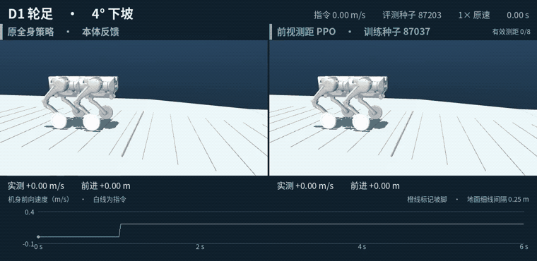
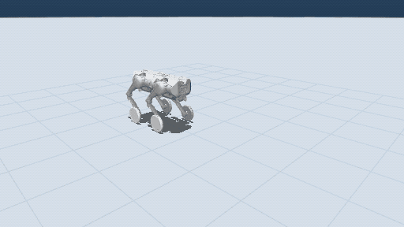
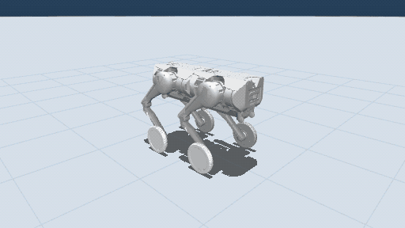
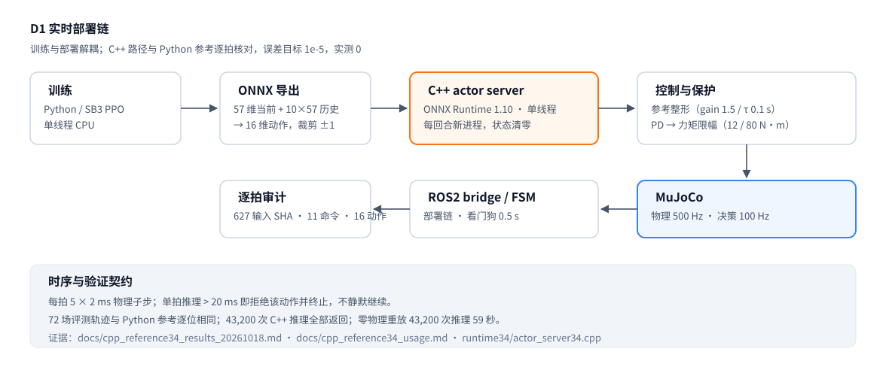

# DDT D1 强化学习控制实验

> **求职向概览（机器人控制 / 部署方向）：[PORTFOLIO.md](PORTFOLIO.md)** — 30 秒定位、时序与安全约束、可核验结果、面试故事、简历条目与边界。

**D1 正逐步转向 SuperMimic 式的模型强化学习。** 全身策略每 20 ms（50 Hz）同时输出 12 个腿关节角目标和 4 个轮速目标。底层以 250 Hz 跟踪目标并限矩，腿部使用位置 PD，车轮使用速度反馈。MuJoCo 以 500 Hz 积分。[动作到力矩的映射](training/d1_rl/interface.py)

**从零学习驻坡的第一轮。** 三份随机初始化的策略自行采集数据，三份新世界模型各更新 100 次。36 个原生轮速校准片段在 0.62～0.66 秒触发非轮部位接地，策略更新数为 0。视频把同一次起步的两档轮速并排展示，九组全部保留。[15 秒实测视频](docs/assets/cold_start94.mp4) · [冷启动结果和后小腿接地复核](docs/supermimic_cold_start94_results.md)

**沿模型建议改一次全身策略会怎样？** 三个模型在三个新起点均指对方向。正向一步使 0.64 秒内的平均驻车偏离减少 0.75～1.06 mm，模型把局部斜率高估 3.29～8.38 倍。45 段均有完整读数，一段反向整步在末拍触地。正式验收 0/9。[九组原生对照视频](docs/assets/policy_direction95.mp4) · [实测收益与验收](docs/supermimic_policy_direction95_results.md)

**让世界模型专门学“改动作会少后溜多少”。** 三份独立模型各做两组等预算训练，共更新 300 次。在另外 45 段原生盲测中，两组均指对 18/18 个方向，幅值误差在 25% 以内的从 2/18 增到 7/18，两组完整验收各为 1/9。新增损失只在一个训练种子上同时改善动作效果估计和原策略回报估计。策略更新 0 次。[18 秒原生实测与两种预测](docs/assets/paired_response96.mp4) · [逐种子对照](docs/supermimic_paired_response96_results.md)

**驻坡预测为什么越往后越偏？** 后 16 拍改用 MuJoCo 实际执行的动作，配对模型的幅值达标数仍为 6/18。保持这些动作，只在第 16 拍给一次真实状态，达标数升至 18/18，三个种子都改善。此次使用 2,880 个离线模型步，完整驻坡验收沿用上一轮的 1/9。[原生画面与四条收益曲线](docs/assets/suffix_replay97.mp4) · [两项回放结果](docs/supermimic_suffix_replay97_results.md)

训练端以感知 PPO 为基线。先检验世界模型能否算准改变轮速后机身会提速多少、在坡上会少后溜多少。用 11,766 个归档转移训练了三份模型，每份在三个重置上与原生 MuJoCo 结果配对。行驶提速通过 4/9 对，驻坡后溜通过 0/9 对。轮地响应通过验收、短时域梯度经小扰动验证后，再用世界模型中的回报梯度更新全身策略。[预测与实测对照图](docs/assets/terrain_world91.png) · [验收结果与迁移方案](docs/terrain_world91.md)

给这三份模型回放 MuJoCo 实际执行的轮腿动作，9/9 对都算准行驶提速幅度，其中 4/9 对也算准了两臂各自的车速。驻坡减量方向 9/9 正确，完整验收 2/9。到 0.64 秒，三个模型对一个驻坡重置都高估后溜，对另两个都低估，暂缓增加驻坡样本权重。[固定动作与闭环对照图](docs/assets/fixed_actions92.png) · [误差出现的时点与课程决定](docs/fixed_actions92.md)

随后让三份感知 PPO 都从同样的三个坡上姿态起步，补齐了原动作与轮速修正的 18 条物理轨迹。九组在首秒各少退 5.91～8.53 mm。三份世界模型对其中一个初态全都高估后溜，对另外两个全都低估，完整通过 6/27 对。[九组实测视频](docs/assets/stand_data93.mp4) · [可下载验证集与逐格结果](docs/stand_data93.md)

自训 PPO 通过 ONNX 在单线程 C++ 中运行。33 候选在原平地 formal 36/36 与独立 holdout 36/36 通过，综合 J 相对 25 基线高 5.89%。C++34 的 72 场轨迹与 Python 逐位相同，零物理重放 43,200 次推理耗时 59 秒。ROS2 控制器适配仍需单独验证。[C++34 资格结果](docs/cpp_reference34_results_20261018.md)

## 原 PPO 与感知 PPO 怎样过坡

左侧是已经训练好的第 25 轮 PPO，由原 C++34 程序运行。右侧从同一权重起步，加入八束前视测距后微调 4,096 步。三组配对训练种子合计 24,576 个原生 D1 环境转移。独立评测中，三个组都在下坡 3/3 过线、上坡 0/3 过线。报告也列出了同样微调但屏蔽所有测距的对照组。[6 秒下坡视频](docs/assets/full_body87/down.mp4) · [同种子上坡未过线视频](docs/assets/full_body87/up.mp4) · [三组逐地形结果](docs/full_body_perception87.md)

随后用三个新种子追查上坡减速。只给四轮目标各加 0.50 rad/s，4～6 秒实际机身均速从 0.1005 升至 0.1329 m/s，三个配对均超过预注册提速门槛。前轮过线由 0/3 增至 1/3，后轮在六段中均未触坡。[速度与承重点对照图](docs/assets/uphill88.png) · [上坡诊断与逐拍证据](docs/uphill_diagnosis88.md)

把一半上坡训练起点移到坡面后，三个种子都采到了四轮承重样本。在原起点自主上坡时，两种课程各 0/9 过线，4～6 秒的配对速度变化在 −0.0042 至 +0.0006 m/s 之间。视频两侧都由带测距的全身 PPO 控制。[6 秒上坡课程对照视频](docs/assets/uphill89.mp4) · [各训练种子结果及提前终止记录](docs/uphill_curriculum89.md)

在 4° 坡上从静止起步，修正四轮共同后退目标让三个种子首秒少退 6.88～8.26 mm，均低于 30 mm 门槛。对 180 帧历史观测离线求解全身逆动力学，独立复核确认 3 帧满足全部硬约束。轮缘滑动加速度的修复另有合成回归。[六段驻坡轨迹图](docs/assets/stand90.png) · [WBC 逐帧验收与修复结果](docs/stand_wbc90.md)

## C++34：直行、转向与停车

同一份完整 25 random 权重，经 33 参考整形，由真实 C++34 actor 驱动。两段均完整记录 12 秒：静止、运动、停车；固定零延迟、reset seed 1001，仅用于展示。

| 前进 → 停车 | 正反转向 → 停车 |
|---|---|
|  |  |
| 0.2 m/s 指令；551,003 B | ±0.2 rad/s 指令；1,006,299 B |

两场新录制共 **1,200 次 C++ 推理、12,000 个物理步**；离屏渲染保留 482 张 PNG，GIF 各 12.05 秒，新增训练为 0。来源、计数和资源见[机器摘要](reports/showcase35_results_20261022.json)，录制方法见[35 说明](docs/showcase35_capture.md)。这些片段不增加资格或性能结论；性能仍以[33/34 原结果](docs/cpp_reference34_results_20261018.md)为准，默认模型未替换。

**84 双轮迹地形预瞄。** 原安装位在正式闭环中 0/924 帧可判，测距原点前移 16 cm 的事后几何复查有 80/308 帧可判并通过梯度核验。[三组输入、坡道对照片段与复算方法](docs/terrain_gradient84_results_20261119.md)

**83 真实运行链路与策略诊断：** [结果、失败与边界](docs/project83_results_20261104.md)。原 C++34 actor 完成 64 次会话推理及 24 拍正常 ROS 消费，三种注入故障均阻止失效动作；合计 89 次确认推理返回，另 1 次超时的服务端推理状态未知。三个固定模型一致出现偏航/停车梯度冲突，投影仅给出 0.425%–0.494% 的局部预测收益；0 次参数更新，尚无新控制性能或硬件资格。

**82 交叉验证与接口修复：** [实现、证据与未解决项](docs/project82_crosscheck_20261103.md)。新原生适配核心通过 11,256 项断言，覆盖动作契约、热重入、命令过期和迟到响应；尚未接管 ROS2 或硬件。63 个完整回合与四尺度响应的独立读回保留了策略未过性能门的结论。

历史研究记录（54–81，含全部失败项）

**81 独立目标函数对照：** [完整结果与失败项](docs/objective81_results_20261103.md)：六次策略更新、372条独立短分支与63个完整评测回合均完成。短筛3/3通过，原任务/停车/安全阈值全部通过；Q6完整偏航只改善0.019%–0.231%，平均J增加0.036%–0.142%，且完整偏航弱于C6对照，候选拒绝。未追加训练或替换默认策略。

**80 稳态采样覆盖修复：** [完整实现与短筛查结果](docs/steady_sampling80_results_20261103.md)：三个模型、12次策略更新、120个安全短分支全部完成，但新采样Q相对旧采样增加0.00436%–0.00983%，短筛查0/3通过。按预注册停止，63个完整评测回合未运行；没有替换默认策略。

**79 模型—策略反馈闭环：** [三个配对学习器的完整结果](docs/feedback79_results_20261103.md)包含9次策略头更新、300次模型更新和63个完整评测回合，原任务/停车/安全阈值全部通过。反馈组对冻结模型组的J比为1.00004699，未达到改善门；六候选也均未通过原偏航改善要求。有限H32、无critic，完整模型资格未重新取得，默认策略保持不变。

**78 可微响应保护：** [实现与完整回顾性验证](docs/protected_response78_results_20261103.md)消除了75新增的3个总代价回退和8条偏航幅值回退记录；三个模型的world-vz方向均45/45，原响应误差改善保持，body恢复到control的算术精度范围。多步状态护栏20/24通过，64001四组超限，完整候选仍拒绝；CPU51.16秒，零新训练/物理。[77完整端点检验](docs/output_isolation77_results_20261103.md)解释了为何只替换世界vz不能保护水平响应。

**75 世界竖直速度响应对照已完成：** [三个seed的完整结果](docs/world_vz75_results_20261101.md)：新状态world-vz响应RMSE下降70.33%/68.52%/66.43%，五组共45个状态的world-vz方向资格由0/45、14/45、15/45提高到三个45/45；body响应误差却增加2.86%–4.89%，新增2个代价反号、1个代价幅值失格及8条yaw幅值回退记录，完整候选拒绝。7182项AD/FD自检通过，6000模型更新、4680验证策略步完整；没有策略更新或新增控制性能结论。

**76 响应诊断完善：** [逐项区分算术、幅值、反号与未知](docs/response_diagnostics76_20261101.md)，完整读回3186条存档记录；原4050项自检均满足容差，123项方向失格来自低幅值。70条低幅值记录对端点相邻F64值扰动均不跨零或原幅值门；原失败、未知和缺失yaw自检保留，未新增训练或控制效果结论。

**74 完整响应读回：** [六模型、864区间与全部45坐标](docs/full_response74_results_20261101.md)显示，世界线速度是唯一三对共同变差的组；事后分解定位世界vz误差增加4.94%/1.77%/4.55%。该坐标训练标签24/24合格，但尚未验证新修复；1.25秒CPU、零模型/物理/训练，原失败与未知保持。

**73 响应支持审计：** [全部36点、240方向与三seed配对](docs/support73_results_20261101.md)未支持简单的状态距离解释；动作差异关联存在阶段混杂，260拍分层后接近零。0.53秒CPU、零模型/物理/训练；保留全部18项预注册关联及明确标注的事后分层，72仍未修复。

**72 固定yaw权重对照：** [三seed配对完整结果](docs/yaw_weight72_results_20261101.md)：训练yaw误差均下降34.6%–41.3%，新状态分别下降29.2%/39.7%及增加11.1%；新增5个代价方向失败，候选拒绝。4050项AD/FD自检全部通过；6000模型更新、4680验证策略步完整，没有策略更新或控制性能提升结论。

**71 完整训练审计：** [六模型、全部6828窗口及24标签中心](docs/training_gradient71_results_20261101.md)显示，三个active的加权偏航梯度范数仅为状态梯度的1.06%/3.33%/3.29%，未见一致强反向梯度；有值监督的58中心误差仍高于62。7.61秒CPU、零训练/物理；据此开展上述72固定yaw权重对照；71本身不改变原资格。

**70 代价误差分解：** [完整648对端点、六分项与三个seed](docs/cost_decomposition70_results_20261101.md)显示，前向/侧向代价导数误差均下降，倾斜/高度均增加，偏航仍是最大误差项。5751项恒等式与读回核验通过；3.19秒CPU、零模型/物理/训练。旧失败以偏航零点差贡献较大，新增H1失败以响应差贡献较大，该分解本身不构成修复验证。

**69 速度响应监督：** [三个配对seed的完整结果与图](docs/body_jvp69_results_20261101.md)显示，测试body响应RMSE下降64.9%/84.7%/64.0%；3078项AD/FD自检全部通过。正式body方向为50/54、53/54、53/54，仍有小幅值失格，并新增5个明确代价反号和2个幅值失格点，完整修复未通过。6000模型更新、4680验证策略步完整，无策略更新或控制性能提升结论。

**67 联合响应定位：** [全部模型、九点的真实轨迹诊断](docs/joint_response67_results_20261101.md)完成6912个一步方向、311040项数值自检；原五例失败中仍有一个首拍动作响应反号和一个H32联合投影反号，另保留新退化和未知。22.0秒CPU、零物理/训练，未取得完整修复资格。

**66 基点检验：** [保持自由敏感度的代价重定位](docs/cost_rebase66_results_20261101.md)仅纠正5个既有错误中的2个，两个32拍错误保留，全32前缀新增4个已解析反号（H4/H5/H30/H31）；28.1秒CPU、零物理/训练。基点修正不足以解释全部错误，继续检查真实轨迹上的联合响应。

**65 零物理定位：** [全部九个状态的梯度图与分项诊断](docs/cost_prefix65_results_20261101.md)显示，yaw首拍方向正确仍不足以保证总代价方向；失败点的前向/侧向代价敏感度明显失配，单拍总代价也仍有错误。13.8秒CPU、零新增训练和物理，完整修复资格不变。

**64 混合符号监督：** [三个配对 seed](docs/mixed_sign64_results_20261101.md)的首拍方向（旧回归9点＋新测试9点）均从13/18提高到18/18，旧失败轨迹回归均从6/9到9/9；多步代价仍有5/4/1个已解析方向错误，另1个物理参考不稳，完整修复门未通过。6000模型更新、4680验证策略步完整，无策略更新或新增控制性能结论。

**59 导数监督对照：** [三个配对 seed 的完整结果](docs/yaw_jvp59_results_20261101.md)显示，训练标签的导数RMSE降低97.4%–98.1%，独立轨迹首拍方向仍均为12/18；一个候选新增8个总代价方向错误，另一个物理参考不可判。6000模型更新、4680验证策略步完整；尚未修复模型响应，也没有新增控制性能提升结论。

**56 训练跨度对照：** [三个配对 seed 的结果](docs/paired_horizon56_results_20261101.md)显示，H32 状态误差均降低 34%–39%，但 H8/H32 方向匹配总数同为 24/27，各有一个 seed 未过门。6000 次模型更新与 4680 个验证策略步全部完成；没有策略更新或新增控制性能提升结论。

**54–55 模型梯度诊断：** [全链双精度计算](docs/model_gradient54_results_20261101.md)在原门槛下通过 54/54 个自检；[物理差分诊断](docs/observed_gradient55_results_20261101.md)在预先固定的四档小扰动下得到 9/9 个稳定参考。55 的原严格方向门未通过，完整控制对照未启动；自由模型的响应方向仍需改进，尚无新增控制性能提升结论。此前 [51 单步拟合](docs/supermimic51_offline_scope.md)、[52 采集失败](docs/model_gradient52_results_20261031.md)、[53 三模型梯度检验](docs/model_gradient53_results_20261101.md)均保留原结论与失败证据。

**怎么读这个仓库**

- 展示面：[PORTFOLIO.md](PORTFOLIO.md) → 本页 30 秒版 → 上面的部署链图 → 下方"一页结论"；
- 实现入口：`runtime34/actor_server34.cpp`、`tools34/`、`training/`；
- 实验记录：`docs/`；本页下方按时间排列的是历史流水，不必按顺序读。

下文记录 D1 的 PPO 训练、ONNX 导出、ROS2/C++ 接口与 MuJoCo 有界评测。控制目标依次是稳定直行、可靠越障和提速。下述成绩来自本仓库的仿真，作者的 RM 轮腿 sim-to-real 经历属于另一项目。

## 一页结论

截至2026-10-22，33/34 在原 formal 与独立 holdout 中均通过 36/36；它使用完整 25 random 权重，综合 J 相对该基线仍变差 5.89%。默认模型继续保留16 control，其完整结果见17及23。

| 模型或运行 | 已完成验证 | 当前结论 |
|---|---|---|
| 默认16 control / 17 / 23 | 原36例27通过；真实C++闭环与Python逐拍动作、物理轨迹一致 | 0/20ms各9/9，40/60ms仍有失败 |
| 25 zero | 新增262,144步，导出、C++64数值与36例评测完整 | 30/36通过 |
| 25 random | 同预算；0/20/40ms各9/9，全部36例跑满，停车均过门 | 33/36通过；60ms转向三例角速度误差超线，holdout跳过 |
| 33/34 参考整形与 C++ 部署验证 | formal 36/36 + holdout 36/36；72 场轨迹与 Python 逐位相同 | 原矩阵资格通过；综合 J 相对 25 基线变差 5.89%，默认未替换 |
| 26偏航奖励对照 | 第一组1302步后触及4GiB运行停止线并清理；第二组未开始 | 无PPO更新、无配对结果，partial不可评测或续训 |
| 27偏航奖励对照 | 两组各131072步完成，导出、C++64数值与各36例评测完整 | control 24/36、yaw3 18/36，均弱于25 random；未进入holdout |

[25实际结果及逐轨迹诊断](docs/low_memory_delay25_results_20261018.md)显示抗延迟提高伴随部分原有场景综合误差变大，不能概括为全面提高精度。25整轮约22.6分钟，两组训练最低可用内存约6.09/5.84GiB；26中止事实见[独立记录](docs/yaw_reward26_interruption_20261018.md)。

**27已实际完成：** 本机整组3GiB限额下约14.5分钟完成，两组各36例全部跑满；已读内核峰值约1.016GiB，无保存的OOM事件。普通续训也丢失了低延迟转向能力；增加偏航奖励只相对新control改善转向误差，并新增6例前进停车失败。保留25 random最佳记录和原默认模型，详见[27结果、训练分布与退化诊断](docs/yaw_reward27_results_20261018.md)。下一步先检查相对基线的策略变化，已有结果不支持继续堆训练量。

[28共同输入诊断](docs/policy_drift28_results_20261018.md)已完成：216条保存输入×3策略，共648样本前向、0新训练/物理。相对25 random，两份27 final的平均Gaussian KL为0.7625/0.7176，超过99.97%的分量来自动作均值变化。这支持检验固定基线约束，但不证明退化因果，也不改变原36资格结果。

[29固定基线KL对照已完整执行](docs/policy_anchor29_results_20261018.md)：两组同完整25 random与Adam起步，各新增32768步；control为24/36、anchor为31/36，均未超过原25的33/36。两组停车与完整时域保持，KL约束减轻了退化，但anchor仍有40ms两例、60ms三例转向失败。总108736policy、约7.8分钟，无OOM；同窗口诊断显示振荡减弱却平均欠幅增加，下一步针对动作动态继续检验。

[30 固定策略因果陷波已完成并淘汰](docs/causal_notch30_results_20261018.md)：36场全跑满，但通过率由33/36降至27/36，并新增60ms倒车停车退化。动作递推及FIFO回放一致，未运行holdout或替换默认；该阶段原25仍为最佳完整候选；后续32已提高至35/36。

[31 完整历史镜像组合同样淘汰](docs/symmetry31_results_20261018.md)：36场全跑满、停车均过，但转向12例全部未过，通过数24/36。43200次实际ORT及组合/FIFO回放完整；后续32已通过命令预补偿提高至35/36。

[32 固定偏航命令预补偿的完整结果](docs/command_gain32_results_20261018.md)：formal从33/36升至**35/36**，全36满时域、停车全过，但完整时域平均J变差10.22%。前进/倒车24份完整轨迹逐位等同原25，实际命令与评分未改。剩60ms/seed1001转向未过，未运行holdout或替换默认。

[33 因果参考整形](docs/reference_shape33_results_20261018.md)：**formal36/36 + 独立holdout36/36通过原阈值**，全部满时域且停车通过；formal平均J相对25仍差5.89%，相对32改善3.92%。[34 C++有状态闭环](docs/cpp_reference34_results_20261018.md)随后也通过：formal与holdout共72场C++执行，轨迹SHA与Python33逐位相同，动作差0，43200次请求全部返回；5.89%的综合J取舍不变，默认未替换。[使用说明与零物理重放入口](docs/cpp_reference34_usage.md)已提供，72场43200次C++推理重放与保存动作逐位相同。

**此前闭环与资源结果：** [23实际C++闭环](docs/cpp_diagnostic23_results_20261018.md)完成20,011策略拍，与Python ORT逐拍动作误差0，36份物理轨迹与17完全一致，原策略仍为27/36。随后[24双组KL保护对照](docs/delay_comparison24_interruption_20261018.md)首组在47,316步触及4GiB内存停止线，已清理且不续跑partial；第二组与评测未开始，不能判断KL设置效果。25使用新的独立预算，见[预先固定的对照定义](docs/low_memory_delay25.md)。

**此前21与22：** 完整zero18续训权重经21导出、C++64数值核对及原36场评测后，仅15/36通过，主要退化在倒退跟踪，未替换原模型。18另一训练臂收到来源未知的SIGTERM，保留未完成及未知最终计数。见[21实际结果](docs/completed_zero21_results_20261018.md)与[中断记录](docs/local_optimization18_interruption_20261018.md)。22另从原完整control及Adam出发，以学习率1e-4完成新的262144步，并修复中断时的脏RPC收集和清理。

**22已实际完成：** 262144步训练、导出、C++64数值核验及正式36场均完整，18/36通过（0/20/40/60ms为6/6/3/3）。12场倒车均跑满，但停车净位移超原门槛；不同于21的欠跟踪。原control仍保留。真实课程中倒车运动占49.97%，未发现“少训练倒车”的证据；详见[22结果与课程复核](docs/low_lr22_results_20261018.md)。

**历史17收尾：真实 control 权重导出与64例C++数值对齐通过，36场正式评测全部收齐。0/20ms各9/9达标，40ms为6/9、60ms为3/9，完整延迟资格未通过。** 17没有新增训练；实际导出图、来源与本机入口见[收尾交付](docs/closeout17_results.md)和[摘要](reports/closeout17_20261018.json)。保留 aux=0 control，aux=1 对照未展示联合收益；17未验证C++闭环，后续23的独立后端验证见上，ROS和实机资格仍未验证。

**历史合同10（2026-10-17）：环境例外获批后，E0 `_02` 完整通过；正式训练在 3,879,424 / 8,388,608 transitions（46.25%）时因 RAM 保护停止，已按未完成关闭。** 最终计数和清理完整；Q1–Q5 不可评估，资格未评测，不重跑或续训。首次 `_01` 的沙箱 IPC 失败与原始 null 计数完整保留。见[结果](docs/career_results_10.md)、[最终摘要](reports/contract10_amended_summary.json)、[首次失败摘要](reports/contract10_summary.json)和[终态快照](reports/contract10_execution_status.json)。

**历史合同09（2026-10-16）：熵系数设为0的训练因RAM门停止，完成57.3%，按未完成关闭。Q1–Q5不可判定，资格未评测，不重跑或续训。** 见[结果](docs/career_execution_results_09.md)与[紧凑摘要](reports/contract09_summary.json)。

此前的[工程优化](docs/engineering_optimization_10.md)已打通合同 08 完整最终权重的单样本 ONNX 数值链：原容差不变，SB3/Torch 差值 0，Python/C++ ORT 的 64 例最大差均约 `1.31e-6`。这使用新增导出入口，旧合同的 FAIL 与控制资格不变；[合同 10](docs/career_execution_contract_10.md)的新预算已批准、代码已冻结，其首次 E0 的环境失败见上。

1. **早期六次自训都没有通过平地低速资格**（03b–04b 依次 0/3、0/3、1/3、0/3、0/3，外加 03d 的8倍训练1/3），对应的正式三臂×三seed未放行。后续候选16/17的独立结果见本页最新收尾，不拼接到这些旧版本。仅有仿真结果，没有实机验证。
2. **训练量不是瓶颈（合同 08，8 倍训练）**：同配置、同种子、同超参，只把 03d 的训练放大到 8,388,608 步。新入口的前 1M 步与原训练逐位相同（256 个 rollout 全部一致），所以这是干净的单变量对照。训练回报在约 2 倍时就已走平（末 25 % 变化 -0.7 %），资格仍是 1/3，只是通过的任务换了，forward 还在停车窗口内跌倒。turn_stop 的"首次通过"主要靠来回抵消（路径/欧氏 3.91），不算停住的能力。回报更高、评测更差。离线重放全部 9,163 个训练回合（逐回合与真实环境核对一致）后发现：训练最后 1/4 里，向前行驶段内的跌倒从 13 次升到 43 次，转向同期变好；同时动作噪声 std 从 1× 附近的 0.36 一路涨到 0.76。两者在时间上相关，因果没有验证。
3. **每个失败都被追到具体机制，并且本项目五次推翻了自己的先前结论、都公开更正在原位**：基于离线拟合的刹停估计（被受控探针推翻）、"策略没有归零"（被零物理步重算推翻）、"位移分布均匀"（窗口宽度未归一化的口径错误）、"位移≈入口速度×衰减常数是机制"（强制归零下不成立）、"前倾正比于速度"（把静止偏置算进了比值，由独立复核指出）。另一条是正向发现：奖励"看不见"的目标会诱发抖振。
4. **一次预注册的物理测量（合同 05M，共 18,020 native）回答了"停车慢是不是轮动作造成的"**：把切零后的四个轮动作强制为零，τ 没有缩短（0.657 s，推翻线 0.41 s），200 tick 位移仍有 0.0532 m（门槛 0.05 m）；策略的轮动作只解释了约 26–29% 的位移，**其余约七成在轮动作为零时仍然存在**。所以"只改轮动作"过不了位移门。注意"轮动作为零"是轮目标转速为零，即经 kd 的**被动阻尼制动**，不是"轮不出力"；**主动反向制动从来没测过**，所以这条结论只对被动阻尼成立。
5. **04b 的驱动相稳定在偏低的平台上**（指令 0.2 时 0.132 m/s，指令 0.3 时 0.176 m/s），前倾随速度单调增大，但不是正比：静止时就有 -0.066 rad，去掉这个静止基线后，每 m/s 的前倾在 0.132 m/s 处是 -0.61、在 0.176 m/s 处是 -0.81 rad；两个平台点之间的斜率 -1.42 rad 每 m/s 外推到零速度得 +0.040，与静止实测对不上，所以三个点连不成一条线，**形状未知**（入口 0.176 m/s 时峰值 |pitch| 达 0.22，超过资格的 0.20，其中约 0.07 是静止时就有的偏置）。此前这里写的"约 −1.11 到 −1.18 rad 每 m/s"把静止偏置算进了比值，是读过头，已更正。**原因没有被验证**，仓库里同时记着一次没通过独立验证的尝试。
6. **方法本身是这个项目的产出**：每个实验先登记新版本、冻结输入 SHA、预算、预注册预测与证伪条件；失败原样保留；文档里的数字由测试对着回执核对；每个新工具做变异验证，存活变异按"测试缺口 / 等价变异"分类处理。

## 当前结果

当前默认是候选16的control，17正式矩阵为27/36，23补齐真实C++闭环验证；25 random为33/36，后续33/34通过formal与holdout各36/36，同时保留综合J变差5.89%的取舍，未替换默认模型。对应证据见本页开头。以下为03b–04b及早期合同的历史记录。

五次从随机初始化开始的开发训练均已完成，每次 1,048,576 transitions。固定低速任务通过数依次为 **0/3、0/3、1/3、0/3、0/3**（03b / 03c / 03d / 04a / 04b）。**五个版本都没有通过整体控制资格**，正式三臂×三 seed 未放行、未执行。另有一次 03d 配置的 8 倍训练（合同 08，8,388,608 transitions），同样 1/3，见[合同 08 结果](docs/career_execution_results_08.md)。

合同 09 只去掉熵奖励，计划同样训练 8,388,608 transitions，但在 4,807,168 步触发 `RAM_RESERVE_BELOW_3_GIB`。E0/E1 等价性通过；训练未完成，未导出、未做资格评测，不计作第七次完整训练，也没有关于熵假设的判定。

在03b–04b的历史任务中，**04b 的 reverse_stop：7 项适用门槛通过 6 项**（回执共 8 个字段：6 项通过、1 项失败、1 项不适用——`stable_wz` 在平移任务上为 `null`，不适用而非通过），含真正通过（路径/欧氏位移比 1.73，不依赖度量抵消）的停车位移门，并经独立 C++ 运行器复现到 8 位小数。唯一失败是驱动相 vx 跟踪 0.0695 > 0.06。**这是历史单条任务成绩，不是资格通过。**

> 更正记录：本页与总账 `final_delivery_01.json` 曾写作"8 项通过 7 项"，把不适用项（`null`）当成了通过。原始 Python 与 C++ 回执一直是 6 true / 1 false / 1 null，已由勘误回执 `handoff_20261013_errata.json` 与新总账 `final_delivery_02.json` 纠正，历史总账原样保留。

### 每个版本被哪个门卡住

门槛：vx MAE ≤ .06 · wz MAE ≤ .08（正负各自）· 末秒水平速度 ≤ .02 · 末秒 \|wz\| ≤ .03 · 停车位移 ≤ .05 · roll/pitch 峰值 ≤ .20，三条任务须全过。下表直接读自各版本的固定评测回执：

| 版本 | forward_stop | reverse_stop | turn_stop | 通过 |
|---|---|---|---|---:|
| 03b | 5.96 s 侧倒 + roll/pitch .594 | 位移 .087 | wz MAE .196 | 0/3 |
| 03c | 末秒速度 .022 + 位移 .097 | 末秒速度 .027 + 位移 .069 | wz MAE .117 + 末秒速度 .060 + 位移 .147 | 0/3 |
| 03d | 位移 .081 | **全门通过** | wz MAE .103 + 位移 .061 | **1/3** |
| 04a | 末秒速度 .025 + 位移 .076 | 末秒速度 .029 + 位移 .078 | wz MAE .112 + 末秒速度 .023 + 末秒\|wz\| .031 | 0/3 |
| 04b | vx MAE .068 + 位移 .075 | **vx MAE .070**（7项适用门中唯一失败） | 11.16 s 跌倒 + 四项超限 | 0/3 |
| 03d 8× | 9.70 s 跌倒（停车窗口内） | vx MAE 0.080 + 末秒速度 0.036 + 位移 0.059 | **全门通过**（位移靠来回抵消） | 1/3 |

读这张表的方式：**卡住的门在版本间迁移**。03b 还站不住；03c/03d 解决了姿态与完成度，剩下停车位移；04a 把 turn 的位移压进门槛却引入 12 Hz 抖振、末秒速度门三条全败；04b 消除抖振、让 reverse 的位移**真正**达标，代价是驱动相跟踪退化与 turn 跌倒。**turn_stop 的 wz MAE 四个版本一致未达标，而 04a/04b 的两项改动都事前声明过不针对它。**

合同 04 的两次实验各只改一项奖励，差别只在被测量，因此两者对比隔离了这一个变量：

| 版本 | 唯一改动 | 主判据 | 资格 | 代价 |
|---|---|---|---|---|
| 04a | 零令段"离锚点净位移"惩罚 | **成立**（turn 位移 0.0608 → 0.0349） | 0/3 | 引入 12 Hz 指令级抖振，末秒速度门三条全败 |
| 04b | 零令段"轮动作均方幅值"惩罚 | **被推翻** | 0/3 | 抖振消除（降约 500 倍）但驱动相 vx 退化、turn 跌倒 |

## 查明的机制

**设计奖励前先问"策略看得见吗"。** 57 维观测里没有基座位置、也没有线速度，历史只有 200 ms。04a 要求最小化的"离锚点位移"对 actor 不可观测，PPO 于是找到唯一的无记忆代理行为 —— 12 Hz 抖振（质心摆幅仅 1.08 mm，但速度幅值约 0.02 m/s），净轮速目标标准差从 03d 的 0.060 放大到 0.976 rad/s。

**通过一个门槛不等于能力成立。** 03d 的 reverse_stop PASS 有相当成分来自欧氏度量抵消：欧氏位移差 4.93 倍，但路径长度只差 1.39 倍 —— 倒退先向后冲 0.0262 m，再被同一个正向偏置推回 0.042 m。

**合同强制的接口物理测量推翻了一个中间结论。** 零轮动作下的被动刹停距离实测 0.00733 m / 0.16 s（从 0.0883 m/s），比接口算术预测的 0.01720 m 还强约 2.3 倍，**远在 0.05 m 门槛以内**。所以 04b 的位移失败不是阻尼不足，而是策略在刹车窗口内没有归零：forward 的 8–9 s 实测 mean(a²) 是 11–12 s 的 **22 倍**，该窗口贡献了总位移的 70 %。此前一个基于离线拟合的估计（阻尼比预测弱 4–8 倍）被本测量推翻 —— 那次拟合取到的是刹停后的回弹段。

> **更正（2026-10-14，零物理步的离线重算）：上面"策略没有归零"这半句被后来的数据推翻了。** 零轮动作能在门槛内刹停这一点**仍然成立**；"22 倍"这个比值**数值也对**，但解释错了：8–9 s 的均值是被切零后最初 10 个 tick（0.2 s）拉高的，04b 的轮动作 `mean(a²)` 在切零后 0–5、5–10、10–25 tick 依次是 0.134、0.047、**0.0076**，10 tick 内就降到 0.02 阈值以下并保持。所以问题不是"归零太晚"。更接近事实的描述是：策略很快把动作压小了，并把 03d 时代**与速度无关的恒定偏置**（零令下净目标截距 +0.53 rad/s、R²≈0）消除了（截距 −0.04、R² 0.95），但在低速爬行段（≤ 0.05 m/s）它只以约**一半的滚动斜率**跟随机身速度（阻尼保留约 0.50；该回归在 0.05–0.13 m/s 的制动段不适用，不能外推）。可验证的事实是：forward 停车位移 ≈ 入口速度 × 衰减常数（预测/实测 0.91–1.01），衰减常数约为零轮动作参照的 5 倍，而阻尼减半只能解释约 2 倍；反向任务的数据不可用。另一个需单独标出的点：04b forward 的入口速度只有 0.132 m/s（03d、04a 约 0.2），所以它的 0.0753 m 位移不是对门槛速度的成绩。**位移的主要机制目前未定**，见[结果文档](docs/career_execution_results_04.md)的离线分析一节。

> **再更正（2026-10-16，合同 05M 的物理测量）：上一条里"forward 停车位移 ≈ 入口速度 × 衰减常数"只是策略臂上的经验吻合，不是机制。** 强制轮动作为零后，这个公式过预测约 1.6 倍（衰减先快后拖尾，不是指数，τ 随拟合窗口从 0.19 涨到 0.66 s）；公式的缩放仍对，前置系数随臂而不同。同时"针对命令切零后前若干 tick"这条路径依赖的前提（策略没及时归零）已被推翻。完整判定与事后观察见[结果文档 M10–M13](docs/career_execution_results_04.md)。

## 工程交付

默认模型的导出与本机入口见[17交付](docs/closeout17_results.md)，C++实际闭环见[23结果](docs/cpp_diagnostic23_results_20261018.md)，最新完整训练结果见[25对照](docs/low_memory_delay25_results_20261018.md)。[wheel GUI/固定演示复验](https://github.com/LYHrmer/wheel-legged-control-lab/blob/main/docs/b22_closeout30_result_20261018.md)已完成；两仓后续优化仍以各自当前结果为准，不能把17阶段交付当作所有能力收尾。

本轮两个仓库的三轮功能与验证汇总见[优化交付记录](docs/optimization_iterations_20261016.md)。

用户提供的六个开源仓库与 RoboMaster 文章已完成[对照阅读](docs/upstream_reference_review_20261017.md)：补充历史编码器的速度监督、非对称观测和有效配置审计等候选，记录源码依据及迁移边界，未启动新训练。

后续已新增[完整历史日志的阶段诊断](docs/phase_learning14.md)与[发布器启动/故障回执修复](docs/watchdog_publisher14.md)，本轮只做离线核验，不产生新策略成绩。下一训练按用户选择先使用本机、接受更慢，见[低并行度准备草案](docs/local_training_plan14_draft.md)；[服务器估算](docs/training_server_plan_20261017.md)保留为备选，暂不租用。

[速度监督候选](docs/velocity_candidate15.md)已进入本地实现：同拍机体系标签、同架构辅助损失对照和包含编码器的完整导出图。它仍是工程候选，随机数值检查不代表机器人训练或资格通过。

[本机有界对照准备方案 16](docs/local_comparison16.md)提供同架构 aux=0/1 两组、4/2 环境事前选择、独立来源与单次顺序执行门，以及原阈值的固定跟踪/停车比较。准备包不授权执行；新预算上限包含预检与评测，共 2,166,288 transitions / 21,662,880 native。

[准备回执](reports/local_comparison16_preparation.json)绑定 86 项来源、源码提交与 4 环境方案；246 项定向检查及源码 CI 已通过。该回执描述准备时点。

随后用户授权完成了[本机对照 16](docs/local_comparison16_results.md)：4 环境、CPU 单线程，两组各训练 1,048,576 步；含预检和固定评测共 2,166,288 transitions，约 34 分 40 秒，最低可用内存 4.935 GiB。两组各 3/3 通过本次零延迟参考阈值；**aux=1 的跟踪和停车汇总误差分别比 aux=0 增加 227.59% 和 37.26%，未展示收益，保留 control 候选**。原沙箱权限失败记录与独立替代的授权链均保留，不将本次 pilot 视为完整部署资格。

- **部署预检与失败回执**：新增入口核验工程工件身份，兼容 scale 导出，执行纯 ROS imports 并生成待用命令；实际 11 项导入检查通过，0 节点、0 物理步。见[第二轮说明](docs/deployment_preflight_11.md)。

- **ROS 启动环境缺陷已修复**：03 的启动器手写 `PYTHONPATH` 丢掉了 `rpyutils` 实际所在的路径。新入口只做 source、不覆盖 `PYTHONPATH`，导入预检 **11/11 PASS**；回执显式记录 `watchdog_validated: false` —— **导入通过不等于 watchdog 通过**，真实停发后的物理停稳仍未验收。
- **不改冻结文件也能换实现**：`tools/train_d1_ppo.py` 等冻结脚本全程零改动，改用"校验 SHA → 注入 factory → `runpy` 作 `__main__`"的通用入口；任务工厂用委托链扩展而不是修改上游（上游 SHA 已写入冻结回执）。
- **零积分静态检查两次在训练前拦下真实缺陷**：04a 启动器的无限递归（0 积分、未扣额度）、04b 第一版饱和点把实测区间放进梯度平区。
- **其中 32 项不依赖机器人模型，已接入 CI**（上方徽章）：校验每个发布配置都恰好是冻结 pilot03d 基线加**唯一一项**声明过的改动、奖励项的形状/连续性/梯度覆盖范围/最坏代价上界，以及 04b 没有继承 04a 的项。`robot_model_required: false`、0 物理步，clean clone 即可跑。需要构造环境的完整检查（04a 25 项、04b 30 项）仍在本机跑。
- **跨语言一致性**：64 例真实 C++ ORT 1.10.0 黄金比对最大误差 4.77e-7（容差 1e-5，0 物理步）；12 s 独立 C++ 回放与 Python 复现到 5e-9（04a）与 8 位小数（04b），结构检查各 24/24。
- **修复导出比较口径与训练监督入口**：新增单样本导出入口匹配实际 batch 1 部署，保留原阈值并记录 batch 64 数值差异；合同 08 权重已通过 Python/C++ ORT 的 64 例检查。新监督器严格核对预检、退出码、完整账本与进程组收尾，资源采样单独留存。见[工程结果](reports/export_engineering10_summary.json)与[说明](docs/engineering_optimization_10.md)。
- **预算如实记账**：合同 08 结束时累计 13,664,256 transitions / 137,162,750 native；合同 09 后为 18,504,192 / 185,562,110；合同 10 再加入 E0 与未完成训练的 3,912,192 / 39,121,920 后，**全项目累计 22,416,384 transitions / 224,684,030 native**（[05M](reports/contract05m_summary.json)、[08](reports/contract08_summary.json)、[09](reports/contract09_summary.json)、[10](reports/contract10_amended_summary.json)）。失败步同样计入；总账由最终回执重算，不采用较早的 live_status。历史中含一次工具缺陷造成的 ≤1,650 native 预算损失，按上限保守计入并写明原因。

## 阅读入口

- 紧凑结果（可在 GitHub 直接读）：[合同 05M 物理测量](reports/contract05m_summary.json) / [合同 04](reports/contract04_summary.json) / [合同 03](reports/contract03_summary.json)。**合同 04 的摘要是历史文件，未改写**，其中"策略在已经停住之后才归零"等机制结论已被推翻，更正清单在 05M 摘要的 `corrections_to_earlier_published_claims` 字段里。
- [合同 04 结果解释与完整证据入口](docs/career_execution_results_04.md) / [合同 03](docs/career_execution_results_03.md)
- [独立复现教程](docs/tutorial/00_复现教程.md)，其中[第 5 章](docs/tutorial/05_合同04诊断与奖励设计.md)是完整的"诊断 → 单一假设 → 预注册 → 实验 → 判定（含被推翻）"闭环
- [合同 08 结果：8 倍训练没有让 03d 通过资格](docs/career_execution_results_08.md)
- [合同 09 结果：去掉熵奖励的训练因 RAM 门停止，未完成](docs/career_execution_results_09.md) / [事前冻结合同](docs/career_execution_contract_09.md)
- [导出与监督工程修复](docs/engineering_optimization_10.md) / [下一训练合同 10](docs/career_execution_contract_10.md)
- 有界合同：[08 规模训练](docs/career_execution_contract_08.md) 及其[附录 A](docs/career_execution_contract_08_addendum_a.md) / [04a](docs/career_execution_contract_04a.md) / [04b](docs/career_execution_contract_04b.md) / [04b 附录 A](docs/career_execution_contract_04b_addendum_a.md) / [05M 物理测量（已执行）](docs/career_execution_contract_05m.md) / [03](docs/career_execution_contract_03.md)
- 草案与放弃的合同（保留作为"为什么没做"的记录）：[06 训练不足 vs 新项外溢（已放弃）](docs/career_execution_contract_06_draft.md) / [07M 前倾是不是速度的控制通道（草案，未冻结）](docs/career_execution_contract_07m_draft.md)
- 历史交接：[合同09关闭时点](docs/codex_handoff_20261016.md) / [04及后续过程](docs/claude_handoff_20261011.md) / [03](docs/codex_handoff_20261009.md) / [04之前](docs/claude_handoff_20261009.md)
- [第三方资产与上游许可证声明](THIRD_PARTY_NOTICES.md)：逐项说明哪些是自写、哪些只被引用而未再分发、哪些以最小 diff 上下文摘录及其上游许可证
- [工作笔记](docs/notes/README.md)：实施过程的随手记录，其中结论可能已被后续实验推翻，以结果文档为准

## 复现与来源

开发工作区是 `/home/lyh/ddt_ros2_ws`。Ubuntu 22.04 / ROS2 Humble、MuJoCo 3.3.0、C++ ONNX Runtime 1.10.0；训练依赖和操作命令见 [本机说明](README_LOCAL.md) 及 [依赖清单](training/DEPENDENCIES03.md)。所有 shell 示例使用 `rtk`，需要原始输出时使用 `rtk proxy`。

本仓库自写代码与文档按 [MIT](LICENSE) 发布；机器人模型、mesh 和原配策略来自与合作者共同开发的 `workspace2.zip`，**不随本仓库分发**，应另行取得原文件。上游许可证与摘录范围见 [THIRD_PARTY_NOTICES.md](THIRD_PARTY_NOTICES.md)。此仓库包含自写训练/部署/评测代码、教程、小型配置、生成的场地及必要文本补丁；**不包含**原始第三方资产、训练权重、依赖安装目录或大型逐步轨迹。新机器不能仅凭 clone 直接运行，应先按教程恢复源包，再应用 [复现补丁](tools/upstream_reproduction03.md)。文档中的 `evidence/` 与录像链接多数指向本机保留的完整证据，GitHub 可直接阅读上方紧凑结果。

原版 GUI 入口使用同事策略；本项目自训策略的独立 C++ 验证与原版演示分开记录，**不能混算成绩**。

## 与另一条路线的关系

[wheel-legged-control-lab](https://github.com/LYHrmer/wheel-legged-control-lab) 走的是**经典控制 + 有界残差 RL**：在 6 状态平面模型上，2 维残差叠在 LQR 上把高度 RMSE 从 99.3 降到 22.4 mm（20 个配对种子）；但同一结构换到 16 执行器全机、残差扩到 16 维后，**没能通过预注册贡献门**（保留集误差比零残差高 3.60%，`RL_contribution_passed=false`）。

本仓库是那个负结果的后续：改走**纯自训 RL、不叠基控**的路线。早期五个版本未通过平地低速资格；后续16/17已通过0/20ms的全部任务，25 random达到原矩阵33/36，33/34再通过原formal与独立holdout各36/36。后者覆盖该矩阵的60ms转向，但综合J相对25变差5.89%的取舍仍在。早期奖励形状与可观测性诊断保留于[合同04结果](docs/career_execution_results_04.md)。

两条路线各自卡在哪、为什么，是这两个仓库合起来要回答的问题。**两者是独立的 git 历史、不同的模型来源**（那边的 D1 URDF/STL 来自 Apache-2.0 的 `Rangens/WMP-D1-loco`，这边来自与合作者共同开发的 `workspace2.zip`），**成绩不可拼接**。该工作区与旧仓库独立，后者的 77 份冻结文件与用户结果本轮已逐一校验、保持只读。

## 下一阶段

合同 03、04 的五次开发训练、合同 05M 的物理测量与合同 08 的规模训练额度均已用尽；合同 09 因内存停止，未用额度随关闭失效。**不重跑或续训旧合同、不换 seed、不挑中间 checkpoint、不调权重重跑**。新训练需要新的合同与预算。

**已经确立的**：只改轮动作过不了位移门（被动阻尼下强制归零仍有 0.0532 m）；04b 的零令段轮动作惩罚不是通向资格的路径；**在 03d 的奖励下多训练不会改善资格**（8 倍训练已收敛，仍是 1/3）。

**没有确立的**：前倾与驱动平台为什么会出现（它们在 04b 1× 和 03d 8× 两个独立训练里都出现了，是否同一机制没有验证）；为什么 8× 出现强烈的方向偏置（forward 驱动 0.062 m/s，reverse 0.281 m/s，指令都是 0.2）。

**熵奖励与前进退化之间的因果仍未验证**：合同 09 只跑到 57.3%，合同 10 `_02` 只跑到 46.25%，均未完成冻结预算，不能用已完成部分替代预注册预测。[完整执行链](docs/contract10_execution_pipeline.md)已按未完成分支关闭合同 10，剩余额度不授权重试。[合同 07M 草案](docs/career_execution_contract_07m_draft.md)（测量前倾是不是速度的控制通道）仍未冻结。任何后续训练都需要新的方案、预算、零积分静态检查和事前冻结回执。导出方面已用独立新入口修复 batch 比较口径并通过数值检查；冻结旧导出器与合同 08 的原始 FAIL 保留。
