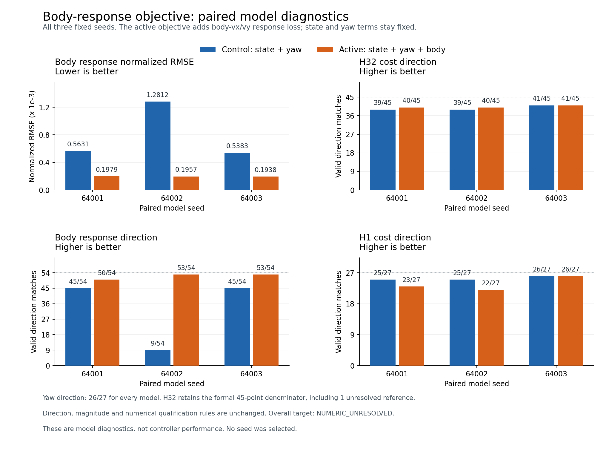

# 69：速度响应误差三对下降64%–85%，总代价方向仍未修复

**新增一个固定权重的body-vx/vy响应损失，在三个配对模型上降低了测试响应RMSE，但没有通过原完整修复门或本轮无退化门。** 六模型、6000次更新与4680个验证策略步完整结束；没有partial或执行失败。三个control的最终参数mapping SHA逐位复现64 active，因此配对差异可归因于新增损失，而非对照配置漂移。没有策略或控制参数更新。

| 模型seed | 测试body归一化RMSE，control → active | 降幅 | body正式方向 /54 | H32代价方向 /45 | H1代价方向 /27 |
|---|---:|---:|---:|---:|---:|
|64001|0.000563138 → 0.000197882|64.86%|45 → 50|39 → 40|25 → 23|
|64002|0.001281206 → 0.000195680|84.73%|9 → 53|39 → 40|25 → 22|
|64003|0.000538327 → 0.000193767|64.01%|45 → 53|41 → 41|26 → 26|

首拍yaw三对全部26/27 → 26/27。表中正式分母未缩减：H32共45点，旧64301/110仍是1个物理参考未知；其余44个H32以及全部27个yaw、54个body状态×通道、27个H1代价参考可判。新增测试69301/260的yaw响应被六模型全部四档预测反号，不能把64原18/18扩展为本轮27/27。

RMSE使用旧56、旧64和新693xx三组各9个状态、全部四档θ与两通道，共216个标量差分误差，按冻结F32尺度提升到F64后的0.30000001192092896归一化；三组等权均方后开方。四档并非独立样本。三种子每个来源、每个通道的RMSE都下降；仅新693xx一组的active/control比也为0.53724、0.22136、0.50226。历史点作为回归保留，新点在全部拟合结束后才采集，没有用于拟合或调权重。

三个active的54个body状态×通道在全部四档上的**原始符号均正确**；正式50/54、53/54、53/54的缺口分别来自4、1、1个vx通道预测幅值低于1e−5。不能用原始54/54替代正式资格。该辅助目标是φ(model post-state)的动作方向导数，含四元数变换基点，并不等于纯B矩阵辨识或完整动作Jacobian正确。

数值求导与预测幅值也要区分。324项自由H32、162项自由H1、2592项body直线/实际端点自检，共**3078/3078项AD/FD一致性通过**（含development，不含旧593xx附表）；没有同函数AD/FD符号冲突。body共1296个模型×状态×通道×ε标量中79个低于方向幅值门，涉及20个模型×状态×通道；H1另有3个低幅值点。因此六模型中只有64001 control的全部数值方向资格通过，其余五个失格原因是幅值，而非AD/FD误差。`target_status=NUMERIC_UNRESOLVED`按冻结代码保留，不将这个状态误述为浮点求导不稳定。

逐点不退化门未通过。以下七例原control合格、active不合格，必须保留，不能由其他点的改善抵消。五例是达到幅值门的明确反号，两例是幅值失格（其中一例原始符号仍同号）。

|模型seed|测试点|时域|真实梯度|active梯度|失败类型|
|---|---|---:|---:|---:|---|
|64001|56303/260|H1|+0.001767276|−0.000081592|明确反号|
|64001|64302/260|H1|+0.000611154|−0.000134727|明确反号|
|64002|69301/110|H32|+0.002140635|−0.002480261|明确反号|
|64002|56302/260|H1|+0.000805070|−0.000005412|幅值失格，原始反号|
|64002|64301/260|H1|+0.000669715|+0.000003323|幅值失格，原始同号|
|64002|64302/260|H1|+0.000611154|−0.000061206|明确反号|
|64002|69303/260|H1|+0.001745750|−0.000195595|明确反号|

旧64303/110的五个已知失败也没有一例达到修复门：三个active H1中，64001/64002仍明确反号，64003缩到−7.806e−7而失去幅值资格；64002/64003的H32仍明确反号。新693xx的状态损失变化分别为−4.17%、+1.77%、+1.49%，也不是全面改善。旧593xx回归作为完整附表保留，其中59301/110 H32仍未知，不参与主门且不改判。

本轮唯一变量是β：control为0，active为0.08980082414438752。原状态损失和yaw损失及λ保持；control是64的active混合符号配置。全部使用原7200个转移、H8、B64、6828个共同窗口、相同采样和1000次最终更新；body损失对68准入的全部96×2标量等权平均，不选ε、符号、seed或checkpoint。96行来自24状态、4个训练seed。β0直接返回原目标图，三个control最终SHA核验通过；所有六模型完成后才评测，新自由H1/H32预测在新扰动物理前封存。详见[执行前四项计划](body_jvp69_plan_20261101.md)与[预注册JSON](experiments69/body_jvp69_preregistered.json)。

最终 `raw_body_rmse_gain=true`，但 `body_target_improved=false`、`paired_improved=false`、`active_repair_validated=false`；全局状态仍为 `REFERENCE_UNRESOLVED`。旧未知参考并非唯一阻碍：即便只看已解析参考，本轮也存在上述明确反号、低幅值和逐点退化。结果支持继续研究代价各分项与多步敏感度传播，不支持直接将当前模型梯度用于策略更新或声称控制性能提升。

正式执行CPU111.863秒、进程墙钟113.901秒，监督器124.811秒（含内存准入）。计数为6000模型更新、4680policy/46800native/23400PD，三个600步基线加9点×10分支×32步；没有新增训练物理，策略/控制更新均为0。cgroup峰值0.7914GiB、最低有效可用4.0744GiB；Nice10、单CPU单线程、MemoryHigh2GiB/MemoryMax3GiB/Swap0，所有内存事件为0。738项源码/输入、1033份封存预测与权重前后核验通过，失败/partial不覆盖、不续跑，48及v27不变。

72项合成测试通过（4.12秒）。执行源码提交`ae1d485bac2920dc3df3e7102c1c266b3314639c`的[body-jvp69 CI](https://github.com/LYHrmer/ddt-d1-rl-lab/actions/runs/41298532861)与[static-checks](https://github.com/LYHrmer/ddt-d1-rl-lab/actions/runs/41298532868)均成功；CI验证合成契约，本机运行回执才是上述模型与物理结果的来源。

证据：[68训练标签准入](body_response68_results_20261101.md)、[69完整机器报告、逐项失败与原始SHA](../reports/body_jvp69_results_20261101.json)、[可导出SVG](assets/body_jvp69/body_jvp69_paired_summary.svg)。原始目录为`evidence/body_jvp69/admission_01`及`evidence/body_jvp69/execution_01`；三份对照、三份候选和全部新旧失败均保留。本轮预注册SHA256：`75fb9cefb15879f067d1ac4119b089de02b8f34cfc16dec2064279b360dd1b1c`。
