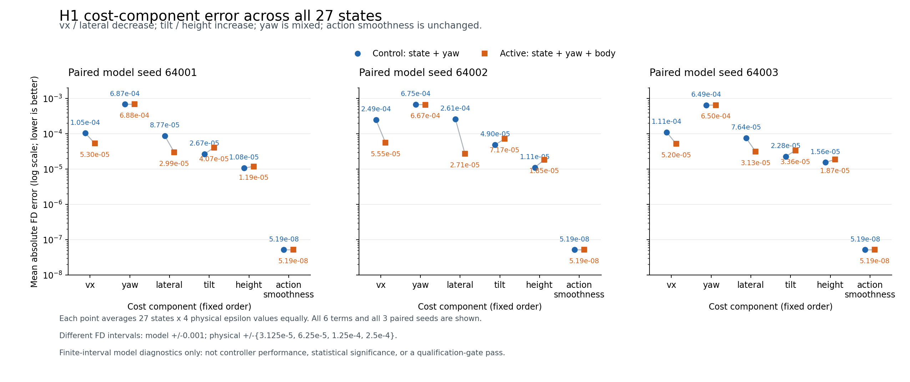

# 70：速度响应变准后，总代价为何仍会反号

69新增body导数监督后，三对模型的前向、侧向响应拟合都改善了，但完整方向资格仍未通过。70完整读回六模型、27状态、四档真实扰动的保存端点，发现：**偏航仍是最大的首拍代价导数误差来源；前向、侧向误差下降的同时，倾斜和高度误差在三个seed上都增加。** 旧失败点以偏航的零点差贡献为主，六个新增H1失败则以偏航的割线响应差贡献为主，不能用一个统一幅值修正解释全部问题。

本轮是诊断，不是修复。未运行模型、actor、物理或训练，69所有失败、幅值失格、未知参考与资格保持原判。[预注册计划](cost_decomposition70_plan_20261101.md)、[机器计划](experiments70/cost_decomposition70_preregistered.json)和[完整报告及原始文件SHA清单](../reports/cost_decomposition70_results_20261101.json)可核对。

## 完整样本，而非挑选失败点

全部162个model×point、648个模型/真实差分区间配对、3888个成本分项均完成。主分析对27状态×四档真实ε等权；旧56、旧64、新693xx各九状态也分别报告。control与active沿用69：前者为state＋yaw JVP，后者只增加body-vxy JVP；每臂均为64001/64002/64003三个模型初始化。

下表为分项FD MAE，单位为 **10⁻⁶**，每格为control→active。三个seed完整列出，不按结果排序。

| 成本项 | 64001 | 64002 | 64003 |
|---|---:|---:|---:|
| 前向vx | 104.740 → 53.048 | 249.221 → 55.469 | 110.508 → 51.952 |
| 偏航yaw | 687.077 → 687.657 | 674.505 → 667.365 | 649.182 → 650.185 |
| 侧向lateral | 87.688 → 29.890 | 261.467 → 27.065 | 76.419 → 31.269 |
| 倾斜tilt | 26.682 → 40.745 | 48.960 → 71.669 | 22.830 → 33.563 |
| 高度height | 10.760 → 11.911 | 11.123 → 18.529 | 15.562 → 18.744 |
| 动作平滑 | 0.051896 → 0.051896 | 0.051896 → 0.051896 | 0.051896 → 0.051896 |

vx误差下降49.4%/77.7%/53.0%，lateral下降65.9%/89.6%/59.1%；tilt增加52.7%/46.4%/47.0%，height增加10.7%/66.6%/20.4%。这四项的同向变化也分别出现在旧56、旧64、新693xx三个子集。yaw变化为+0.084%/−1.059%/+0.155%，三对不一致，不能称为改善。这里的三对一致是原始数值描述，不是显著性检验。

## 两类失败需要不同解释

代价的平方残差导数依赖**残差本身及其动作响应**。70对22个标量残差采用固定的对称代数恒等式，把FD差分成零点差、中点相对零点的偏移差、割线响应差；按原六个成本组汇总。公式与不同差分区间的限制见预注册计划。绝对贡献先逐坐标取绝对值，不用组内抵消制造小误差，也不把这些绝对量当成可相加的因果百分比。

旧64303/110点的真实yaw成本FD约−4.662×10⁻⁶，三个active模型分别为−239.681/−262.877/−198.005×10⁻⁶。其误差分解如下，仍为四档ε平均、单位10⁻⁶：

| 模型seed | yaw零点差贡献 | yaw响应差贡献 | active总代价AD | 真实总代价FD |
|---|---:|---:|---:|---:|
| 64001 | −179.793 | −55.226 | −62.638 | +200.612 |
| 64002 | −193.614 | −64.601 | −79.958 | +200.612 |
| 64003 | −149.979 | −43.363 | −0.781 | +200.612 |

该点的零点差贡献较大。64003的总代价方向仍因幅值低于原1e−5门槛而失格；真实yaw**分项**也低于该幅值门，本表仅用于代数记账，没有新增分项方向资格。

六个新增H1失败全部保留如下。yaw误差在六点×四档ε的24个区间中均是绝对值最大的分项；下表单位同上：

| 模型seed | 状态seed/tick | yaw分项FD误差 | 零点差贡献 | 响应差贡献 | 69原判 |
|---|---|---:|---:|---:|---|
| 64001 | 56303/260 | −1898.18 | −328.08 | −1570.10 | 明确反号 |
| 64001 | 64302/260 | −707.63 | −58.25 | −649.39 | 明确反号 |
| 64002 | 56302/260 | −952.42 | −270.24 | −682.18 | 幅值失格，原始符号反向 |
| 64002 | 64301/260 | −555.72 | −217.97 | −337.76 | 幅值失格，原始符号同向 |
| 64002 | 64302/260 | −624.19 | −57.10 | −567.09 | 明确反号 |
| 64002 | 69303/260 | −2200.42 | −266.31 | −1934.11 | 明确反号 |

这些点的control也已有偏航误差；部分body误差此前恰好抵消了它。减少body误差后，总和可能更差。但不能把全部回退都归为“补偿消失”：64001两个新增失败点的vx分项误差也增大了。倾斜项的正误差又部分抵消了偏航的负误差，单独减少倾斜误差同样不保证总代价方向改善。

全部15个H1失败（含control）及六个新增H1回退均在完整报告中。69另有一个新增H32反号，本轮未分解：保存的H32档案缺少完整正负端点轨迹，不能假定已有数据能支持相同分析。

## 数值与资源核验

- 5751个检查记录全部通过：物理读回81、模型读回1782、区间恒等式3888。最大分项恒等式误差1.73e−13，最大总AD差重建误差4.34e−19；容差固定为1e−10＋1e−8尺度。
- 保存的总AD−模型FD最大差7.34e−10；总和舍入差最大7.37e−13。所有all27统计中的中点偏移绝对量均值最大8.02e−12。这些量级不支持用浮点消减解释当前约1e−4–1e−3的主要误差。
- CPU 3.191秒，诊断墙钟3.620秒；包含10秒内存准入的监督器墙钟15.091秒。任务组峰值399,745,024 B（0.372 GiB），最低有效可用4.337 GiB，无OOM/限额事件。
- 原始327文件、15,860,330 B完整保留；1000个来源SHA在执行前后核对，包含69的738个继承绑定。56项最终源码测试通过；正式执行无失败或partial。绘图保留一条不影响二维输出的Matplotlib Axes3D导入警告。

源提交`a7d78962b27e3a05d6173e0b120ef7c37d6ea4a5`的[cost-decomposition70 CI](https://github.com/LYHrmer/ddt-d1-rl-lab/actions/runs/41301798303)与[static-checks](https://github.com/LYHrmer/ddt-d1-rl-lab/actions/runs/41301798320)均成功。执行计划SHA为`9d8c011d16a9b4d3719cbcbe56049bfb225e105562933279a8809b048ace2cd4`。

## 下一步的可判定问题

下一步先检查**全部训练标签中心**的预测值及响应拟合，再在固定配对预算下选一个训练变量。导数监督约束斜率，并不直接锚定同状态的函数值；但70尚未证明新增值监督一定优于提高现有yaw损失权重。提高监督损失权重也不等于统一放大模型输出，不能用不同状态上高估/低估并存来排除它。

当前尚缺训练中心值偏差及各目标梯度关系的证据，不能把倾斜退化直接称为梯度冲突。新候选不使用这些已看过的测试失败点作为训练标签，必须保留三个配对seed、旧回归集及新的独立验证。小幅值失格、未解析的64301/110 H32物理参考、长程误差与完整控制资格均仍未解决。
