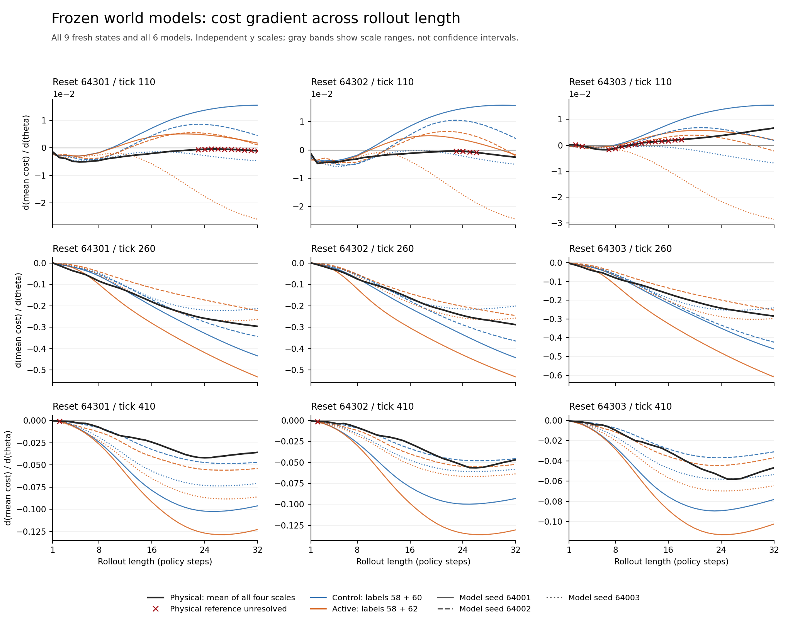

# 65：首拍yaw方向修复后，总代价项的耦合仍失配

**全部六个固定模型、九个新测试状态的诊断完整完成；没有新增物理或训练。** 64的首拍yaw响应方向改善保持，但不能据此认为单拍总代价或32拍优化方向已修好。65逐项重建了64的θ0轨迹、标量成本、AD和FD；原标量成本/AD/FD恢复差均为0，JVP均值与标量AD最大差约5.0e−16。1728/1728个总前缀、10368/10368个分量自检通过。原64资格和未知参考不重判。

图包含全部9个状态、全部6个模型和32个前缀，没有按结果挑选。灰带是四档物理中央FD的范围，不是统计置信区间；红叉表示物理参考未解析。各子图纵轴独立。可下载[SVG](assets/cost_prefix65/cost_prefix65_all_fresh.svg)；PNG480424字节，SVG222125字节，均小于5MB。

在此前已记录失败的64303/110，H32真实前向速度项为+0.01589024，三个active仅为+0.00082063至+0.00589011。真实侧向项为−0.00174474，六个模型却都为正；64003 active的偏航项−0.03304180也明显超出真实−0.00675738的幅度。下表同时保留全部control，避免只展示有利模型。

|模型|前向速度项导数|偏航项导数|侧向项导数|总代价导数|
|---|---:|---:|---:|---:|
|物理参考四档均值|+0.01589024|−0.00675738|−0.00174474|+0.00666105|
|64001 control|+0.00660498|+0.00607537|+0.00381649|+0.01546980|
|64001 active|+0.00589011|-0.00540618|+0.00262806|+0.00197771|
|64002 control|+0.00075876|-0.00288766|+0.00526933|+0.00190942|
|64002 active|+0.00082063|-0.00540201|+0.00329586|-0.00219393|
|64003 control|+0.00491875|-0.02083558|+0.01031075|-0.00683491|
|64003 active|+0.00471077|-0.03304180|+0.00071658|-0.02856849|

总量还包括tilt、height和action_smoothness。此点H32前五项都通过原四尺度稳定门；动作平滑项约1.9653e−8，未达到幅值门，不据其符号归因。某些模型的总方向碰巧正确，也不能掩盖分项误差相互抵消。

问题并非只在长时域出现：三个active在九个新状态上的**单拍总代价方向均为8/9**，同一个64303/110失败，真实+0.000200612，模型分别−0.000163986、−0.000412650、−0.000058630。64的“首拍方向通过”指yaw-rate状态28对轮动作的响应，并不是单拍总代价方向；两个结论不冲突。

对64303/110的时间定位也需谨慎：四档中央FD在h3、h11共同翻号，但附近前缀未通过严格稳定门，不能把这两个位置写成已确定的物理转折。已解析区间是h1为正、h4–6为负、h19–32为正；h2/3及h7–18均未解析。H8负值不具备有效方向参考资格。64301/110的H32仍保持64的未解析状态，不能借短前缀通过改判。

这些分量导数包含“代价在预测状态上的局部权重×自由轨迹敏感度”。前向项偏小既可能来自预测值偏差，也可能来自敏感度传播失真；本轮没有区分真实A、B，不能直接宣布某个动力学Jacobian是根因。下一项最小诊断应先把代价求值基点重定位到真实基线，同时保持模型自由传播导数不变，再决定是否沿真实轨迹检查Aδs＋Bδa。这种使用真实基线的检验仅用于定位，不属于可部署修复；当前不据此增加训练跨度、调λ或改控制损失。

工作量：**0物理步、0模型/策略/控制更新**，9个物理档案点、54个冻结模型重放点。CPU13.810秒，进程墙钟15.577秒，正式任务监督器墙钟27.276秒（含内存准入观察）。峰值0.4200GiB，最小有效可用4.5703GiB，无内存事件；9项合成测试及Ruff通过，928项绑定前后复核成功。无partial、失败执行、覆盖、重试或续跑。二维图单独在相同资源守卫下生成并目视检查；Matplotlib的3D导入警告保留在渲染日志，二维输出完成。

源码提交 `86e6cbe80011a7403526c8a20b10b22faf0eda77` 的 [cost-prefix65 CI](https://github.com/LYHrmer/ddt-d1-rl-lab/actions/runs/41292719882) 与 [static-checks](https://github.com/LYHrmer/ddt-d1-rl-lab/actions/runs/41292719847) 均成功。

证据：[执行前计划](cost_prefix65_plan_20261101.md)、[源码/输入绑定](experiments65/cost_prefix65_preregistered.json)、[机器摘要与全量原始文件SHA](../reports/cost_prefix65_results_20261101.json)、[绘图源码](../tools65/plot65.py)。全部原始报告、各尺度分量明细和NPZ保留于 `evidence/cost_prefix65/diagnostic_01/`，约34.45MB。线上摘要保留全部模型前缀和总物理参考，物理分量的逐尺度明细可由原始SHA核对。冻结源、48归档和v27保持，没有新增控制性能结论。
