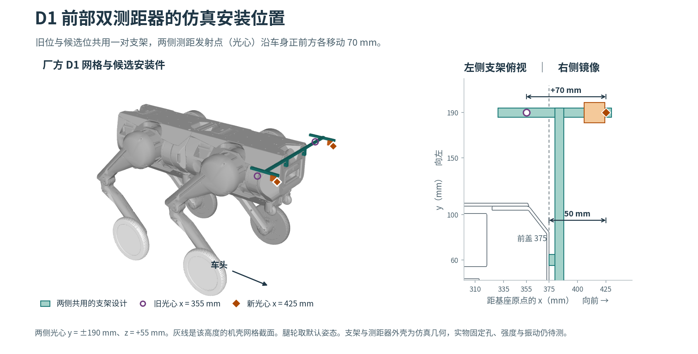

# D1 前部双测距器的安装位置与后缘可见性

D1 的两个发射点已通过固定坐标系装进 MuJoCo，两侧共用一副横梁。候选位置沿车身前方移动 70 mm，在 459 个存档姿态上，与运动零件外形的最小保守间隙为 **68.75 mm**。此前被台阶完全挡住的 6 个预瞄点，前移后仍有 **6 个完全被挡住**。本轮达到仿真安装要求，未达到点云采集门槛。候选场景可用于检查安装，控制策略的默认配置继续沿用已验版本。[事前方案](experiments107/installation.json) · [冻结提交](https://github.com/LYHrmer/ddt-d1-rl-lab/commit/800469fcfcf28c0a540565b997f44961a6e28625)



## 实际装到了哪里

以 `base_link` 为原点，x 向前、y 向左、z 向上，坐标单位为毫米。左、右发射点在模型中的名字分别为 `mount107_optics_left` 和 `mount107_optics_right`。采集直接读取两者的世界位置和朝向，支架与传感器外壳也参与首回波及自遮挡查询。[安装参数](experiments107/mount.json) · [模型与采集入口](../tools107/mount107.py)

| 安装 | 左发射点 (x, y, z) | 右发射点 (x, y, z) | 相对前盖 |
|---|---|---|---|
| 原光心，装到同一副支架 | (355, +190, 55) | (355, −190, 55) | 后方 20 mm |
| 前移光心 | (425, +190, 55) | (425, −190, 55) | 前方 50 mm |

前盖在两块安装垫中心的网格坐标是 (375, ±60, 55)。原传感器代码只描述了光心，旧光心所在横截面到最外壳面的侧向距离约 80 mm。本轮据此新增安装垫、立柱、横梁、纵轨和外壳，两个位置的固定支架完全相同。50 mm 前悬及外壳尺寸是本轮的仿真设计值。实机装配仍缺实际器件外形、孔距、承载与线束数据。新增部件按光学遮挡和静态间隙建模，质量、接触力及冲击响应需另行验证。[厂方对应版本](https://github.com/DDTRobot/ddt_ros2_control/blob/4f5d9621a90282ddf4865078bbfa9ca7669f0698/urdfs/d1_description/mujoco/robot.xml#L32-L52)

## 哪些开源细节用于这次设计

- **DDTRobot D1** 提供了前盖、基座和运动轮腿的真实模型基准。本次将本机 MJCF 和 11 份 STL 逐文件对上厂方历史提交，再据此取安装面和计算间隙。工件中发布了内容哈希。[厂方网格目录](https://github.com/DDTRobot/ddt_ros2_control/tree/4f5d9621a90282ddf4865078bbfa9ca7669f0698/urdfs/d1h_description/meshes) · [本机与上游的文件对应](experiments107/vendor_geometry.json)
- **ANYmal D 与 Unitree Go2** 分别在 URDF 里定义前部深度相机、光学坐标系和机身上的不同传感器固定关节。D1 也给每个光心一个独立的固定坐标系，逐姿态核对它相对机身的变换。[ANYmal D 相机坐标系](https://github.com/ANYbotics/anymal_d_simple_description/blob/d5bf4dc3a81af81a16b9598fc15c98e339f45a33/urdf/anymal.urdf#L99-L145) · [Go2 的固定传感器关节](https://github.com/unitreerobotics/unitree_ros/blob/157ff950351e5f535e03c5d85a16b7d594b3dbcc/robots/go2_description/urdf/go2_description.urdf#L748-L758)
- **JEPLO** 为额外安装的倒置 MID-360 单独指定了传感器姿态，并在部署代码中处理遮挡角区。**Spot SDK** 在图像采集记录中携带采集时间及当时的坐标变换。这两点落实到 D1 的检查方式上，先用采集时位姿检查台阶是否挡住视线，再单列方向是否落在已定义的可用角区。每个预瞄点的标签仍取 40 ms 后送达时的轮前位置。[JEPLO 安装配置](https://github.com/ASIG-X/JEPLO/blob/460e2272907af053d6e66b57fec71fdbe6ca1774/training/go2_parkour/go2_parkour/tasks/go2_loco_env_cfg.py#L216-L225) · [JEPLO 遮挡处理](https://github.com/ASIG-X/JEPLO/blob/460e2272907af053d6e66b57fec71fdbe6ca1774/deployment/lidar_depth_pub/lidar_depth_pub.cpp#L191-L226) · [Spot 采集接口](https://github.com/boston-dynamics/spot-sdk/blob/v5.2.0/protos/bosdyn/api/image.proto#L79-L90)

## 两道验收门

**安装间隙通过。** 在 89201、89202、89203 三个不同复位的完整平地轨迹中，取第 0～152 拍的所有姿态。每个位置检查 459 次，合计 918 次。每次把支架及外壳与运动零件的视觉和碰撞几何比较，并核对两个发射点的位置和朝向。数值是包围盒分离给出的间隙下界，仅代表已检查的运动范围。[逐帧位姿和间隙](../reports/mount107/installation/clearance_samples.npz) · [最差姿态与零件对](../reports/mount107/installation/geometry.json)

| 位置 | 距腿轮视觉外形的最小下界 | 距腿轮碰撞几何的最小下界 | 最近零件 |
|---|---:|---:|---|
| 原光心 | 62.43 mm | 80.06 mm | 右前大腿与右传感器外壳 |
| 前移光心 | 68.75 mm | 84.31 mm | 右前大腿与右纵轨 |

**台阶后缘的视线未通过。** 台阶高 30 mm，查询点设在前轮轴前方 350 mm。同一批 8 个已知离台难例，各取前包、本包和左右两个安装点，向本次真实的轮前预瞄点作 4 条理想线段。判定需要至少打开一个原本四条线全挡的难例。[上一轮的真实回波图](terrain_history106.md) · [逐行比较](../reports/mount107/installation/sightlines.json)

| 指标 | 原光心 | 前移光心 |
|---|---:|---:|
| 台阶没有挡住的理想线 | 5/32 | 8/32 |
| 同时落在距离和未遮挡角区的畅通理想线 | 3/32 | 4/32 |
| 至少有一路畅通的难例 | 2/8 | 2/8 |
| 原来四路全挡、现有一路畅通 | — | **0/6** |

新增的 3 条畅通线全部来自第 798 行。它原先已有一路畅通。第 831 行原先四路都通。其余 6 个预瞄点依然处在台阶的几何遮挡区。已批准的上限为 216 个模拟点云包，按上述条件实际采集 **0 包、0 束**。本轮的动力学积分、世界模型更新、策略更新也均为 0。新位置的实际回波准确率与闭环越障改善仍待测量。[安装阶段资源回执](../reports/mount107/installation/resources.json)

## 这 70 mm 还差多少

验收结束后，在 6 个仍全挡的样本上反算了光心沿机身前方滑动多远，才有一条理想线刚好擦到台阶上后棱。用线段与矩形盒相交另行复核了临界点两侧的结果。最近的一例相对新位置还差 **18.73 mm**，最远的一例还差 **57.65 mm**。这些临界位置都超过当前纵轨的最前端 x = 430 mm。刚好相切仍然没有证实实际光束能取得低地面回波，把计算值直接当作实机安装尺寸会遗漏视场、固定和强度条件。[六个几何下界](../reports/mount107/shadow_bounds.json) · [解析计算](../tools107/shadow107.py)

## 查看场景或复核

本机已导出前移位置的平地场景，路径为 `evidence/mount107/model_forward_01/mujoco/scene107.xml`。MuJoCo 3.3.0 已实际加载文件并核对两个发射点。场景通过本机路径引用厂方网格。拥有原模型的工作站也可以用下面两条命令导出到自己的新目录并加载检查。两种位置分别选 `--arm original` 或 `--arm forward`。[导出程序](../tools107/export107.py)

```bash
PYTHONPATH=.python-deps:training:. python3 -B -m tools107.export107 /tmp/d1-forward-preview --arm forward
PYTHONPATH=.python-deps:training:. MUJOCO_GL=disable python3 -B -m tools107.export107 /tmp/d1-forward-preview --check
```

公开的数值工件可直接用 NumPy 回读。

```bash
python3 -B -m tools107.run107 check
python3 -B -m tools107.shadow107 check
python3 -B -m pytest -p no:cacheprovider -q tests/test_*107.py
```
