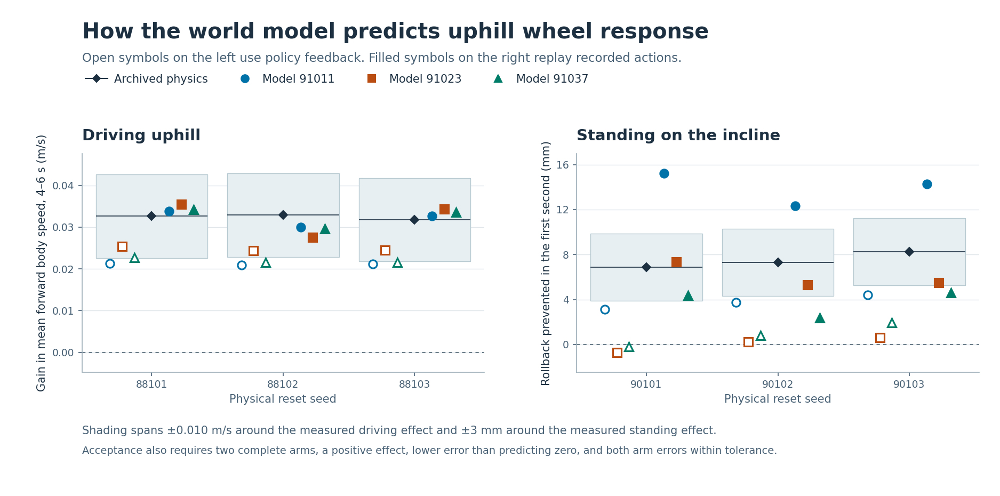

# 给 D1 世界模型同一串轮腿动作，它能算准上坡响应吗？

**这次保留感知 PPO 的课程，也暂缓提高世界模型的驻坡采样比例。** 回放原生 MuJoCo 实际执行的动作后，三份模型在所有行驶配对上都算准了提速幅度，但有五对把两臂的绝对车速都估高。驻坡的九对预测全部给对了方向，幅度却有五对偏低、四对偏高。两项工况按事前规则均为混合结果。[预注册（先于回放提交）](experiments92/fixed_actions.json) · [逐对计分](../reports/fixed_actions92.json)

## 两种动作来源差多少

| 工况与指标 | 原生 MuJoCo（三个重置） | 第 91 轮模型闭环（九对） | 固定实际动作（九对） |
|---|---:|---:|---:|
| 行驶，加轮速后的平均提速 | 0.03178～0.03287 m/s | 0.02095～0.02543 m/s | 0.02752～0.03543 m/s |
| 行驶，提速误差 ≤0.010 m/s | — | 4/9 | **9/9** |
| 行驶，两臂车速误差均 ≤0.040 m/s | — | 9/9 | **4/9** |
| 行驶，满足全部门槛 | — | **4/9** | **4/9** |
| 驻坡，首秒减少的后溜 | 6.88～8.26 mm | −0.70～4.42 mm | 2.37～15.21 mm |
| 驻坡，后溜减量误差 ≤3 mm | — | 0/9 | **4/9** |
| 驻坡，两臂后溜误差均 ≤30 mm | — | 7/9 | **5/9** |
| 驻坡，满足全部门槛 | — | **0/9** | **2/9** |

每个工况复用三个独立的物理配对，由三份固定权重分别预测。全部门槛还要求两臂走满、干预效应为正，且预测误差严格小于直接猜“没有效果”的误差。固定动作下行驶 9/9、驻坡 8/9 优于零效应。按登记顺序，模型 91011、91023、91037 分别通过 0/6、5/6、1/6，整体验收为 **0/3**。[固定动作计分与未通过项](../reports/fixed_actions92.json)

**行驶。** 轮速目标统一增加 0.50 rad/s 后，按 4～6 秒内 100 个端点的体轴前向速度均值计分。固定动作让九对提速误差全部缩小，平均绝对误差从 0.00982 降至 0.00246 m/s。五个未通过的配对中，原策略与加轮速两臂都跑出了偏高的预测车速，单臂误差为 +0.0427～+0.0629 m/s。两臂相减会抵消这部分偏差。模型 91037 在重置 88101 从通过变为失败，在 88103 从失败变为通过。[行驶物理对照](uphill_diagnosis88.md) · [完整配对](../reports/fixed_actions92.json)

**驻坡。** 修正四轮共同后退目标后，固定动作使效应绝对误差在六对缩小、三对扩大，平均值从 5.92 降至 3.97 mm。91011 对三个重置都高估收益，预测 12.32～15.21 mm。91037 都低估，预测 2.37～4.57 mm。91023 在重置 90101 的减量误差仅 0.47 mm，但两臂的后溜量均高估约 42 mm，因此该对仍失败。[驻坡物理对照](stand_wbc90.md) · [逐种子预测](../reports/fixed_actions92.json)

## 误差从什么时候开始出现

三种来源按相对起点的同一拍取值。行驶第 16 拍（0.32 秒），原生仿真的瞬时提速为 0.00788～0.01226 m/s，固定动作预测 0.00256～0.00673 m/s。到第 32 拍，实测为 0.03288～0.03875 m/s，预测为 0.01760～0.02684 m/s。两个时点均低估，虽然最终评分窗口的平均提速九对都达标。[逐拍位置、体轴速度和世界速度](../reports/fixed_actions92_curves.jsonl.gz)

驻坡第 32 拍（0.64 秒），固定动作预测的后溜减量为 1.25～4.73 mm，实测 1.27～2.52 mm。到第 50 拍（1.00 秒），预测分散到 2.37～15.21 mm。另按原来的 50 Hz 梯形积分复核，首秒“世界纵向位移减速度积分”在六条原生轨迹为 −0.175～−0.111 mm，在十八条固定动作预测为 +8.53～+16.37 mm。按干预臂减原策略臂，这项差异在同一配对内最多改变 1.34 mm，单独纠正位置积分仍解释不了最大的 8.33 mm 效应误差。这项速度一致性复核只用于定位。[公开逐拍曲线](../reports/fixed_actions92_curves.jsonl.gz) · [积分定义](../tools91/kinematics91.py)

## 课程怎么处理

第 91 轮世界模型从 42 个已结束回合里均匀抽取八拍窗口。11,472 个合法窗口中，只有 252 个完全落在“从坡上起步、零速度指令”阶段，占 2.20%，而且来自六个回合。窗口彼此重叠。现有归档从第一拍结束后开始存状态，也缺少复位到首拍的训练转移。增加这 252 个窗口的抽样概率，会更频繁地看到同六条轨迹。[覆盖数独立复算](../tests/test_public92.py) · [训练转移构造](../tools91/data91.py)

把固定动作下每一臂的后溜与同一臂的原生值相减，到第 32 拍已能看到误差随重置翻转。下表给出每个重置的两臂、三份模型共六个误差的范围，正数表示模型预测后溜过多。[84 条公开曲线](../reports/fixed_actions92_curves.jsonl.gz)

| 驻坡重置 | 第 16 拍（0.32 s） | 第 32 拍（0.64 s） | 第 50 拍（1.00 s） |
|---|---:|---:|---:|
| 90101 | +2.1～+4.1 mm | +8.0～+14.9 mm | +29.3～+56.3 mm |
| 90102 | −2.0～−0.8 mm | −10.9～−6.1 mm | −27.3～−4.0 mm |
| 90103 | +0.5～+2.0 mm | −7.8～−0.1 mm | −34.5～−3.0 mm |

三个重置各自绑定一份父策略。下一项对照应固定同一份父策略，用独立重置区分初态和动作轨迹的影响，并按轮速、俯仰及承重转换对齐误差出现的时点。只有同一阶段的偏差跨重置重现，才把**该阶段窗口的抽样比例**作为唯一课程变量，匹配模型初始化、更新次数和验收门槛。现有结果保留原课程和奖励，使用模型梯度更新策略仍待轮地响应验收。

## 回放与复核

三份模型复用第 91 轮的最终权重、共同分叉状态和地形输入。每条输入文件只含起点 45 维状态和随后实际施加的 16 维动作序列。行驶取第 180 拍端点以及归档动作第 181～300 行，驻坡取复位状态和随后 50 个施加动作。每步都把模型自己预测的状态送回下一步。原生动作里保留了原策略在原生仿真中的反馈，因而这项回放衡量的是给定这串动作后的模型响应。三十六条回放的首个施加动作、首个 45 维预测端点均与配对闭环逐位相同。[输入与推演代码](../tools92/replay92.py) · [独立计分](../tools92/score92.py)

三份模型各完成六条 120 拍行驶和六条 50 拍驻坡，合计 **36/36 条、3,060 个新模型步**，截断和预测跌倒均为零。复用 36 条模型闭环、12 条原生轨迹。新增物理步、策略调用、世界模型更新、策略更新均为零。单核回放单元使用 Nice 10、MemoryHigh 2 GiB、MemoryMax 3 GiB、swap 0。准入有效可用内存 8.85 GiB，运行最低 8.55 GiB，单元峰值 0.291 GiB，含准入等待共 12.36 秒。[预注册提交](https://github.com/LYHrmer/ddt-d1-rl-lab/commit/a8ff4c003f7ff8cbc977570a84788408511d88cd) · [资源回执](../reports/fixed_actions92.json)

干净检出可从 84 条公开曲线独立重算全部效应、门槛和各时点误差。完整归档、模型权重和本轮原始预测保存在工作站。工作站回放入口使用全新的输出目录并拒绝覆盖已有尝试。[公开读回测试](../tests/test_public92.py) · [工作站入口](../tools92/launch92.py) · [CI](../.github/workflows/fixed-actions92.yml)
