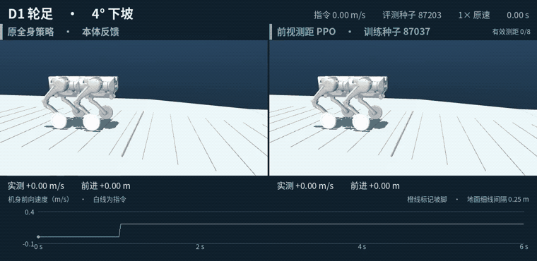

# D1 全身策略在 4° 坡道上的速度与轮腿动作

同一台模拟 D1 收到 0.20 m/s 前进指令。原策略在三次开发上坡的运动段均速为 **0.1422 m/s**，在三次下坡为 **0.2421 m/s**。9 段均走满 6 秒，零跌倒。前轮带载接触点在三次上坡最远到达坡脚后 0.302～0.341 m，三次下坡均超过 0.40 m 标记。平地运动段均速为 0.1848 m/s，包含从静止加速的过程。[逐工况指标与独立读回](../reports/full_body_perception87.json)

## 视频里的两个控制器

[](assets/full_body87/down.mp4)

左侧的**原策略**是本项目第 25 轮训练完成的 PPO 全身策略，使用 `random` 组最终权重。组名指训练时随机化动作延迟。第 34 轮把同一份权重放进 C++/ONNX Runtime 并验证部署一致性。此处每一拍都由原 C++34 程序输出 12 个腿角目标和 4 个轮速目标。它使用机身陀螺仪、重力方向、关节状态、指令和上一次动作，当前帧与十帧历史共 627 个数。底层关节伺服以 250 Hz 跟踪并限矩。[原 PPO 权重的训练来源](low_memory_delay25_results_20261018.md) · [C++34 执行与验证](cpp_reference34_results_20261018.md)

右侧从同一份已训练权重出发，增加一个起始为零的测距输入分支，在原生 D1 中采样 4,096 步并更新 PPO。两侧使用相同模型、坡、指令、20 ms 动作延迟和评测种子 87203。白线是指令，蓝线和绿线是实际机身前向速度，橙线是坡脚。屏蔽测距的第三组也做了相同预算的 PPO 微调，列在下表。

主视频按事先约定的规则，在两侧都完成 0.40 m 且无跌倒的坡道配对中，取感知组速度误差最接近该组中位数的一段。选到训练种子 87037 的下坡。两侧都能过线，均有超速。相同两份策略和相同重置种子的上坡片段保留了未到标记的全过程。[下坡 MP4，6 秒](assets/full_body87/down.mp4) · [上坡 MP4，6 秒](assets/full_body87/up.mp4) · [预注册协议与选段规则](experiments87/full_body_perception.json)

## 三组策略在独立重置上的表现

表中是每种地形三个配对的速度 RMSE 均值，单位为 m/s，越低越好。每段前 1 秒站立，后 5 秒计入误差，提前结束的缺失拍按完整指令误差计。每个训练种子对应一个未参与训练的重置种子，同一对种子下三组策略使用同一场地。全部 27 段均走满 6 秒，跌倒、非法接触与车轮力矩饱和拍数均为零。

| 地形 | 原 PPO25 / C++34 | 屏蔽测距 PPO | 使用测距 PPO | 前轮超过 0.40 m 标记，原 / 屏蔽 / 测距 |
|---|---:|---:|---:|---|
| 平地 | 0.03315 | 0.03158 | 0.03204 | 3/3 · 3/3 · 3/3 |
| 上坡 4° | 0.07625 | 0.07494 | 0.07515 | 0/3 · 0/3 · 0/3 |
| 下坡 4° | 0.07671 | 0.07949 | 0.07867 | 3/3 · 3/3 · 3/3 |

三个下坡配对中，测距组相对屏蔽组的误差都略低，差值分别为 −0.00025、−0.00202、−0.00020 m/s。下坡平均误差仍高于原策略。上坡测距组在三个种子中一例优于屏蔽组，另两例略差；前轮最远只到坡脚后 0.303～0.317 m。两臂的差异包括距离值和测距有效位。这个预算下，测距输入改变了动作，上坡通过率仍为零。[全部 9 个逐种子配对和轨迹校验值](../reports/full_body_perception87.json)

## PPO 实际学了什么

八束前视测距以 6 Hz 采集，40 ms 后到达策略。遇到自遮挡、无回波或超量程就清除该束的有效位。策略收到八个归一化距离和八个有效位。价值网络只用原本体观测。两臂的全身策略、奖励、PD、坡道课程、网络尺寸、初始权重与 Adam 状态都配对；唯一实验变量是送到策略的 16 个感知输入是否被屏蔽。[原生场地和测距](../tools87/terrain87.py) · [感知 PPO](../tools87/ppo87.py)

| 训练种子 | 每臂物理转移 | Adam 更新次数，屏蔽 / 测距 | 有效测距拍数，每臂 | 固定观测下屏蔽测距引起的最大归一化动作差，测距组训练探针 |
|---|---:|---:|---:|---:|
| 87011 | 4,096 | 6 / 5 | 4,068 | 0.00598 |
| 87023 | 4,096 | 8 / 5 | 4,068 | 0.00779 |
| 87037 | 4,096 | 5 / 4 | 4,068 | 0.00666 |

两臂在第一次参数更新前，每对种子的原始测距、实发动作、物理状态和奖励均逐值相同。六个模型的 12 个腿动作输出行和 4 个轮动作输出行都发生了更新，重载后动作逐值一致。每个模型仅用一个 4,096 步 rollout，沿用 25 的 KL 提前停止，所以各次实际 Adam 更新次数不同。6 次训练合计 **24,576 个物理环境转移、33 次 Adam 更新**。9 段原策略开发和 27 段留出评测另计 **10,800 个转移**，总计 **353,760 个原生物理步、176,880 次 PD 更新**。[独立读回程序](../tools87/readback87.py)

本轮策略更新全部使用 PPO。SuperMimic 在学习到的可微世界模型内展开动作轨迹，通过模型把回报梯度传给策略。若比较这种更新方法，可以沿用此处的全身动作和感知输入，使用同一奖励与物理采样预算，单独检验模型给出的轮腿动作方向能否改善真实 MuJoCo 闭环。[SuperMimic 作者说明](https://supermimic.github.io/) · [本仓已有动力学梯度诊断](project83_results_20261104.md)

## 运行与证据

本机原始轨迹、六个完整检查点、测距输入、模型探针、视频源帧和资源日志位于 `evidence/full_body87/`。复现需要恢复原 D1 资产、完整 25 权重和 34 运行时。下列入口在新的工作副本中运行，遇到已有输出会停止，以保留现有结果。受限资源启动器使用相邻 wheel 仓库已有的 systemd 监督程序。

预算在提交 `6a282ab` 登记，采样、训练与首版成片对应 `6250901`。第一次云端检查发现数值测试提前加载了 EGL，纯轨迹读取提前加载了 Pillow。发布修正将绘图库移入实际渲染入口，云端的零渲染测试使用 MuJoCo 的无图形模式。原始成绩和已编码的视频均可按各自 SHA 核对。

```bash
rtk proxy /usr/bin/python3 -B tools87/launch87.py preflight
rtk proxy /usr/bin/python3 -B tools87/launch87.py experiment
rtk proxy /usr/bin/python3 -B tools87/launch87.py verify
```

各重任务串行，CPU 单环境单线程，Nice 10，MemoryHigh 2 GiB，MemoryMax 3 GiB，swap 0。启动前有效可用内存至少 4 GiB，运行至少保留 2 GiB。五个主要单元的最低有效可用内存为 7.77 GiB，峰值组内内存为 1.02 GiB，各单元正常清退。训练与部署参数的零积分预检在 8 个存档输入上测得最大动作差 4.77×10⁻⁷。14 项针对性测试覆盖输入屏蔽、Adam 继承、地形、自遮挡、计分和视频来源。两段视频均由保存的状态离屏渲染；下坡动图来自 120 张 PNG。[资源与数值回执](../reports/full_body_perception87.json)
