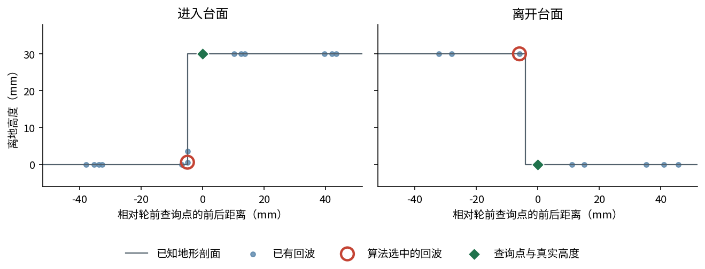

# 40 毫秒的车身运动能解释几次台沿误读？

在第 103 轮的同一批开发回放中，补偿点云从采集到送达之间的车身移动，纠正了台沿处原有 5 次误判中的 **3 次**，均出现在轮前查询点进入台面时。补偿也在高差保持不变的区间引入 **1 次新误判**。比较对象是几何算法读出的轮前高差，单位为毫米。第 103 轮评估的下一包特征预测误差，以及策略实际越障表现，还需各自验证。[逐包结果](../reports/motion104/report.json) · [第 103 轮特征预测](jeplo_action_window103_results.md)

## 同一批回波，三种读法

D1 的 520 束射线在同一姿态采集。40 ms 后收到这一包时，机身已经移动。原算法把送达时的轮前查询位置直接用于采集时的点坐标。这里仅改变两个时刻之间的平面平移和偏航补偿，沿用同一包回波、遮挡、重力对齐、轮前查询位置、最近点算法及原定的 10 mm 容差。[采集合同](experiments100/pointcloud_density.json) · [数据与解算入口](../tools104/motion104.py)

| 遮挡视野，按送达时的轮前高差分组 | 原读法 | 轮速＋IMU 补偿 | 用仿真真位姿补偿 |
| --- | ---: | ---: | ---: |
| 查询点进入台面 | 6/10 | **9/10** | 9/10 |
| 查询点离开台面 | 1/2 | **1/2** | 1/2 |
| 高差发生切换，前两行合计 | 7/12 | **10/12** | 10/12 |
| 高差保持不变 | 137/138 | **136/138** | 136/138 |
| 全部到达包，含各段第一包 | 154/160 | **156/160** | 156/160 |

清晰视野的各项计数相同，两种视野来自相同的物理回波。切换区间的高差平均绝对误差从 11.33 降到 5.59 mm，未切换区间则从 0.17 升到 0.32 mm。12 个切换覆盖 11 个原生时间区间。这批数据共有一个来源种子的 5 段平地运动，回放叠加左右镜像的 3 cm 凸台，均处于轮子触阶前。三个读法都在同一批样本上做配对比较。[观测配对与样本来源](../reports/action_window103/audit.json)

**哪些信息来自机载输入？** 轮速＋IMU 的补偿只使用送达时已具备的三拍观测。用半径 87 mm 乘四轮平均角速度估计前进速度，用陀螺和重力方向估计偏航，积分两个 20 ms 区间。三种读法都使用已归档的机身坐标系轮迹查询。本次复核也用 IMU 重建了点云的重力对齐。另一路用仿真基座真位姿算相对运动，用地形真值判分。80 个运动窗内，基座水平位移中位数为 6.67 mm，轮速＋IMU 的位移向量误差中位数为 2.06 mm，最大为 6.77 mm。160 个遮挡包上，两种补偿给出相同的逐包合格判定。轮滑或触阶后的里程误差仍待实测。[封存的运动窗](../reports/motion104/windows.npz) · [独立坐标复算](../tools104/support104.py)

## 补偿后还错在哪里



图中是补偿后仍然误判的全部两次切换。蓝点是相关轮迹左右 25 mm 内的实际归档回波，左右轴沿前进方向展开。算法按水平面内的二维距离选最近点。**左图**的查询点刚进入台面 4.93 mm，最近回波打在前竖面，仅高 0.59 mm，真实台面高 30 mm。**右图**的查询点已经离开台面 3.98 mm，最近回波仍打在 30 mm 的台面上。黑线和绿菱形来自归档地形，只用于解释读数。[作图代码](../tools104/plot104.py) · [原始距离与命中面](../reports/motion104/returns.json)

合计全部 160 个遮挡包，补偿后的 4 次失败中有 3 次选中了前竖面，1 次选中了台面。新出现的误判属于前一种，查询点实际在前缘外 8.68 mm，却读到 20.41 mm 高的竖面。4 次失败都已有来自正确高度的回波，离查询点的水平距离为 12.07～18.22 mm，只是另一个表面的点更近。**下一项值得检验的单变量是从回波读出轮迹高度的算法**。可在相同补偿上比较现有最近点和利用相邻回波区分地面、竖面、台面的读法，分别报告进台漏报、离台误报、稳定段退化及无法判断的次数。新轨迹上的表现决定是否送入世界模型。[4 次失败逐项核对](../reports/motion104/returns.json)

## 从开源实现学到的取舍

- **JEPLO** 在 Go2 上累积最近 5 帧约 20 Hz 的原始扫描，不做运动去畸变，将返回点投到 60 × 25 的角度网格，每格保留最近距离。发布代码逐点读取坐标并跨帧取最小值。模型使用深度、本体历史和动作序列预测下一时刻的特征。论文附表列出的 100 ms 是训练深度延迟参数，实机端到端延迟需要另外测量。D1 可以借鉴这种时序学习，并用独立的台沿高差衡量特征是否保留控制所需的信息。[论文第 II 节](https://arxiv.org/html/2609.15770v1#S2) · [训练参数表 IV](https://arxiv.org/html/2609.15770v1#Sx1.T4) · [实机点云投影和聚合](https://github.com/ASIG-X/JEPLO/blob/460e2272907af053d6e66b57fec71fdbe6ca1774/deployment/lidar_depth_pub/lidar_depth_pub.cpp#L391-L451) · [潜变量预测代码](https://github.com/ASIG-X/JEPLO/blob/460e2272907af053d6e66b57fec71fdbe6ca1774/training/rsl_rl/rsl_rl/modules/jepa_estimator_sensor_ss.py#L343-L372)
- **ANYbotics elevation_mapping** 按点云消息时间戳查询传感器到地图及机身的坐标变换。D1 借鉴了“观测属于采集时刻”这一做法，将当前轮迹查询变换回点云的采集坐标，只保留本地 40 ms 所需的相对运动。[原作者的坐标查询](https://github.com/ANYbotics/elevation_mapping/blob/f4b082c64a3e660980da53b33c7936a8f2a2ea22/elevation_mapping/src/sensor_processors/SensorProcessorBase.cpp#L64-L109)
- **FAST-LIO2** 用每点的采样时间和 IMU 运动把分时扫描的各个点变换到扫描结束时刻。D1 的存档射线同刻采集，因而这批数据只能检验整包送达延迟。以后接入提供逐点时间戳的实物雷达时，才有对应的扫描内误差可测。[FAST-LIO2 去畸变实现](https://github.com/hku-mars/FAST_LIO/blob/7cc4175de6f8ba2edf34bab02a42195b141027e9/src/IMU_Processing.hpp#L307-L339) · [Livox 逐点时间字段](https://github.com/Livox-SDK/livox_ros_driver2/blob/21445540f0d100dc86a7e6df312dd70bbdb4afdf/msg/CustomPoint.msg#L2-L6)

这次只做几何回读。JEPLO 的预测表征可给策略提供地形输入。D1 若要借鉴 SuperMimic 用世界模型的梯度更新全身策略，还需要有真实触阶响应的仿真轨迹，检验改变动作能否按模型预测改变运动。[JEPLO 教师学生与 PPO](https://arxiv.org/html/2609.15770v1#S3.SS2) · [SuperMimic 原论文](https://arxiv.org/abs/2610.28480v1)

## 复算

新发射射线、物理积分、感知模型更新和策略更新均为 0。正式回读使用单核 CPU 的 systemd 单元，Nice 10、MemoryHigh 2 GiB、MemoryMax 3 GiB、swap 0。启动采样最低有效可用内存 7.23 GiB，运行最低 7.27 GiB，任务组峰值 53.4 MiB。[资源回执](../reports/motion104/resources.json) · [复算输入与来源校验](../reports/motion104/report.json)

```bash
python -B -m tools104.motion104
python -B -m tools104.support104
python -B -m pytest --noconftest -p no:cacheprovider -q tests/test_motion104.py
```
