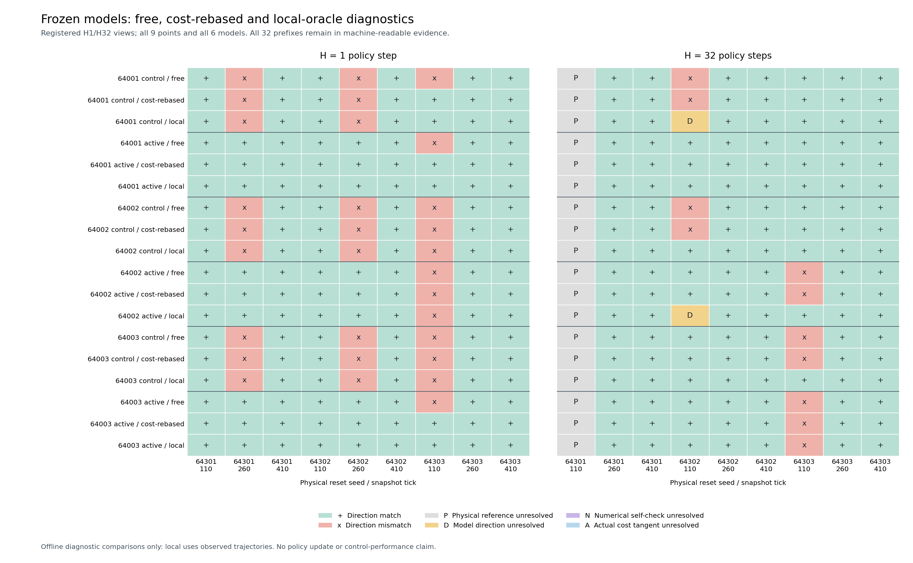

# 67：真实轨迹上仍存在局部响应错误，不能只归因自由递推

**六个固定模型×九点×四档扰动×32步，共6912个一步方向完整完成。** 沿真实轨迹输入计算模型Âδs＋B̂δa，并在真实post-state成本基点投影后，64002 active的首拍总代价仍反号，64003 active的H32局部投影仍反号。这支持继续修正联合响应，同时表明某些自由路径错误受递推/反馈偏离影响；没有证明可部署的梯度修复。

本轮既不调用actor，也不运行物理或训练。真实prestate取同一初始快照加各分支poststate的前31步，previous-action同样逐分支移位；实际F32动作先提升F64再差分。首拍δs=δprevious=0，故该拍可以直接检查实际动作方向的B响应。后续状态/动作扰动相关，只能判断联合响应，不能分别识别真实A、B。

图包含全部六模型和九点。free为原自由闭环梯度，rebased为66保持自由敏感度的成本基点平移，local为67真实轨迹上的一步联合响应投影。后两者使用真实未来信息，属于oracle定位；颜色变化不是控制性能提高。[SVG](assets/joint_response67/joint_response67_all_models.svg)和绘图回执保留。H1/H32是预注册摘要范围，全部32前缀及四尺度数值见机器报告。

|模型|H1同向|H1反号|H32同向（8个已解析参考）|H32反号|H32模型方向未知|
|---|---:|---:|---:|---:|---:|
|64001 control|7/9|2|7/8|0|1|
|64001 active|9/9|0|8/8|0|0|
|64002 control|6/9|3|8/8|0|0|
|64002 active|8/9|1|7/8|0|1|
|64003 control|6/9|3|8/8|0|0|
|64003 active|9/9|0|7/8|1|0|

H32另有一个原物理参考未知（64301/110），六模型全部保留。64001 control和64002 active在64302/110的H32模型投影跨四档变号；64002其中一档还只有4.50e−7，故归为MODEL_DIRECTION_UNRESOLVED，不能挑选其中一档记作通过。

对执行前固定的五个active失败，四档均值如下（判定仍要求全部四档，未用均值替代资格）：

|模型seed|H|物理FD|原自由梯度|66成本重定位|67真实路径局部投影|67状态|
|---|---:|---:|---:|---:|---:|---|
|64001|1|+0.000200612|-0.000163986|+0.000064245|+0.000064383|LOCAL_DIRECTION_MATCH|
|64002|1|+0.000200612|-0.000412650|-0.000154744|-0.000154584|LOCAL_DIRECTION_MISMATCH|
|64002|32|+0.006661050|-0.002193932|-0.003442248|+0.008107708|LOCAL_DIRECTION_MATCH|
|64003|1|+0.000200612|-0.000058630|+0.000117827|+0.000117939|LOCAL_DIRECTION_MATCH|
|64003|32|+0.006661050|-0.028568489|-0.030469259|-0.002168030|LOCAL_DIRECTION_MISMATCH|

这五例均为64303/110。64002 active的H1真实前向/侧向代价项分别为+0.000107307、+0.000119665，局部投影仍为−0.000037593、−0.000089866。首拍不存在累积的δs输入，且真实切向投影与物理FD差仅约1e−13，因而这个实际动作方向上的局部响应错误有直接证据。

64002 active的H32从自由反号变为局部投影同向，支持继续检查自由递推与反馈路径，但不能证明局部幅值准确。64003 active的H32仍错：局部偏航成本项约−0.01660010，真实为−0.00675738；前向项已接近真实（+0.01598187对+0.01589024），侧向项同号但幅度偏小（−0.00090835对−0.00174474）。剩余总方向错误不能笼统归为前向/侧向两个通道，也不能从这些联合投影独立推断A或B。

全32前缀汇总为1492个LOCAL_DIRECTION_MATCH、49个LOCAL_DIRECTION_MISMATCH、180个原REFERENCE_UNRESOLVED和7个MODEL_DIRECTION_UNRESOLVED；这些前缀高度相关，不是1728个独立试验。按实际物理点计，原未知参考共30个“点×前缀”，被六模型复用。没有NUMERIC_UNRESOLVED或ACTUAL_COST_TANGENT_UNRESOLVED。

退化逐项保留：相对66 free，64002 active在64302/110 H31从正确变为局部投影反号，H32从正确变为模型方向未知；相对66 rebased无新增局部反号，但同一H32也新增模型方向未知。完整变化清单在机器报告，未用净计数掩盖新失败。66本身全32前缀新增的4例反号（H4/H5/H30/H31）仍保留原结论。

数值与时序核验：311040/311040个按冻结物理尺度归一化的模型JVP/line-FD通道自检通过；全部Âδs＋B̂δa加和与联合JVP一致，成本总项/分项恢复真实零基线。模型与真实成本投影之差等于同一成本Jacobian对联合状态响应误差的投影；真实成本切向对保存物理FD的总前缀最大余项3.494e-08、分项最大余项4.099e-08，未据此修改任何物理资格。

本轮后可以提出有针对性的训练问题：原辅助项只监督yaw-rate响应，先审核训练集58/62中body-vx/vy响应标签的四尺度稳定性，再决定是否增加一个固定权重的body-vxy辅助项做三seed配对。原yaw系数必须保留，不能通过把三项重新平均而变相减权；新的独立验收轨迹须与已反复诊断的643xx分开。这个候选也不能预先宣称解决64003的H32偏航幅值错误，完整原方向门继续保留。

资源：0物理步、0actor求值、0模型/策略/控制更新，CPU22.037秒，进程墙钟24.282秒，监督器墙钟35.828秒；峰值0.5495GiB，最小有效可用4.5488GiB，无内存事件。13项合成测试及Ruff通过，1121项源码/输入绑定前后复核。无partial、失败执行、覆盖、重试或续跑。

执行源码为`44c67a00422183029f25ba7e5b3320054f509ad2`，[joint-response67 CI](https://github.com/LYHrmer/ddt-d1-rl-lab/actions/runs/41295184720)及[static-checks](https://github.com/LYHrmer/ddt-d1-rl-lab/actions/runs/41295184754)均成功。图另用相同资源守卫生成并检查。证据：[执行前计划](joint_response67_plan_20261101.md)、[源码/输入绑定](experiments67/joint_response67_preregistered.json)、[完整机器摘要和原始文件SHA](../reports/joint_response67_results_20261101.json)、[诊断源码](../tools67/joint67.py)。原始数据保留于`evidence/joint_response67/diagnostic_01/`，约108.11MB。冻结源、48归档、v27及64的REFERENCE_UNRESOLVED完整资格均保持。
