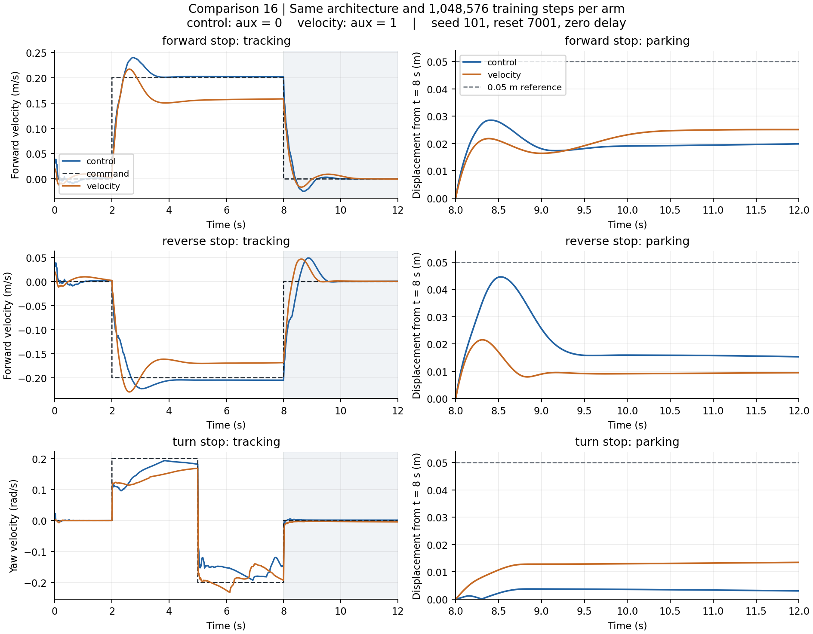

# 本机有界对照 16：执行结果

本轮两组训练、固定评测与比较均完整完成。**同架构的 control（aux_coef=0）表现更好，aux_coef=1 没有展示跟踪和停车的联合收益。** 保留 control 作为后续验证候选，不采用本轮 aux=1 权重。

| 汇总分数，越低越好 | control：aux=0 | velocity：aux=1 | velocity 相对变化 |
|---|---:|---:|---:|
| 跟踪 | 0.187929 | 0.615644 | 增加 227.59% |
| 停车 | 0.101795 | 0.139729 | 增加 37.26% |

判定为 `NO_DEMONSTRATED_BENEFIT`。这两个分数使用[事前方案](local_comparison16.md)规定的原阈值归一化与等权平均；没有在看到结果后更改窗口、阈值或挑选 checkpoint。

## 固定场景的实际表现

两组各有三条完整的 12 s 轨迹，无跌倒或非法支撑；每组均为 **3/3 nominal zero-delay reference pass**。这是 Python SB3 的三个平地、零延迟任务参考阈值，不等于历史完整资格评测、延迟鲁棒性、C++/ROS 或实机资格。

| 稳定跟踪误差 | control | velocity | 原参考上限 |
|---|---:|---:|---:|
| 前进 vx MAE（m/s） | 0.001895 | 0.043914 | 0.06 |
| 后退 vx MAE（m/s） | 0.004939 | 0.030992 | 0.06 |
| 转向 wz MAE（rad/s） | 0.035991 | 0.047880 | 0.08 |

| 任务与组别 | 8–12 s 停车位移（m） | 末秒水平速度（m/s） | 末秒绝对 wz（rad/s） |
|---|---:|---:|---:|
| 前进 control | 0.019867 | 0.000467 | 0.000162 |
| 前进 velocity | 0.025107 | 0.000125 | 0.001239 |
| 后退 control | 0.015347 | 0.000463 | 0.001303 |
| 后退 velocity | 0.009514 | 0.000535 | 0.001995 |
| 转向 control | 0.003034 | 0.000333 | 0.001178 |
| 转向 velocity | 0.013482 | 0.000416 | 0.004018 |
| 原参考上限 | 0.05 | 0.02 | 0.03 |

velocity 的前进末秒水平速度、后退停车位移有所改善，因此不能说所有单项都退化。但其三项稳定跟踪误差均更高，末秒绝对角速度三项也均更高，两个预定汇总分数均变差。

左列是实际速度与指令，灰色区域为 8–12 s 停车窗口；右列为相对 8 s 位置的水平位移模，末点对应表中的停车位移，并非累计路程。图来自已保存的六条 NPZ，只读取数据，没有重新仿真。另提供[SVG](../reports/figures/local_comparison16_tracking_parking.svg)。

## 本机资源与预算

默认 **4 个环境、CPU/Torch/BLAS 单线程、两组串行**。两组均为候选 15 的相同网络、seed 101 随机初始化、未使用教师或旧权重，仅 aux_coef 不同；固定环境与 PPO 配置未改。reset seed 7001，评测延迟为 0。

| 阶段 | 两组合计 policy transitions | native steps | PD updates |
|---|---:|---:|---:|
| 两组预检 | 65,536 | 655,360 | 327,680 |
| 两组正式训练 | 2,097,152 | 20,971,520 | 10,485,760 |
| 两组固定评测 | 3,600 | 36,000 | 18,000 |
| 替代执行合计 | **2,166,288** | **21,662,880** | **10,831,440** |

完整替代执行墙钟 **2,079.871 s（约 34 分 40 秒）**，最低观测有效可用内存 **5,298,982,912 bytes（4.935 GiB）**，未触发 3 GiB 保留线。两组正式各有 256 个完整 rollout，前八个均与各自预检精确一致。每组预检均有八个完整 rollout，跨组首个 rollout 的共同初始化与轨迹一致。

这说明本机在本轮资源条件下承担了这一固定规模任务，不代表任意并行数或其他工作负载都有同样余量。

## 首次权限失败与隔离替代

用户先回复“授权继续”。原工作区的单次顺序器在第一个 worker 启动时遇到沙箱 `forkserver` 的 Unix socket `listener.bind` 权限错误，整轮记录 `FAIL` 并保持关闭。该回执的 `trained_transitions=0`，但 `actual_counts=null`；缺少 worker 计数，不能将物理计数补成零，也没有把未知计数退还为余额。

最小 socket 探针在沙箱内复现 `EPERM`，沙箱外通过；仅运行打印函数的标准库 forkserver 启动/退出探针也在沙箱外通过，均未加载模型。用户随后明确指示“检查问题然后继续”。据此建立独立 worktree `/home/lyh/ddt_comparison16_replacement_20261017`，重新生成与本次指示绑定的准备、静态、授权和冻结记录，使用同样预算上限执行一次。

原失败目录未删除或覆盖，未续训原 attempt。替代执行的 **86 项来源 SHA 与原包完全相同**，源码及科学配置没有改变；忽略目录中的旧冻结输入和网格资产按原字节补齐并核 SHA。真正训练在沙箱外通过原顺序器执行，运行中的计数、资源、前缀、来源与清理规则保持不变。上述预算合计仅描述有完整计数的替代执行，原失败记录仍保留未知计数。

## 证据与后续边界

- [执行摘要](../reports/local_comparison16_execution.json)：授权上下文、两个独立目录、预算、耗时、最低内存、checkpoint 与本地证据 SHA。
- [原比较回执的逐字副本](../reports/local_comparison16_comparison.json)：全部单项指标、资格标志、两个分数与判定。
- 本地完整证据：`/home/lyh/ddt_comparison16_replacement_20261017/evidence/local_comparison16/`；完整权重、NPZ 和日志按仓库约定保留在磁盘。
- 两份独立只读核验通过：全部计数/16 份 worker 关闭快照/21 项登记工件/两组前八回合/86 项来源一致；六条 NPZ 使用 SHA 绑定的原 evaluator 重算，所有指标、分数和判定精确一致。未产生额外模型或物理步。

本轮只能支持单训练种子、单 reset seed、零延迟与当前预算下的探索性选择。control 也采用候选 15 的网络，不能把它与历史不同架构或 8M 预算直接比较并归因。负结果不证明所有速度监督系数或训练预算均无效，也不支持更小系数必然有益的判断。

本轮预算已用完并关闭；保留两组最终权重，后续优先验证 control。完成既定流程后，未启动额外训练、扩展资格采样、ONNX 导出、C++/ROS 或实机运行。
