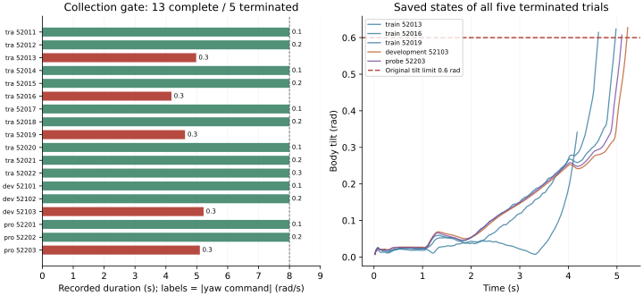

# 52：数据采集未过门，模型梯度问题仍未检验

**正式执行 INCOMPLETE：18 个短试验中 13 个完成、5 个提前终止，预注册要求全部完成，所以拟合未启动。** 三个模型 seed 均为 NOT_RUN；模型更新、策略网络更新、θ 提案均为0。不能把本次写成“三 seed 模型失败”或“SuperMimic 不适用”。[完整机器摘要](../reports/model_gradient52_results_20261031.json)保存原回执、逐段读回、资源记录和全部本地产物 SHA。

## 实际完成了什么

新增独立的可微 actor/观察/历史/滤波/参考整形/FIFO 接口、8步自回归模型拟合、32步闭环反传、同快照真实中央差分以及条件配对评估入口。实现与[五项计划](model_gradient52_plan_20261031.md)在启动前提交为 `cdfb688`。接口准入通过，**这证明实现接口可用，不证明学到的模型或控制候选有效**。

|核验|实际结果|
|---|---:|
|完整25 actor 对64个既有 ONNX fixtures|最大动作差 4.7684e-7，门槛1e-5|
|物理状态→观察 / 传感器映射|最大误差均3.8858e-16|
|参考整形与原实现|最大差0|
|同快照32步重复分支|状态、观察、奖励逐值相同，实际计数未回退|
|新增合成测试|32通过；Ruff通过|
|准入消耗|128策略步 / 1280 native / 640 PD|

首次准入在环境构造前因 Torch 版本身份填写错误而拒绝，0物理、0训练。D1发行包元数据为2.12.1（模块2.12.1+cu130），原计划误写wheel环境的2.13.0。[独立附录](experiments52/runtime_identity_amendment02.md)只修正版本身份；原失败、源码、算法和门槛均不改。新准入通过后才启动首次正式执行。

## 数据和失败全部保留

|角色|完成8秒 / 计划|实际策略步|
|---|---:|---:|
|训练数据|9 / 12|4289|
|开发数据|2 / 3|1061|
|探针数据|2 / 3|1055|
|合计|13 / 18|6405|

|提前终止的角色 / seed|时长(s)|末状态倾角(rad)|超过原0.6rad倾角线|
|---|---:|---:|---|
|train 52013|4.98|0.62372|是|
|train 52016|4.18|0.34110|否|
|train 52019|4.62|0.61444|是|
|development 52103|5.22|0.62762|是|
|probe 52203|5.10|0.60697|是|

图表由已保存 qpos/qvel 数组只读生成，不新增模型调用或物理步。四段末姿态超过冻结倾角线；52016的确切终止原因无法从当前记录确定：采集程序保留了 terminated，但未保存该拍的接触判定信息。不能笼统称为“五次跌倒”。18段的状态连续性、tick、done边界及计数已读回核验。

五次终止都发生在4秒转向反向之后，且都属于原始 `|wz|=0.3rad/s`：该幅度6段中5段终止；0.1和0.2的12段全部完成。开发/探针未加动作噪声也各有失败，所以不能单独归因于训练噪声。33参考整形的1.5倍增益把原始0.3对应到约0.45rad/s稳态内部目标；原资格turn_stop只使用原始0.2。

**本次实验设计的问题是，直接把已验证任务外的采集课程用作模型准入。** 幅度、平移组合、指令时序及噪声没有逐项配对隔离，因此上述关联不能证明某一项的因果。既有33/34资格只覆盖原任务，不能外推到这个新课程。

## 预算与结论边界

正式程序CPU 13.914秒、墙钟14.126秒；监督器含内存准入共26.161秒。最低有效内存6.104GiB，组峰值0.623GiB，无OOM、无swap使用事件。正式消耗6405策略步 / 64050 native / 32025 PD；加准入共 **6533 / 65330 / 32665**。原3个初始化均未开始，真实梯度分支和18场条件对照均未运行。原45项封存身份、wheel v27均保持不变。

原始逐段NPZ、聚合数据、快照、失败及资源记录留在本地 `evidence/model_gradient52/` 和 `~/world_model52_work_20261031/`；Git提交的是可审阅源码、摘要、哈希与图，不包含第三方机器人网格或模型权重。不删失败、不将剩余13段拼成合格候选、不续跑该目录。

此前51的单步拟合结果不足以否定[SuperMimic的多步模型与闭环反传](https://arxiv.org/pdf/2610.28480)。52实现了这些接口的最小版本，但因数据门未通过，**仍没有关于模型梯度能否改善D1控制的实证结论**。没有critic、长周期在线交替或完整策略网络训练，不能称为论文复现。

下一份独立协议应先沿用已验证的原始任务和指令时序，把“采集数据是否可用”与“模型梯度是否正确”分开；逐拍保存实际终止原因。失败终止轨迹也有建模价值，但必须事先定义终止建模与使用规则，不能事后删除失败或放宽52的门槛。当前不修改冻结奖励、课程、策略权重和默认控制器。
