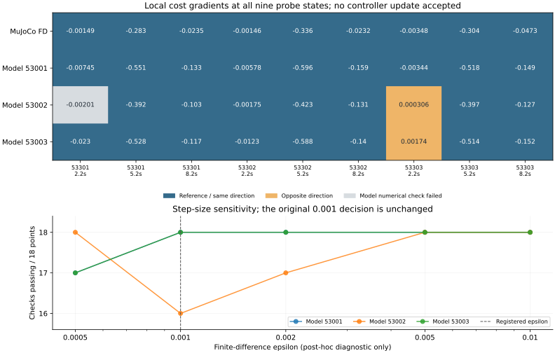

# 53：模型训练与真实梯度验证完成，整体可靠性门未通过

**18/18采集试段、3/3模型拟合和54/54真实分支均完整。三个模型的有效方向匹配为9/9、7/9、8/9，但53002未通过全部数值自检，整体门失败。θ未生成，最终18场控制对照未运行，没有新增控制性能提升结论。** 原始单模型结果全部保留，不选53001替代三初始化判定。

[机器摘要](../reports/model_gradient53_results_20261101.json)包含原执行回执、梯度逐点值、后验诊断全量结果、资源记录和原始文件SHA。启动前的[五项方案](model_gradient53_proposal_20261101.md)与[精确清单](experiments53/model_gradient53_preregistered.json)提交为`49e4efb`；所有53项封存身份复核一致。

## 实际执行

完整25 random权重与33参考整形固定，直接复用原forward_stop/reverse_stop/turn_stop指令和12秒时序；零延迟、平地。训练12条轨迹每任务4条，动作噪声σ=.02；开发和探针各3条原turn_stop，均无动作噪声。没有复用52的失败数据或续跑其目录。

|阶段|实际完成|策略步 / native / PD|
|---|---|---:|
|接口准入|64个actor fixtures；160步映射+同快照32步×2|224 / 2240 / 1120|
|数据采集|18/18完整12秒，训练7200、开发1800、探针1800|10800 / 108000 / 54000|
|模型拟合|3个初始化各1000次更新；每个7116个可采样八步窗口|0 / 0 / 0|
|真实分支|9点×6分支，每分支32步；全54完整|1728 / 17280 / 8640|
|最终配对控制|NOT_RUN，原可靠性门未通过|0 / 0 / 0|
|合计|3000次模型更新；0策略网络更新；0控制参数提案|**12752 / 127520 / 63760**|

正式12528拍的逐拍计数单调、native/policy=10、PD/policy=5；全部日志未记录fallen、非法接触或提前终止。九个真实探针的重复零θ基线精确一致；两种扰动幅度±.005/±.01的差分均满足原可辨识规则。它们是局部短分支，不授予新控制器的完整任务资格。

## 梯度结果与拒绝原因

|模型初始化|开发自检通过|探针自检通过|探针原始同号|探针有效匹配|单模型方向门|
|---|---:|---:|---:|---:|---|
|53001|9/9|9/9|9/9|9/9|通过|
|53002|8/9|8/9|8/9|7/9|未通过|
|53003|9/9|9/9|8/9|8/9|通过|

“原始同号”只比较模型导数与真实差分符号；“有效匹配”还要求模型自检和方向可辨识。原门槛同时要求每模型≥7/9有效匹配、该模型全部探针数值自检通过，以及开发阶段能够生成θ；不能只看7/9这个计数。

三个开发平均梯度分别为−0.219845、−0.168644、−0.218808，均指向增加θ。但53002在开发点`53202 / tick110`的自动微分为+0.000670301、中央差分为+0.000383705，差2.86596e-4，超过原容许1.38370e-4。因此在看真实探针结果之前，提案已经封存为`theta=null`。

53002另在探针`53301 / tick110`出现数值自检失败：差3.38150e-4，容许3.35252e-4。两个模型在`53303 / tick110`还存在方向错误：53002预测+0.000306426，53003预测+0.001744893，而真实差分为**−0.003483694**。所以拒绝不只是一个容差边缘问题。

探针来自3条轨迹的2.2、5.2、8.2秒，相互相关，不能当成9个独立实验；三个模型seed也不是三个独立策略训练seed。没有单seed排名、最好checkpoint选择或控制器替换。

## 模型预测误差与后验诊断

|模型初始化|一步偏航角速度预测RMSE(rad/s)|八步预测RMSE(rad/s)|拟合CPU秒|
|---|---:|---:|---:|
|53001|0.003804|0.017259|7.665|
|53002|0.003927|0.017402|5.638|
|53003|0.003761|0.017758|5.599|

这些是探针集逐试段等权的模型预测误差，八步为0.16秒；不是机器人的跟踪MAE。预测误差接近的模型，在同一个控制敏感度点仍可能反号。本轮没有预注册ridge性能对照，不能声称这些误差证明神经残差胜过ridge，也不能直接与另一仓51的指标作比较。

正式执行结束后，另用保存权重与快照作只读ε敏感性诊断，完整保留0.0005、0.001、0.002、0.005、0.01全部五档结果。原ε=.001的自动微分和差分均逐值复现。每模型开发+探针共18点，数值自检通过数如下：

|ε|53001|53002|53003|
|---|---:|---:|---:|
|0.0005|17/18|18/18|17/18|
|0.001（原判定）|18/18|16/18|18/18|
|0.002|18/18|17/18|18/18|
|0.005|18/18|18/18|18/18|
|0.01|18/18|18/18|18/18|

这说明数值自检对差分步长敏感；尚不能单凭此诊断确定浮点精度是唯一原因。更关键的是，`53303 / tick110`上53002、53003在全部五档ε下的模型差分都为正，与真实负梯度相反。**既有数值自检的敏感性，也有模型的局部方向偏差。** 未选择某档ε重判53，未修改θ提案、任何门槛、模型权重或正式回执。

后验诊断594条模型展开、19008个模型前向步、54次自动微分，CPU17.740秒，新增训练/物理均为0；这些模型推理单独计账，不计成真实仿真步。

## 资源、失败项与仍未解决的问题

正式程序CPU51.978秒、墙钟54.140秒；含启动内存准入的监督器64.842秒。三个模型拟合合计18.901秒。最低有效内存4.271GiB，组峰值0.925GiB；MemoryHigh/Max与OOM事件均为0，swap0限制生效。全程CPU单环境、单线程、Nice10；没有停止其他程序。

正式产物89,662,265字节（85.509MiB），低于128MiB上限；含准入和后验诊断的原始文件共91,145,587字节（86.923MiB），完整保留在 `evidence/model_gradient53/`。检查/资源日志在 `~/world_model53_work_20261101/`。公开提交保存源码、图和含哈希的摘要，不分发第三方网格或模型权重。

测试交接期间，首次合成检查有1项未完成夹具失败、47项通过；封存前完成夹具后48/48通过，Ruff通过，两份检查日志均保留。真实准入和正式执行没有异常或partial。流程COMPLETE只表示按协议完成到拒绝分支，**不表示控制改进成功**。

下一步仍需解决局部动作敏感度与真实物理不一致，以及小梯度的数值核验稳定性。它们应在独立协议中先作诊断；本轮不追加奖励、课程、模型规模或步长搜索来追求过门。当前证据支持继续研究模型梯度路线，但还没有稳定转化为控制收益的证明。这是受SuperMimic启发的局部验证，未实现critic、完整策略网络更新或长期在线交替，不能作为完整论文复现。
