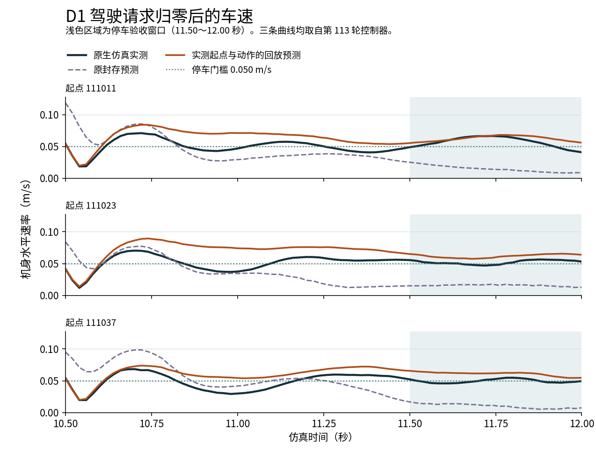

# D1 停车时，四轮为什么还在带动车身后退？

第 113 轮的三段原生仿真都达到了 1.5 m/s 巡航速度。驾驶员已经松开前进指令，停车末半秒的 75 个控制周期里，原厂策略仍每拍给四轮负的速度目标。三个起点的机身分别后退 28.7、26.1、24.8 mm。期间四轮均未触及 12 N·m 的限矩，三个起点的单轮首个伺服力矩最大绝对值分别为 1.16、1.12、1.13 N·m。因此，第 114 轮只在驾驶请求归零后取消四轮共同的速度目标。[第 113 轮成绩](high_speed_world113_results.md) · [预设判据](parking114_proposal.md)

## 同起点的原生停车对照

三组均完整行驶 12 秒。给伺服的目标首次改变前，每组的 527 个连续机身和关节状态与旧臂逐值一致。驻车处理在第 525 拍改写下发目标，经一拍延迟在第 526 拍生效。三次巡航速度和三个单米分段速度均与旧臂相同。只改变共同轮速目标，原来三次超限的停车峰值都降到了 0.050 m/s 以内。[原生入口](../tools114/native.py) · [动作历史和评分的独立复核](../tools114/closed_results.py)

| 开发起点 | 巡航均速（m/s） | 原停车峰值 → 修复后（m/s） | 原前向位移 → 修复后（mm） |
|---|---:|---:|---:|
| 111011 | 1.5270 | 0.06654 → 0.01410 | −28.71 → −6.22 |
| 111023 | 1.5178 | 0.05659 → 0.00414 | −26.08 → −0.61 |
| 111037 | 1.5206 | 0.05487 → 0.01078 | −24.78 → −4.49 |

停车峰值取 11.50～12.00 秒全部 26 个状态端点的机身水平速率最大值。前向位移按相邻两状态的位置差在当时机身航向上投影后累加，负值表示后退。停车达标的三条轨迹仍有毫米级位移。[停车窗口与原评分](../tools110/course.py) · [三条配对基线](../reports/speed_world113)

## 独立起点的停车验收

开发 3/3 全部通过后，用同一套控制器在三个预留起点各跑一次。三个盲测起点均通过全部原门槛。这里报告盲测候选的绝对成绩，配对改善幅度见上表。[事前登记](experiments114/closed_loop.json) · [六段逐项评分和资源回执](../reports/parking114/closed_loop.json)

| 盲测起点 | 中央三米均速（m/s） | 停车末半秒峰值（m/s） | 同窗前向位移（mm） | 峰值时刻（s） |
|---|---:|---:|---:|---:|
| 114211 | 1.5271 | 0.01253 | −5.33 | 12.00 |
| 114227 | 1.5312 | 0.01175 | −4.73 | 12.00 |
| 114239 | 1.5243 | 0.00851 | −3.77 | 12.00 |

六段均走满 12 秒，18 个单米分段均速为 1.5136～1.5378 m/s，轮迹在规定路段的最大横向偏移为 0.6984 m。六段均记录到四轮承重驶出，全程无跌倒或非法支撑。三个盲测峰值都在最后一个采样点，此时机身仍略向后移动。更长时间的驻稳表现和复合坡路上的停车能力仍待验证。[公开轨迹](../reports/parking114) · [复合路线此前的成绩](lidar_compound111.md)

合计 3,600 个策略决策、18,000 次伺服更新、36,000 个物理子步、432 包测距和 449,280 次射线查询。世界模型与策略训练均为 0。六个实际启动的仿真单元中，启动时有效可用内存最低 8.85 GiB，采样最低 5.55 GiB，单元峰值最高 396.6 MiB。114227 的首次准入在启动子进程前因内存降至保留线以下退出，原守卫记录已保留。该起点只有一次实际仿真，六段均有完整轨迹。[准入失败回执](../reports/parking114/resources/guard_native_114227_01/report.json) · [预算与证据索引](../reports/parking114/closed_loop.json)

**视频看前轮与橙线。** 两侧回放预定开发起点 111011 的原生轨迹，左侧是第 113 轮控制器，右侧仅开启共同轮速归零。仿真到 11.50 秒时，地面橙线各自标出当时的前轴位置。到 12.00 秒，左侧前轴后移 26.7 mm，右侧后移 4.7 mm。视频标记取前轴，上表的位移取机身。[10.12 秒并排慢放](assets/parking114.mp4) · [影片与轨迹的来源记录](../reports/parking114/film/video.json)

在仓库根目录运行 `python3 -B -m tools114.closed_archive`，可用公开轨迹逐项复核新旧两臂的一拍延迟、停车速度、准入记录和影片来源。[公开数据核验入口](../tools114/closed_archive.py) · [原生轨迹归档单元](../reports/parking114/publication/guard_publish_native_01/report.json)

## 驻车代码改了哪个量

前进行驶结束，驾驶员请求的纵向、横向、转向速度都归零时，执行层计算当前四个轮速目标的均值，再从每个目标中各减去这个均值。四轮因此保有转速差，能够分别调节。初始静止时不触发驻车。倒车、横移、转向或恢复前进的第一拍都会退出驻车。触发条件读取驾驶员请求，策略输入中还可以带有编码器补偿。[驻车计算](../tools114/control.py) · [全身策略与伺服之间的接线](../tools114/native.py)

例如，在起点 111011 的 10.50 秒，原始四轮目标约为 **+0.893、−5.234、−0.871、+0.795 rad/s**，共同目标为 −1.104 rad/s。修正后分别为 **+1.997、−4.130、+0.233、+1.900 rad/s**。全身策略仍以 50 Hz 产生原始动作，腿部位置 PD 和轮速伺服以 250 Hz 工作，动作保留一拍延迟。[执行接口测试](../tests/test_stop114.py)

三份存档共 1,800 拍。在重构的执行队列中，每组的前 525 拍都保持原动作，第 525 拍改变目标，第 526 拍才送入伺服。以第 0 拍为复位时刻，每条轨迹各有 75 拍在驻车状态。四轮共同目标的逐拍最大残余为 5.01×10⁻⁸ rad/s，各轮之间相对速度差的最大误差为 1.86×10⁻⁷ rad/s，12 个腿目标的误差为 0。存档重构的上一拍原始动作和十帧动作历史也逐项一致。[存档接线核验](../tools114/audit.py) · [能识别错误输出的回归测试](../tests/test_stop_audit114.py)

把修正目标和存档中的同一组轮速编码器读数代入原轮速伺服公式，最后半秒的四轮平均力矩分别从 −0.425、−0.400、−0.395 N·m 变为 +0.252、+0.244、+0.217 N·m。修正后的平均力矩指向抵住后溜的方向。这项离线计算只替换每拍第一次伺服更新的目标，轮速与接触状态都取自旧轨迹。前面两张表记录了修正后实际产生的车身运动。[相同轮速下的力矩复算](../reports/parking114/replay.json)

## 固定动作能解释多少预测误差

从第 113 轮的三个起点取出 10.50 秒的状态和随后 75 拍真正送入伺服的动作。每份冻结模型各回放四次，分别选用原预测或实测的起点、原预测或实测的动作。每一列都用相同的地面、路线和模型参数。下表给出 **11.50～12.00 秒的机身水平速率峰值**，单位 m/s，门槛为 ≤0.0500。[回放实现](../tools114/replay.py) · [逐拍状态、原始结果与误差](../reports/parking114/replay)

| 起点 | 原封存预测 | 只换实测起点 | 只换实际动作 | 起点与动作都换 | 第 113 轮原生实测 |
|---|---:|---:|---:|---:|---:|
| 111011 | 0.0252 | 0.0259 | 0.0675 | 0.0681 | **0.0665** |
| 111023 | 0.0177 | 0.0177 | 0.0637 | 0.0656 | **0.0566** |
| 111037 | 0.0170 | 0.0142 | 0.0768 | 0.0657 | **0.0549** |

只校正 10.50 秒的起始状态，三个模型依旧把实际超限判成通过。保留原预测的起点，只换随后执行的腿轮动作，三个判断全部转为超限。再把起点也换成实测，三个峰值都高于实测，分别相差 0.0016、0.0091、0.0108 m/s。这表明在这三段存档上，误判对后续动作序列特别敏感。后续若优化世界模型，值得查清它在制动阶段把哪些状态传给了全身策略，使策略给出不同的动作。三条回放都使用了事后取得的执行器目标，前瞻预测能力仍以第 113 轮封存结果为准。[四种组合的原始数值](../reports/parking114/replay/report.json)

此前的离线阶段在三个起点共完成 900 个模型步，当时原生停车的记录为 0/3。前三次资源准入在回放子进程启动前退出。第四个单元完成全部回放，启动时有效可用内存 5.70 GiB，运行最低 5.60 GiB。[回放与资源记录](../reports/parking114/replay.json) · [闭环验收方案](parking114_proposal.md)

在仓库根目录运行 `python -B -m tools114.results`，即可用 NumPy 从公开数组复核 900 个已保存的状态转移、四组峰值和驻车动作。此命令读出实际预算与内存记录，可在没有厂家权重的环境运行。[公开数据核验入口](../tools114/results.py)

速度图读取三条原生存档和同一份已核验回放。归档与作图的第一次准入因可用内存不足退出，第二个单元完成了归档与作图。[速度图与来源校验值](../reports/parking114/figure.json) · [归档单元回执](../reports/parking114/publication)

旧臂的三次停车峰值处，仅沿路线向后的速度就各自超过 0.050 m/s。上述原生对照确认了共同倒车目标对这条路线的影响。世界模型能否自行预测这次干预的收益，仍要由独立预测和实测检验。[逐起点速度分量、开源依据与短窗验证方案](parking114_research_next.md)
