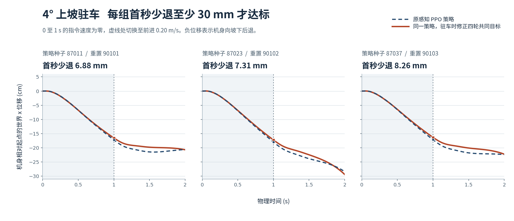

# D1 在 4° 坡上能否驻车，WBC 给出的目标是否可执行？

同一套带测距的全身 PPO 和关节 PD 做了两项检验。六段闭环仿真中，修正四轮共同后退目标使三个配对的首秒后溜各减少 6.88～8.26 mm，均低于 30 mm 门槛。另一项离线测试把 180 帧历史观测交给全身逆动力学 QP。经独立力学复核，**3/180 帧满足全部硬约束**，三帧都是坡上刚重置的静止时刻。[事前登记](experiments90/stand_wbc.json) · [完整结果和独立复核](../reports/stand_wbc90.json)

## 六段实测驻坡轨迹

每对使用第 87 轮的一份完整感知 PPO 权重和同一个新重置种子，从坡上 x=1.10 m 起步。首秒指令为零，随后给出 +0.20 m/s。修正组在首秒只抵消四轮目标的负均值，所有轮加相同的可行增量。两组均经过原来的一拍动作延迟和底层伺服。首秒后溜取起点至 1.00 秒端点的世界 x 位移。第二秒另列，便于判断收益能否延续。[实验入口](../tools90/stand90.py)

| 策略 / 重置种子 | 原策略首秒后溜 | 修正后首秒后溜 | 首秒少退 | 第 2 秒净后退，原 / 修正 |
|---|---:|---:|---:|---:|
| 87011 / 90101 | 172.26 mm | 165.38 mm | 6.88 mm | 33.70 / 41.50 mm |
| 87023 / 90102 | 179.70 mm | 172.39 mm | 7.31 mm | 104.49 / 121.55 mm |
| 87037 / 90103 | 171.49 mm | 163.23 mm | 8.26 mm | 52.59 / 59.27 mm |

修正实际到达伺服，三组首秒分别有 38、37、38 拍收到正增量，平均增量为 0.449、0.469、0.448 rad/s。六段均跑满 100 拍，跌倒、非法接触、轮力矩饱和均为零。独立读回用原权重重算了 600 个决策、9,600 个动作分量，逐字节匹配。这一干预对后溜有小幅影响，三个种子的车辆在前进指令期间都继续净后退。[逐组位移、动作与计数](../reports/stand_wbc90.json) · [读回实现](../tools90/readback90.py)

## 离线 WBC 的 180 帧

平地起步、坡上驻车、前轮触坡各取 60 帧。三份轨迹来自第 89 轮首次 PPO 更新前的实际随机采样。第 87 轮父策略在当时的 627 维本体观测与 16 个测距特征上重算确定性动作，动作历史保留当时实际下发的值。关闭 WBC 的旁路 180/180 逐字节返回原动作。启用 WBC 时，每拍由编码器、IMU、指令和延迟 40 ms 的八束测距估计支承状态，求解 22 个广义加速度、四个三维接触力和 16 个力矩，再映射到 12 个腿角与 4 个轮速目标。可达性按当前估计姿态及冻结伺服核算。所有 WBC 目标都保存在离线记录中。[估计与采样](../tools90/shadow90.py) · [原 QP 与伺服映射](../tools90/wbc90.py)

| 阶段 | 预注册帧数 | 原实现给出目标 | 独立复核满足所有硬约束 |
|---|---:|---:|---:|
| 平地驻车切换前进 | 60 | 47 | 0 |
| 坡上驻车 | 60 | 43 | 3 |
| 前轮刚触坡 | 60 | 44 | 0 |
| **合计** | **180** | **134** | **3** |

43 帧达到 OSQP 的 4,000 次迭代上限，另有 3 帧在动作回算后的动力学残差超过 `1e-4`。余下的 134 帧中，131 帧在独立计算轮缘滚动和法向加速度时超限。137 个数值解的最大滚动和法向残差分别为 0.6281 和 0.9201 m/s²。用递归逆动力学和接触力投影重建的刚体动力学残差，与原计算最多相差 3.55×10⁻¹⁴。独立复核只读取保存的姿态估计、动作和解，执行了 0 次 QP 求解。[独立力学复核](../tools90/mechanics_check90.py) · [逐帧输入、输出、拒解原因与耗时](../reports/stand_wbc90_frames.jsonl.gz)

**轮缘滑动时的加速度。** 原实现在 MuJoCo 3.3.0 的空间加速度与世界坐标下材料点的线加速度之间漏加了 `ω × v`。其中 `v` 是轮缘材料点速度。纯滚动时它为零，带着滑速转动时会影响硬约束。把这一项从独立测量中扣回，137 个数值解的滚动、法向残差与旧实现的最大差都小于 4.5×10⁻¹⁰ m/s²。单独的修正版经过浮基、带关节的四轮合成模型验证。在单轮、对角双轮、四轮和静止对照中，修前最大误差为 3.124 m/s²，修后为 2.05×10⁻¹⁰ m/s²。修正版在这 180 帧上的机械可行率仍待验证。[修正版](../tools90/rolling_bias90.py) · [可公开运行的合成回归](../tools90/check_rolling_bias90.py) · [MuJoCo 3.3.0 的空间加速度转换](https://github.com/google-deepmind/mujoco/blob/3.3.0/src/engine/engine_support.c#L1249-L1256)

**支承估计。** 有前一拍端点的 177 帧可与冷重建的接触力比较。708 个轮次里，640 个承重、68 个失载，估计器全部判为承重。720 个轮法向中，120 个由空间位置包住轮位的实测地形片段提供，均为刚触坡时的前轮，其余 600 个由编码器几何估计。用同一车身坐标比较，可评分承重轮的平均法向误差为 1.173°，机身前向速度估计 RMSE 为 0.0151 m/s。四轮实际均承重的 122 帧中照样有 31 帧被原实现拒绝。支承误判和求解收敛需要分别验证。[接触与速度评分逐帧数据](../reports/stand_wbc90_truth.jsonl.gz)

**单核耗时。** 180 帧的估计、名义模型装配、冷启动求解和原实现的检查合计 P50 / P95 / P99 / 最大为 3.50 / 8.68 / 9.39 / 9.61 ms，超过 20 ms 的有 0 帧。一次性导入、建模及控制器初始化为 1.496 s。三份归档解压、验证及载入策略分别为 1.955、0.070、0.070 s。每帧另记 PPO 推理时间，文件读写和事后真值评分位于计时窗口之外。端到端实时控制仍需闭环测量。[计时边界及每次超时索引](../reports/stand_wbc90.json)

## 复现与失败记录

预注册固定了 3 个新重置种子、6 段 2 秒仿真及 180 个归档帧索引。六段共 600 个策略步、3,000 次伺服更新、6,000 个物理子步。本次新增训练为 0。两个测量单元串行在一个 CPU 核运行，Nice 10、MemoryHigh 2 GiB、MemoryMax 3 GiB、swap 0。启动有效内存分别为 6.91、7.28 GiB，运行中最低为 6.09、6.25 GiB。驻坡单元峰值为 0.93 GiB，WBC 单元峰值为 1.13 GiB。[资源与测试回执](../reports/stand_wbc90_checks.json)

首个只读结果校验在法向均值处中止。估计器以本回合航向为零，第一次读回直接比较了两个世界坐标下的法向，得到 1.17989°。独立读回从原归档提取对应的姿态四元数，把两边的法向各自转到车身坐标，重算得到 1.172995689°，与逐帧评分一致。首次失败、独立读回、原始求解以及全部拒解均有单独记录。[失败及复核回执](../reports/stand_wbc90_checks.json)

干净检出后，CI 可以核验公开的逐帧数据和合成模型；原 D1 轨迹与权重保存在工作站。两组测试各自单独调用 pytest，合成运动学用例运行在允许创建原生模型的测试入口。[CI 依赖和运行命令](../.github/workflows/stand-wbc90.yml) · [带资源守卫的工作站入口](../tools90/launch90.py)
