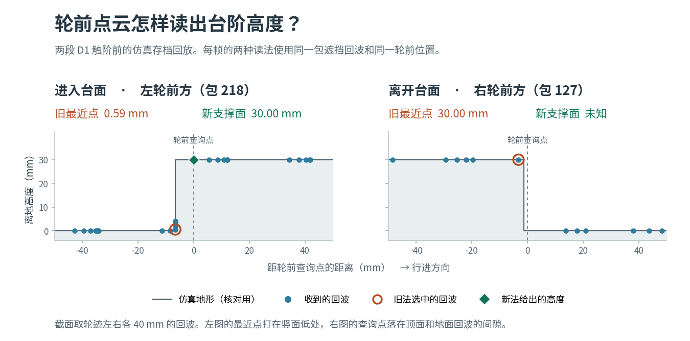

# 轮前该读地面、竖面还是台面？

D1 新增了一个单帧点云读数器。它给出左右轮前各自的支撑高度，证据不足的一侧返回未知。在两个未参与本轮算法设计的来源上，实际齐平却报成有高差的次数从 **8/352 降到 0/352**。但有 12 包无法给出高度。按事前约定把未知计为失败，遮挡视野总合格数由 **499/512 降到 498/512**。两份来源仅一份通过全部门槛，默认读法继续使用已归档的最近点算法。[冻结方案](experiments105/support_surface.json) · [两臂全部逐包预测](../reports/surface105/predictions.npz) · [分组验收报告](../reports/surface105/report.json)



图中用了上一轮已经查看过的两帧，只用于解释算法。左图中旧法选中了竖面低处的 0.59 mm，新法报告 30.00 mm 的台面。右图中旧法选中了顶面的回波，报出 30.00 mm。新法找不到足以确定后缘位置的回波，右轮读数为未知。两臂只接收点云和轮前查询坐标，图中地形轮廓来自离线核对。[作图入口](../tools105/plot105.py) · [上一轮的问题定位](jeplo_motion_compensation104.md)

## 同一帧点云怎样读

1. 左右轮分开，在各自查询点周围的 15 cm 内读取经过同一套轮速和 IMU 运动补偿的回波。如果一张平面能在 2 mm 残差内解释这些点，且倾角不超过 35°，就按这张平面求轮位高度。查询点紧贴已测区域时，只在半个轮宽内有近点、一个轮宽内至少四个点在两个水平方向都有分布且彼此一致的条件下允许小范围外推。
2. 遇到高度跳变时，先找有二维覆盖的高度层。回波若落在两个高度之间、在水平面中排成窄线，且观测范围覆盖查询点，可以用它们标出台沿。竖面本身的中间高度没有承重面的含义。对于同一局部凸起，只在上层的观测范围内读台面，在同一侧的地面回波能围住查询点时读地面。
3. 一侧缺乏足以选面的证据时保留未知。程序另提供两个单轮高度，只有两侧都得到读数才计算左右高差。2 mm 是拟合平面的参数，验收沿用原来的 10 mm 容差。相叠表面、回波稀疏、坡面、斜向台沿和左右镜像都有合成回归样例。[读数实现](../tools105/surface105.py) · [几何回归测试](../tests/test_surface105.py)

ETH 的局部平面提取会同时检查拟合误差和法向，PCL 的有组织点云边缘检测会区分深度跳变和找不到对侧回波的边界。本轮借鉴这两项判断，D1 直接处理重力对齐的 XYZ 回波。[ETH 平面分割](https://github.com/leggedrobotics/elevation_mapping_cupy/blob/20a8a26b67a995b43eb44c23568854d1fed82a52/plane_segmentation/convex_plane_decomposition/src/sliding_window_plane_extraction/SlidingWindowPlaneExtractor.cpp#L107-L149) · [PCL 遮挡边界处理](https://github.com/PointCloudLibrary/pcl/blob/fd39f32af932d50e033dba17b29e6d5fa4f64255/features/include/pcl/features/impl/organized_edge_detection.hpp#L176-L215)

## 固定算法后的对照

两臂共享 40 ms 运动补偿、查询时刻、回波、遮挡和容差。补偿使用送达时已收到的轮速、陀螺和重力观测，两臂沿用原归档的机身坐标系轮迹查询。推理入口只接收 XYZ 与查询点。两臂写完全部预测后，评分器才打开地形高度标签。89011 和 89023 来自第 101 轮的旧训练档，用于过往模型训练，本轮几何算法只在 89037 和人工几何样例上开发。表中计数为“最近点 → 新算法”的合格包数，未知计失败。[输入来源与逐束核验](../reports/surface105/input_audit.json) · [封存及评分实现](../tools105/score105.py)

| 验证来源，遮挡视野 | 进入台面 | 离开台面 | 高差不变 | 全部到达包 | 新法未知 | 事前验收 |
| --- | ---: | ---: | ---: | ---: | ---: | --- |
| 89011 | 14 → 16 / 16 | 2 → 2 / 6 | 216 → 216 / 218 | 248 → 250 / 256 | 5 | 通过 |
| 89023 | 13 → 13 / 16 | 5 → 3 / 7 | 217 → 216 / 217 | 251 → 248 / 256 | 7 | 未通过 |
| 两来源合计 | **27 → 29 / 32** | **7 → 5 / 13** | **433 → 432 / 435** | **499 → 498 / 512** | **12** | **1/2 通过** |

遮挡下，45 次前轮查询点进出台面的切换，两种算法各通过 34 次。新法在进台多读对 2 次，也在离台少读对 2 次。13 次离台中有 **8 次**返回未知。清晰视野各组计数与遮挡相同，两种视野共用物理回波。全部到达包包含各序列的首包，切换和不变两组只统计存在前一包的时刻。

原来报错的 13 包有 3 包被纠正、9 包变为未知、1 包仍然报错。原来合格的包有 3 包变为未知、1 包出现新的错误读数。新法仍有两次把实际 30 mm 的单侧台面读成齐平，分别是验证档第 191 和 538 行，均进入了用地面回波判断低层的分支。仅通过检查“已给出高度的包”会漏掉 12 个失败。下一项值得验证的是这 8 次离台未知，在较早的已送达点云中是否能看到后缘另一侧的地面。若能看到，可单独比较加入上一帧的效果，否则需改变可见范围。[逐行预测](../reports/surface105/predictions.npz) · [完整失败项](../reports/surface105/report.json)

## 开发记录与复算

初稿仅允许在实测支撑面内部插值，在已见 89037 遮挡视野上得到 149/160 合格、11 包未知。加入有范围限制的单平面外推与跨轮宽的竖面检查后，同一批为 154/160、6 包未知，最近点为 156/160。这一来源不参与验收。最终算法和门槛在提交 `93e3098` 冻结，随后只做一次正式回读。[保留的初稿失败](experiments105/design_smoke_v1.json) · [冻结提交](https://github.com/LYHrmer/ddt-d1-rl-lab/commit/93e3098ef6e861fded374688f758b97a0de1a831)

本轮复用 13 个触阶前回合、208 个原生运动窗口和 672 份物理点云，共 1,344 个清晰或遮挡视图。新增射线、动力学积分、世界模型更新和策略更新均为 0。正式回读单核、Nice 10、MemoryHigh 2 GiB、MemoryMax 3 GiB、零 swap。数据支持评估感知读数，机器人触阶后的运动和越障成功率仍需闭环测量。[资源回执](../reports/surface105/resources.json) · [工件校验](../reports/surface105/seal.json)

```bash
python -B -m tools105.run105 check
python -B -m pytest -p no:cacheprovider -q tests/test_*105.py
```
