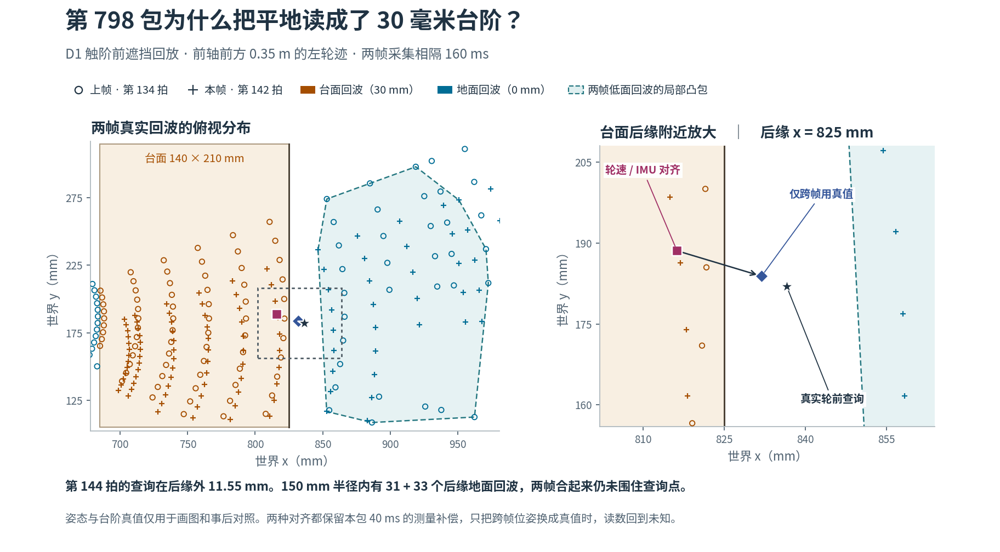

# 上一帧看见的低地面，能用来给现在的轮前位置定高吗？

两个已看过的 D1 来源上，单帧遮挡读数合格 498/512，查上一帧合格 501/512。6 次从“未知”改成数值的读数中，3 次正确，3 次错误。来源 89011 的离台样本没有获益，89023 在离台时补对 1 次、补错 2 次。**两个来源都没通过预设门槛。** 候选保留为离线工具。这里的“轮前”指前轮轴前方 35 cm 的左右轮道预瞄点，13 个原生回合都截自触阶之前。[冻结提交](https://github.com/LYHrmer/ddt-d1-rl-lab/commit/eb1745d490802e91ce720ea2836504d8bccad626) · [逐包读数](../reports/history106/predictions.npz) · [完整分组及失败记录](../reports/history106/report.json)

## 论文如何改变了读数方法

- **JEPLO** 在四足机器人上用约 20 Hz 的最近五扫生成球面深度图。作者明确保留运动畸变，每个角度格取最短距离，训练时预测下一次传感器表征，策略用 PPO。它验证了这条管线的四足越障能力。D1 的两包间隔已达 160 或 180 ms，为了检验 10 mm 的高差读数，这次只借用“观察历史”，单独校正轮前位置。[论文第 II 节](https://arxiv.org/html/2609.15770v1#S2) · [作者的深度图实现](https://github.com/ASIG-X/JEPLO/blob/460e2272907af053d6e66b57fec71fdbe6ca1774/deployment/lidar_depth_pub/lidar_depth_pub.cpp#L391-L451)
- **Fankhauser 等的高程图**把里程计和定位不确定性传到旧观测。这个区别直接影响台沿的读数，把查询点平移约一厘米就可能从低地面移到高台面。D1 因此在评分时另算了一次精确姿态对齐，保留同一个表面算法和相同的点云。测量算法只接收轮速、IMU 和回波。[论文与作者版本](https://doi.org/10.1109/LRA.2018.2849506)
- **OctoMap** 把首回波及其前方射线中的自由空间分别处理。回波后方缺少这条射线提供的观测。D1 据此把“低地面在附近有回波”和“这些回波在平面上围住预瞄点”分开计数。将来接入 **SuperMimic** 时，可以把可观测性连同地形特征给世界模型。原论文的可微动力学回答的是“改动作会怎样改变运动”。D1 的轮地响应梯度和闭环控制仍有各自的验收。[OctoMap 论文](https://www.arminhornung.de/Research/pub/hornung13auro.pdf) · [SuperMimic 原文 v3](https://arxiv.org/abs/2610.28480v3)

## 一次只改上一包的使用方式

当前包能给出数值时，两臂逐包完全一致。当前未知时，候选把今天的两个预瞄点投到上一包的采集坐标系，再用冻结的第 105 轮读数器求左右高差。每个高差的两侧都从同一包读取，共同的机身高度平移在相减时抵消。旧包必须来自同一回合、地形布局和遮挡条件。序列首包无历史，旧包本身也缺少支持时继续输出未知。[读数实现](../tools106/history_readout.py) · [50 Hz 轮速和 IMU 时序](../tools106/history106.py)

验收沿用含边界的 10 mm 与左右方向门槛，未知计为失败。两个来源须分别至少补对一次遮挡离台，且各自的清晰、遮挡全批均不能发生错填。这两份来源已在第 105 轮查看过，回读回答的是已知故障能否被修复。每一清晰视图与其遮挡视图共享原生运动和同一批首回波。[事前方案](experiments106/history.json) · [第 105 轮结果](support_surface105_results.md)

| 两个来源的 512 个遮挡视图 | 合格 | 未知 | 有数值但错误 | 进入台面合格 | 离开台面合格 |
|---|---:|---:|---:|---:|---:|
| 原最近点读数 | 499 | 0 | 13 | 27/32 | 7/13 |
| 第 105 轮单帧表面 | 498 | 12 | 2 | 29/32 | 5/13 |
| 上一帧重新查询，轮速和 IMU 对齐 | 501 | 6 | 5 | 29/32 | 6/13 |
| 仅将跨包位移换成仿真真值，诊断用 | 502 | 8 | 2 | 30/32 | 6/13 |
| 直接延用上一包数值，诊断用 | 500 | 0 | 12 | 29/32 | 5/13 |

89011 每个视图条件从 250/256 到 251/256，遮挡离台仍是 2/6。89023 从 248/256 到 250/256，遮挡离台从 3/7 到 4/7。它新增的 3 个数值错误发生在第 698、798、927 行，分别是把 −30 mm 读成齐平，以及两次把齐平读成左高 30 mm。替换成跨包真位姿后，这 3 次错填消失。开发来源 89037 的遮挡合格从 154/160 到 157/160，离台仍为 0/2。若沿用第 105 轮与最近点比较的门槛，仍只有 1/2 来源通过。[分来源和阶段计数](../reports/history106/report.json)

## 台面后缘的八个未知

8 个遮挡样本都核实了前一预瞄点在高台，本次预瞄点已越过后缘 2.32～13.83 mm，仍在同一侧轮道宽度内。每个旧包在距目标 150 mm 内都有真正位于后缘后方的低地面回波，最近的一点距目标 8.02～39.04 mm。只看前包、只看本包、两包合用，局部低地面回波能从四周围住目标的分别是 **0/8、0/8、0/8**。这是对归档 XY 插值条件的检查。单帧读数器还允许有界的短距离平面外推，所以也可能在回波未围住的位置读对。[逐例坐标和回波数](../reports/history106/report.json) · [轮道与凸包判定](../tools106/footprint106.py)

第 798 行是评分后选取的第一个离台错填。后缘在世界坐标 x = 825.00 mm，部署可用的轮速和 IMU 把上包查询放在边前 8.75 mm。只把跨包位移换成真值，查询移到边后 6.91 mm，算法返回未知。仿真送达时的真实查询点在边后 11.55 mm。那一次读出的 +30 mm，足以把已经结束的台面误报成仍向前延伸。



另三条轨迹 87201、87202、87203 保存了点云及仿真位姿，缺少当时策略收到的完整 IMU 序列。两臂都使用真位姿来单独核对几何方法。在 108 个遮挡视图中，合格从 103 到 104，5 个未知变成 3 个，其中补对 1 次、补错 1 次。6 个离台事件只来自 3 条运动轨迹。即使跨包对齐准确，外推也会读错一层。[次级几何对照代码](../tools106/geometry100.py) · [独立来源结果](../reports/history106/report.json)

## 能否通过改变采样看清后缘

主验收结束后，另做了一个解析检查。在每个难例的前后两次采集时刻，从左右传感器实际安装点分别向真实预瞄点连一条直线。32 条线中，27 条穿过 30 mm 台阶实体，5 条与台阶相离。**6/8 个难例的四条线全部被台阶挡住。** 第 798 行有一条线畅通，第 831 行四条均畅通。畅通方向能否产生首回波，还取决于实际发射角、遮挡掩码和机器人本体。本项使用了仿真位姿和障碍尺寸，只解释已评分样本。[32 条理想视线、坐标及相交长度](../reports/history106/sightlines.json) · [线段与盒体判定](../tools106/sightline106.py)

下一项优先检验**传感器的前后安装位置**。在机身可安装范围内选定一个前移量，固定传感器俯角、束数、35 cm 预瞄距离与读数器，先计算能给原先四路全挡的 6 例打开几条视线。如果这些位置仍全部被挡住，就省去新采集。如果视线打开，再用独立轨迹比较实际轮道回波覆盖，逐项记录错报与未知。转动同一安装点的发射方向可以改变角度采样，却无法绕过已经挡住理想直线的台阶。后续接入全身策略时，可以给每侧预瞄高度附上“已观测／未知”标记，并把世界模型推断的高度单列。闭环中是否少误触阶，仍要在机器人真正接触障碍后测量。

## 复核

主回放覆盖 1,344 个存档视图，次级几何对照覆盖 216 个。新增原生决策、传感器采集、世界模型更新和策略更新均为 0。首次内存准入降至 1.99 GiB，子进程未启动。独立的新单元用时 11.60 秒，最低有效可用内存 8.68 GiB，峰值占用 72.37 MiB。[首次准入回执](../reports/history106/admission_01.json) · [完整运行的资源回执](../reports/history106/resources.json) · [封存清单](../reports/history106/seal.json)

```bash
python -B -m pytest -p no:cacheprovider -q tests/test_*106.py
python -B -m tools106.run106 check
python -B -m tools106.sightline106 check
```
