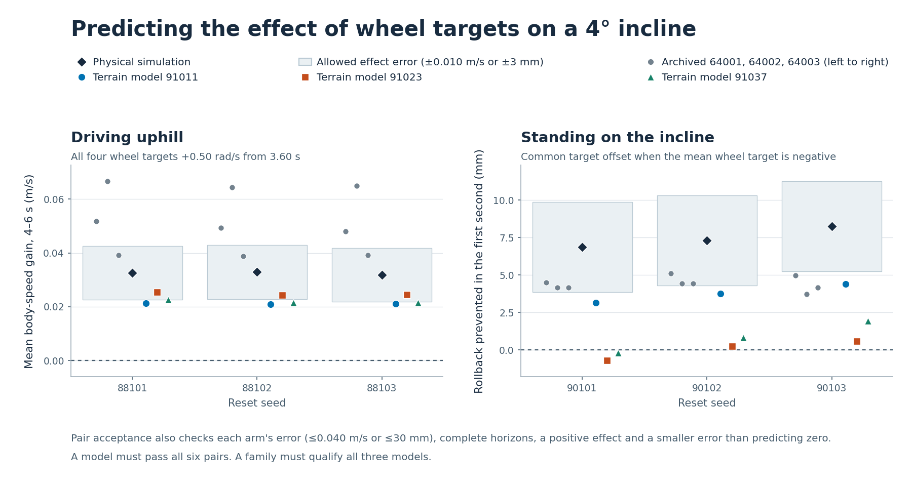

# D1 在上坡时，世界模型能算准轮速干预的效果吗？

三份加入地形输入的可微动力学模型都预测到行驶时提高轮速会让 D1 提速。它们低估了增幅，也低估了驻坡时修正反向轮速能减少的后溜。按预注册规则，三份地形模型和三份归档模型各有 **0/3** 通过整体验收。运行了 900 次动力学模型更新、6,120 步模型推演，新增 MuJoCo 积分与策略参数更新均为零。[预注册协议](experiments91/terrain_world_model.json) · [逐对报告](../reports/terrain_world91.json)

| 工况与量纲 | 原生 MuJoCo 存档，3 个重置 | 地形模型，3 个模型 × 3 个重置 | 完整配对过门 |
|---|---:|---:|---:|
| 行驶中给四轮各加 0.50 rad/s，4～6 s 体轴均速增量 | +0.03178～+0.03287 m/s | +0.02095～+0.02543 m/s | 4/9 |
| 坡上零指令，修正共同反向轮速，首秒后溜减少量 | +6.88～+8.26 mm | −0.70～+4.42 mm | 0/9 |

每个配对要求方向正确，干预效应的误差小于零效应预测的误差，同时满足预注册的两类数值门槛。行驶时按增量误差 ≤0.010 m/s、两个单臂速度误差各 ≤0.040 m/s 判定。驻坡时对应门槛是 3 mm 和 30 mm。三个新模型分别通过 0/6、3/6、1/6 对，三个旧模型各 0/6。72 条预测轨迹全部跑满。三个模型复用同一组物理重置，每个工况有三个独立的物理配对。两种干预的物理效果在本次预注册前已经发表，结果只支持对这些工况的回顾性判断。[行驶物理对照](uphill_diagnosis88.md) · [驻坡物理对照](stand_wbc90.md) · [84 条紧凑曲线](../reports/terrain_world91_curves.jsonl.gz)

## 模型学到了哪一段

训练源是 89 的三个完整 mixed 采集文件。纳入的 42 个已结束回合给出 11,766 个合法相邻转移，其中平地 3,887 个、上坡 3,693 个、下坡 4,186 个。4 个提前终止回合也参与拟合。三个文件最后各有 79、298、103 行来自未结束回合，全部排除。所有模型共用同一批次采样序列，每个随机初始化训练 300 次，按 8 个连续预测端点计算损失，使用最终权重。[数据和 FIFO 对齐](../tools91/data91.py) · [可微模型与训练目标](../tools91/model91.py)

模型每拍读入 45 维状态和已经过一拍延迟的 16 维动作，预测 20 ms 后的状态。新模型还查询预测位置前、中、后各一处的路面相对高度和坡度。这是训练端的已知地形信息。行驶测评从 3.60 s 的共同状态分叉，调用原 C++34 策略 120 拍。驻坡测评从静止起点分叉，调用匹配的感知 PPO 50 拍。每拍都从模型自己的姿态、动作历史和传感器时序重新生成策略输入。测距使用静态几何，原生传感器逐位对照的 12 个测试包全部匹配。[预测入口](../tools91/rollout91.py) · [传感器几何复核](../tools91/check_ray91.py)

两份预测封存后，独立进程才从两臂物理轨迹重算体轴速度与后溜。它还核验了每条模型轨迹的首个策略动作、FIFO 对齐和原始文件哈希。测试覆盖记录的因果边界、单位四元数、多步反传和全量曲线读回。准备、拟合和两组预测的运行时最低有效可用内存为 6.02 GiB，任务组峰值为 0.92 GiB 以内。[独立计分](../tools91/score91.py) · [公开读回测试](../tests/test_score91.py)

## 如何定位偏差

在已存曲线上按干预后的时长回看，行驶第 16 拍（0.32 s）的物理瞬时速度增量为 0.00788～0.01226 m/s，三个地形模型给出 0.00151～0.00220 m/s。到第 32 拍（0.64 s），物理值是 0.03288～0.03875 m/s，模型值是 0.01642～0.01997 m/s。驻坡第 8 拍时三个物理重置都仍略向反方向变化，第 32 拍时均转为受益，首秒减少的后溜才达到 6.88～8.26 mm。这些时点来自事后诊断，正式评分仍使用原定窗口。[逐拍世界位置和体轴速度](../reports/terrain_world91_curves.jsonl.gz)

对驻坡 42 条轨迹另做了一次运动学核对。用 50 Hz 记录的世界纵向速度作 1 s 梯形积分，再与同一条轨迹的世界纵向位移相减。按“位移减积分”计，6 条原生轨迹的差为 −0.175～−0.111 mm，三个地形模型的 18 条轨迹为 +9.04～+16.66 mm。即使改用速度积分读出干预效应，地形模型的 9 个配对仍全部低于各自的物理实测。现有模型中既能看到位移与速度的偏差，也能看到速度响应本身偏弱。50 Hz 梯形积分是一项独立检验，原生物理积分频率为 500 Hz。[逐臂世界速度与积分](../reports/terrain_world91_kinematics.json)

## 逐步采用 SuperMimic 的训练方法

SuperMimic 在 Unitree G1 的全身动作跟踪上交替采集仿真经验、拟合共享世界模型、更新策略。策略在短想象轨迹里对回报反向传播，价值网络估计想象窗口之后的收益。作者主要实验采用 32 拍。D1 已有 79 轮平地反馈实验做过有限时域的策略头更新。91 把可微动力学验证推进到带延迟测距、轮地接触和上坡静止起步的工况。全身策略的 12 个腿角和 4 个轮速输出仍能直接交给现有伺服执行。[SuperMimic 论文](https://arxiv.org/abs/2610.28480) · [作者对训练循环和价值网络的说明](https://supermimic.github.io/) · [D1 平地模型更新实验](feedback79_results_20261103.md)

1. **下一次先定位轮地响应。** 在同一批起点和同一份已锁模型上，只改变模型每拍收到的动作来源。一臂使用保存的物理已施加动作，另一臂使用模型闭环中重新生成的动作。按 4、8、16、32 拍及驻坡 50 拍检查两臂世界速度、体轴速度和位移。前者若也低估，先查动力学与训练样本中的轮地响应。只有闭环明显恶化时，优先检查预测姿态如何经测距、历史和策略放大误差。这项诊断需要单独登记模型步预算。
2. **再校验能否把梯度交给策略。** 预注册独立坡面起点和成对的小正负轮速扰动，比较短时域自动微分与原生 MuJoCo 有限差分的方向、量级及可分辨范围。保留一拍 FIFO 与延迟测距的真实输入边界。若需要训练响应损失，训练用扰动与最终验收用扰动分别采集。这一步才能检验模型给策略的局部更新方向，本轮两种有限干预提供了测量尺度。
3. **通过后再做 PPO 对模型梯度的配对对照。** 两臂从相同的感知策略、PD、奖励、课程开始，使用相同原生交互预算和至少三个训练种子。先注册上坡通线、驻坡后溜、平地下坡保持和跌倒门槛，再做单环境 CPU 小训练。后续再单独检验轮换采集和价值网络是否带来收益。

同一时期还有两项与 D1 更接近的工作。Go2-W 项目在 16 自由度轮足平台上用本体感知强化学习做实机行驶，把长距离运行中的关节负载作为问题。JEPLO 在 Go2 上从 LiDAR 和本体观测学习地形表征，公开了训练和部署代码。D1 可分别借鉴轮腿联合指标、缺测感知的验证方法。对这些项目的核对支持多条正在推进的方向，研究占比仍需系统性文献统计。[Go2-W 实机论文](https://arxiv.org/abs/2606.21387) · [JEPLO 论文](https://arxiv.org/abs/2609.15770) · [JEPLO 源码](https://github.com/ASIG-X/JEPLO)
