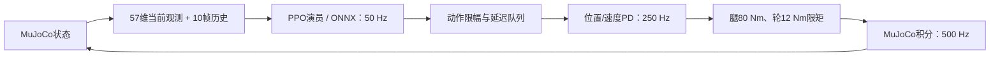

# 从观测到轮腿力矩

这章解释新建的纯 D1 PPO 环境和独立 C++ 运行器。机器人模型来自同事，原 `flat_lab.onnx` 也来自同事；`training/d1_rl`、有界训练/导出/评测脚本和 `runtime03` 是本轮新增。原策略的成功片段不能算作新策略训练成绩。

## 先分清三种频率



每次 `env.step(action)` 积分 10 个 2 ms 物理步。在其中第 0、2、4、6、8 步更新 PD；每次算出的力矩保持两个物理步。下一个策略边界刷新观测，再推理一次。墙钟运行多快不改变这三个仿真周期。Reset 只做几何放置与 `mj_forward`，后者求当前状态的派生量，不推进仿真时间。

旧 ROS2/FSM 推理按墙钟线程调度，新运行器按仿真时间调度；这也是旧录像不能混入新三臂实验统计的原因。

## 57 维观测与历史

关节顺序是 FL、FR、RL、RR，每条腿依次 hip、thigh、calf、foot。四元数使用 wxyz，方向为机体到世界；世界重力投到机体系时用逆旋转。

| Python切片 | 数量 | 内容 |
|---|---:|---|
| `0:3` | 3 | 机体系角速度，先 `0.97*当前 + 0.03*前次滤波值`，再乘0.25 |
| `3:6` | 3 | 单位重力在机体系的投影 |
| `6:9` | 3 | vx、vy、wz指令，乘 `[2,2,0.25]` |
| `9:25` | 16 | 关节角减默认角；四个轮角置零 |
| `25:41` | 16 | 关节速度乘0.05 |
| `41:57` | 16 | 上次发出的、已夹到±1的策略动作 |

Actor 输入为当前 57 维加历史 10×57 维，共627维。历史按旧到新排列，不包含当前帧；当前帧在本次动作产生之后才入队。Reset 将历史填成初始帧，并清零上次动作、角速度滤波和延迟队列。

车体线速度、世界坐标和接触力没有加入 Actor 输入。环境真值用于奖励与评测；不能在部署阶段偷加这些变量，再宣称策略仅靠本体感知。

## 动作不是直接电机力矩

默认关节角每腿为 `[0,0.8,-1.5,0]` rad。腿动作改变位置目标，轮动作改变速度目标：

```text
q_target_leg = q_default + leg_scale * clipped_action
tau_leg = 60 * (q_target_leg - q_leg) - 1.5 * dq_leg
dq_target_wheel = 5 * clipped_action
tau_wheel = 0.5 * (dq_target_wheel - dq_wheel)
```

然后按腿±80、轮±12 Nm夹紧，写入 `qfrc_applied`。XML中的执行器限矩不会自动替这个通道夹紧，因此训练端和部署端都显式限矩。

原03a采用 `leg_scale=0.25`。静力检查发现默认站姿前calf需约18.18 Nm，相当于动作1.212，超出新接口±1范围；腿进一步下沉后仍有可行解，因此不能据此断言模型不能站立。03b另建配置将腿尺度扩大至0.5，同姿态所需动作约0.606。这个修改也把相同动作噪声对应的角度扰动加倍，效果须以新训练验证。旧03a结果保留。

手算例：03b中某腿关节动作0.2、位置恰为默认角、速度为0，目标偏移0.1 rad，力矩为6 Nm。轮动作0.2、当前轮速0，目标1 rad/s，轮力矩0.5 Nm。半径约0.087 m，轮尺度5 rad/s对应约0.435 m/s的滚动目标量级；这套低速接口尚不覆盖1.5 m/s目标。

## 为什么要明确延迟位置

本轮对照只改变动作通道：B固定0 ms；R每个episode抽0/20/40 ms；M固定20 ms。动作先夹紧，再进FIFO。Actor中的“上次动作”记录发出的动作，实际PD执行的是FIFO输出；二者分别记录。指令与观测不跟着延迟。

同seed的重置、指令、延迟各有独立随机流。否则R多抽一次随机数就可能改变下一次指令，削弱“只改变延迟”的可比性。

## PPO和终止的关键点

PPO以采样动作的概率比限制单次策略变化；优势由奖励和价值估计通过GAE计算。训练buffer保存采样的原始动作及其log_prob，环境可以限幅执行，但不能把buffer动作偷偷换成限幅后的值。导出部署使用确定性均值，再按同一规则限幅。

真正跌倒或身体非法承载是 `terminated`，后续价值不bootstrap。正常20 s时间上限是 `truncated`，需从截断状态bootstrap。两者混用会使价值学习产生系统误差。MuJoCo数值警告、NaN或预算异常直接中止并保留错误回执，不当作普通episode继续训练。

核对入口：[`env.py`](../../training/d1_rl/env.py)、[`interface.py`](../../training/d1_rl/interface.py)、[原接口审计](../d1_interface_audit_03.md)、[新运行器说明](../../runtime03/README.md)。离线数值一致只说明实现对齐，不等于策略已学会控制；物理成绩要看有实际步数的回执。
