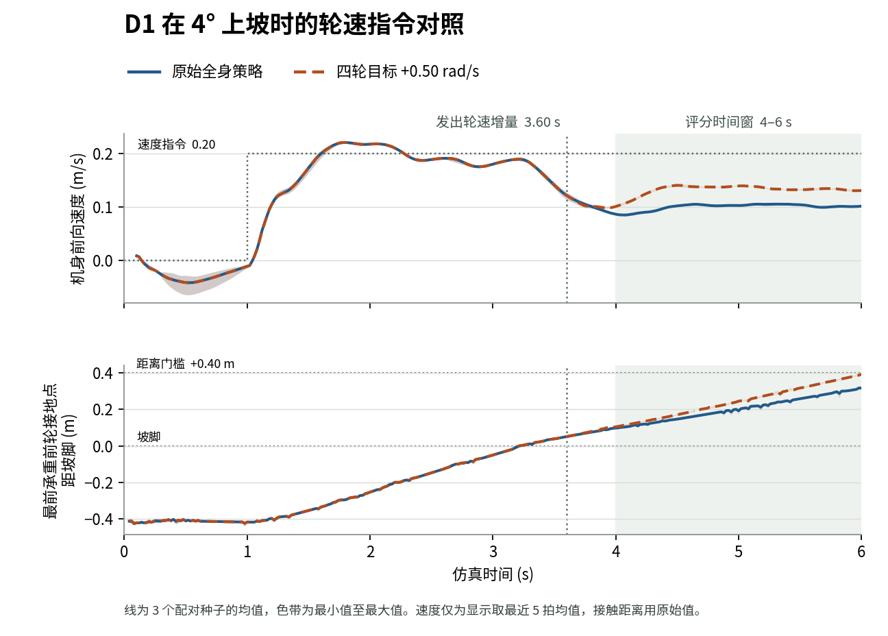

# D1 为什么一上 4° 坡就减速

前轮触坡后，实际轮速很快落后于配对平地，到最后一秒，原 PPO 给出的四轮目标也低于平地。给相同策略的四轮目标统一增加 0.50 rad/s，在三个新重置种子上都能让机身提速。4～6 秒的平均速度从 **0.1005 升至 0.1329 m/s**，追回原有速度缺口的约三分之一。指令为 0.20 m/s，前轮到达原距离标线的次数由 0/3 增至 1/3，六段中均未测到后轮在坡面承重。[预注册](experiments88/uphill_wheel_probe.json) · [逐拍 CSV](../reports/uphill88_measurements.csv) · [机器可读结果](../reports/uphill_diagnosis88.json)

## 六段因果对照

每个种子都从静止、同一位置和姿态起步。完整 PPO25 在原 C++34 运行时输出 12 个腿角和 4 个轮速目标，关节 PD 以 250 Hz 跟踪。两次运行的唯一区别是从 3.60 秒发出的动作起，干预组在四个轮速目标上各加 0.50 rad/s。两组都保留原动作延迟、动作历史和闭环反馈。三个配对的位姿与速度到 3.62 秒逐位相同，第一项不同的动作在 3.62～3.64 秒实际施加。之后腿部也能随新状态自然响应。[执行入口](../tools88/probe88.py) · [独立读回](../tools88/verify88.py)

验收用 4 秒之后到 6 秒（含）的 100 个原始速度样本。三个种子都要提速至少 0.0200 m/s，六段均须走满 6 秒且没有跌倒或非法接触。独立的距离指标取法向负荷大于 1 N 的最前方前轮接触点，在世界 x 方向量到坡脚的最远距离。

| 重置种子 | 原策略速度 (m/s) | 加量速度 (m/s) | 提速 (m/s) | 距坡脚最远，原策略 → 加量 (m) |
|---|---:|---:|---:|---:|
| 88101 | 0.09963 | 0.13226 | +0.03263 | 0.321837 → 0.391348 |
| 88102 | 0.10058 | 0.13346 | +0.03287 | 0.320068 → **0.400016** |
| 88103 | 0.10133 | 0.13311 | +0.03178 | 0.311697 → 0.386001 |

**提速判据通过 3/3。** 唯一过线的接触点超出 0.40 m 约 0.016 mm。另两段分别差 8.65 mm 和 14.00 mm。六段的轮速目标增量裁剪、轮力矩饱和拍、跌倒和非法接触均为零。给定这些种子、场地与时间窗，实验支持轮速需求偏低是失速的一个可干预因素。当前证据只覆盖前轮上坡、后轮留在平地的阶段。

| 4～6 秒实测均值，三个种子等权 | 原策略 | 加轮速目标 |
|---|---:|---:|
| 发给伺服的四轮平均目标 (rad/s) | 2.9755 | 3.4436 |
| 实测四轮平均转速 (rad/s) | 1.4367 | 1.8238 |
| 四个驱动电机平均末次 PD 力矩 (N·m) | 0.7698 | 0.8107 |

逐拍向当时的策略输出加 0.50 rad/s，反馈后两组轮速目标的实际均值差为 0.4682 rad/s。加量后速度仍低于指令 0.0671 m/s。此次未训练策略，定时加量仅用于测量这条输入到机身速度的响应。

## 原策略是从哪里开始慢的

复核第 87 轮的 36 条轨迹。原策略三个开发种子的前轮分别在 3.22、3.32、3.16 秒首次承重触坡。按各自触坡时刻对齐，之前半秒上坡与平地均速同为 0.1836 m/s。之后半秒上坡降到 0.1434 m/s，配对平地为 0.1833 m/s。上坡前左、前右轮分别比平地慢 0.704、0.533 rad/s，两后轮的同期差值绝对值均低于 0.020 rad/s。[原策略与感知 PPO 的上坡录像](assets/full_body87/up.mp4) · [逐轮计算](../tools88/drivetrain88.py)

| 原策略开发组三种子，最后一秒 | 平地 | +4° 上坡 | −4° 下坡 |
|---|---:|---:|---:|
| 机身实际速度 (m/s) | 0.1886 | 0.1064 | 0.3145 |
| 四轮平均目标 (rad/s) | 3.1764 | 2.9753 | 3.3982 |
| 四轮平均实际转速 (rad/s) | 2.2432 | 1.4906 | 3.4295 |
| 四轮平均末次 PD 力矩 (N·m) | 0.4675 | 0.7427 | −0.0133 |

伺服在上坡增加了驱动力矩，原策略给出的轮速目标却比平地低约 0.2011 rad/s。原 36 段均未触及 12 N·m 的车轮力矩上限。力矩均值取每个 20 ms 窗口的末次 PD 更新，触限判断覆盖窗口内全部五次更新。[冻结的伺服控制律](../training/d1_rl/interface.py)

用已存关节位姿和速度重算轮胎材料接触点相对地面的纵向滑速。按承载加权，开发组末秒前轮上坡的绝对滑速为 7.63～8.34 mm/s，配对平地为 10.55～12.62 mm/s。后轮仍在平地，滑速从 4.02～4.63 升至 7.08～10.65 mm/s。连同留出集，12 组同策略、同重置的配对均显示前轴滑速降低、后轴升高。数据支持继续追查后轮滑移，持续的前轮空转与这些末秒记录不符。10,800 个 50 Hz 边界的前轴位置及承重点位置、缺失状态均与归档一致。接触力按保存状态重构，500 Hz 子步摩擦峰值缺少原始记录。[接触计算](../tools88/contact88.py)

## 测距 PPO 看得到坡，给了多大补偿

对 87 的三个感知策略，固定原上坡轨迹的机身、关节和动作历史，只替换射线所见的地形。按原 6 Hz 采集、40 ms 延迟重建的 14,400 个上坡测距特征与归档逐值相同。把地面换成平地后，每段有 298/300 拍的距离包发生变化，八束有效位均相同。三段最大的有效距离差分别为 15.79、15.78、15.94 cm。[同姿态换地形复算](../tools88/policy88.py)

| PPO 训练种子 | 上坡读数减同姿态平地读数，四轮有符号均值 (rad/s) | 逐轮逐拍取绝对值的均值 (rad/s) | 把测距和有效位全部置零，平均绝对变化 (rad/s) |
|---|---:|---:|---:|
| 87011 | +0.000306 | 0.000380 | 0.009937 |
| 87023 | +0.000273 | 0.000282 | 0.006981 |
| 87037 | +0.000097 | 0.000231 | 0.005970 |

三个种子在上坡末秒都给出了方向正确但很小的平均轮速增量。全置零还会清掉有效位，它衡量的动作响应比只换坡形大约 25 倍。这个对照测的是同一状态上的策略输出。六段新增闭环用的是原 PPO25，所以不能把其提速记到感知策略名下。

训练覆盖给出了可检验的原因。三个感知策略原本共有 3,900 个上坡采样步，其中机身原点越过坡脚的只有 **122 步，占 3.13%**，每个种子分别为 13/1,200、31/1,200、78/1,500。机身原点最远只过坡脚 4.18 cm。每个种子只采集了一轮数据，采样时感知支路权重从零开始，两臂的实发动作和状态相同。随后更新的感知动作在留出评测中执行，优化器尚未采集它们带来的第二轮上坡反馈。[原训练与动作更新](full_body_perception87.md)

当前证据不支持优先调整高度奖励。在已发生的三条上坡轨迹上，把固定世界高度换成距地高度，最后一秒的高度项积分只改变约 0.00027～0.00044，且惩罚加大。同期速度跟踪项相对准确跟速的积分缺口为 0.398～0.422。这项离线重算没有检验改奖励并重新训练的效果。

下一项可判定的训练问题是，单独改变**起点到坡脚的距离分布**，增加前后轮都在坡面上的训练样本后，感知策略能否在原起点和新评测种子上自主提速并稳定过线。原奖励、关节 PD、评测场地和门槛可沿用。若使用 SuperMimic 式可微世界模型，可以先用这六条轨迹校验它能否预测四轮加量的速度变化方向及幅度。

## 核验与资源

预注册提交为 `b644cc1`。本轮实际执行 6 段、1,800 次策略推理、9,000 次 PD 更新和 18,000 个原生物理步，训练步数为零。接触、策略与图表读回均未积分。全部重任务在串行单线程 systemd 单元中运行，Nice 10，MemoryHigh 2 GiB，MemoryMax 3 GiB，swap 0。仿真单元启动前有效可用内存 7.77 GiB，运行记录最低 5.81 GiB，组内峰值 0.61 GiB，无 OOM。[资源回执与两个判据](../reports/uphill_diagnosis88.json)

公开 CSV 包含全部 1,800 个区间结束时刻的速度、承重前轮位置和故障标志，CI 从 CSV 重新计算六个速度、六个距离和三个判定。原始 `trace.npz`、C++ 会话回执、只读分析与资源日志保存在本机 `evidence/uphill88/`，启动器会保留已存在的运行。[公开数据验收](../tests/test_uphill_report88.py) · [限额执行入口](../tools88/launch88.py)
